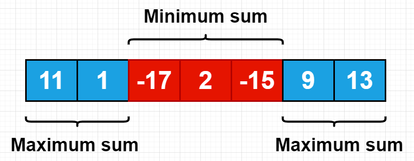

# ✅ [C++]Easy solution with explaination in O(N) time complexity✅

**Author:** vishnoi29
**Votes:** 573
**Link:** [https://leetcode.com/problems/maximum-sum-circular-subarray/solutions/3066058/](https://leetcode.com/problems/maximum-sum-circular-subarray/solutions/3066058/)

---

\uD83C\uDFA5\uD83D\uDD25 Exciting News! Join my Coding Journey! Subscribe Now! \uD83D\uDD25\uD83C\uDFA5

\uD83D\uDD17 Link in the leetcode profile 

New coding channel alert! \uD83D\uDE80\uD83D\uDCBB Subscribe to unlock amazing coding content and tutorials. Help me reach 1K subs to start posting more videos! Join now! \uD83C\uDF1F\uD83D\uDCAA

Thanks for your support! \uD83D\uDE4F\uD83C\uDF89
# Approach
There are 2 possibility of The **maximum subarray sum in circular array** 
1. **Maximum subarray sum in non circular array**
   - If max subarray sum in non circular array then we can simply apply Kadane's Algorithm and we will calculate the max_sum_subarray
   -  Example A=[-3,-5,**3,5,7,3,5**,-9] ans= 23
   
2.**Maximum subarray sum in circular array.**
   - If max subarray sum in circular array then we will calculate the `minimum sum of subarray` and **Subtract** it from `total_sum` of array.
   - Example A=[11,1,-17,2,-15,9,13]
    

 
   - Here we will remove {17,2,-15} from our total sum that will give us max subarray sum because max sum include some prefix and suffix part:- 
Ans= max(prefix+suffix)
Ans= max(total sum - subarray)
Ans=total sum + max(-subarray)
**Ans= total sum - min(subarray)**
3. **Corner case -When all the element in the array are negative** then our answer will be `max_sum_subarray` because if when all the element are negative at that time our `total_sum - minsum_subary=0`
and it will return 0 means empty subarray thats why we will return max sum of subarray

4. **At last we will return**
   max(subarray sum in non circular array,Maximum subarray sum in circular array)
  
   


# Complexity
- Time complexity:O(N)
- Space complexity:O(1)

# Code
```
class Solution {
public:
    int maxSubarraySumCircular(vector<int>& A) {
        int total_sum=0,curr_sum1=0,curr_sum2=0,mxsum_subary=INT_MIN,minsum_subary=INT_MAX;   
        for(auto i:A)
        {
            total_sum+=i; curr_sum1+=i; curr_sum2+=i;
            mxsum_subary=max(mxsum_subary,curr_sum1);
            if(curr_sum1<0) curr_sum1=0;
           minsum_subary=min(curr_sum2,minsum_subary);
            if(curr_sum2>0) curr_sum2=0;
        }
        return (total_sum==minsum_subary)?mxsum_subary:max(mxsum_subary,total_sum-minsum_subary);  
    }
};
```
If you really found my solution helpful **please upvote it**, as it motivates me to post such kind of codes.
**Let me know in comment if i can do better**.
Let's connect on **[LINKDIN](https://www.linkedin.com/in/mahesh-vishnoi-a4a47a193/)**


