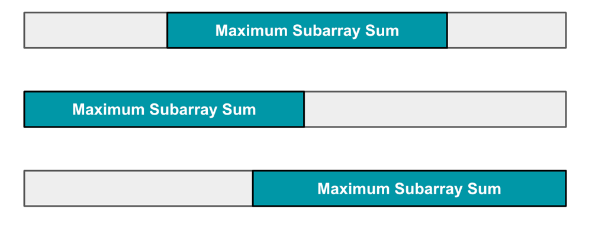
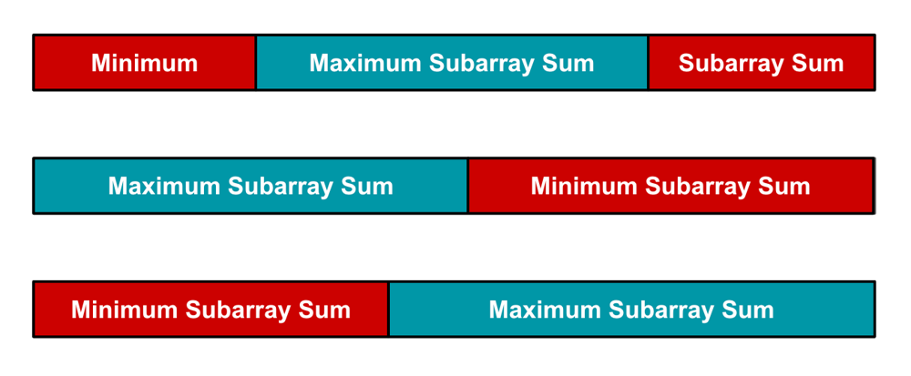
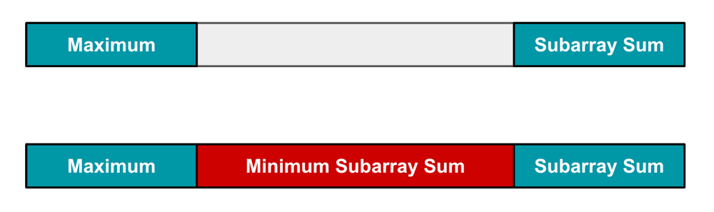

# Weird Kadane || Explanation With Images ✅

**Author:** hridoy100
**Votes:** 199
**Link:** [https://leetcode.com/problems/maximum-sum-circular-subarray/solutions/3066636/](https://leetcode.com/problems/maximum-sum-circular-subarray/solutions/3066636/)

---

# Intuition
Before you start with this problem, please go and solve this problem: [53. Maximum Subarray](https://leetcode.com/problems/maximum-subarray/)
<!-- Describe your first thoughts on how to solve this problem. -->

# Approach
We will be using Kadane's algorithm. But not the usual way. We need to keep and handle some additional things.

Let's think first, if this wasn't a circular array:



The subarray sum can be found like the image shown above.

When, we found the maximum subarray sum, colored in blue shade. The rest of the white places will give us minimum subarray sum.




Can we think similar intuition for the circular array?



The corner case for the circular array is the above image where maximum subarray sums are splitted. So, for this case, we need the minimum subarray sum.

As we have the minimum subarray sum, we can do `totalSum-minSum` and get the maximum subarray sum from it.

<!-- Describe your approach to solving the problem. -->

# Complexity
- Time complexity: $$O(n)$$
<!-- Add your time complexity here, e.g. $$O(n)$$ -->

- Space complexity: $$O(1)$$
<!-- Add your space complexity here, e.g. $$O(n)$$ -->

# Code
```
class Solution {
    public int maxSubarraySumCircular(int[] nums) {
        int n = nums.length;
        int maxSum = nums[0], minSum = nums[0], curMax=0, curMin=0;
        int totalSum = 0;
        for(int num : nums){
            curMax = Math.max(curMax + num, num);
            maxSum = Math.max(maxSum, curMax);
            curMin = Math.min(curMin + num, num);
            minSum = Math.min(minSum, curMin);
            totalSum+=num;
        }
        return maxSum>0? Math.max(maxSum, totalSum-minSum) : maxSum;
    }
}
```


