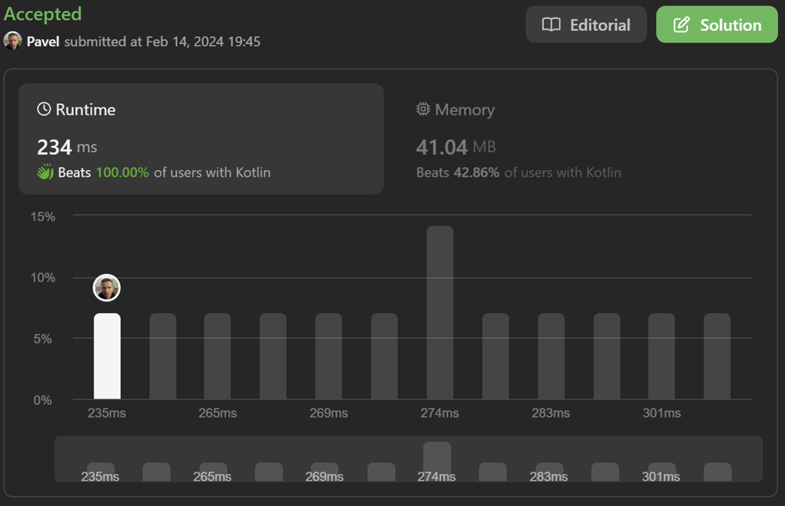

# Two Pointers + New Array | O(n) time, beats 100% (234 ms)

**Author:** naXa777
**Votes:** 0
**Link:** [https://leetcode.com/problems/sort-array-by-parity-ii/solutions/4728292/](https://leetcode.com/problems/sort-array-by-parity-ii/solutions/4728292/)

---

# Approach

Two Pointers

# Complexity

- Time complexity: $$O(n)$$
- Space complexity: $$O(n)$$ - not counting output size

# Code
```kt
class Solution {
    fun sortArrayByParityII(nums: IntArray): IntArray {
        val answer = IntArray(nums.size)
        var eveni = 0
        var oddi = 1
        for (n in nums) {
            val isEven = n % 2 == 0
            if (isEven) {
                answer[eveni] = n
                eveni += 2
            } else {
                answer[oddi] = n
                oddi += 2
            }
        }
        return answer
    }
}
```

# Screenshot

