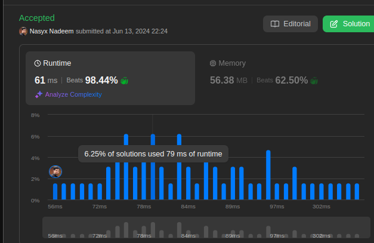

# Simple typescript solution beats 98% users

**Author:** sdarnadeem
**Votes:** 1
**Link:** [https://leetcode.com/problems/sort-array-by-parity-ii/solutions/5308620/](https://leetcode.com/problems/sort-array-by-parity-ii/solutions/5308620/)

---



# Approach
- Create a new empty array of the size input array
- Keep track of the oddIndex and evenIndex starting from 1 and 0 respectively
- Loop over the input array, if the element is odd, add the value to the empty array at index oddIndex and increment it by 2
- Apply similiar logic for the odd elements.

# Complexity
- Time complexity:
O(n)

- Space complexity:
O(n)

# Code
```
function sortArrayByParityII(nums: number[]): number[] {
    const res = new Array(nums.length);
    let evenIndex = 0, oddIndex = 1;

    nums.forEach(n => {
        if (n % 2 ===0) {
            res[evenIndex] = n;
            evenIndex += 2;
        } else {
            res[oddIndex] = n;
            oddIndex += 2;
        }
    })
    return res;
};
```