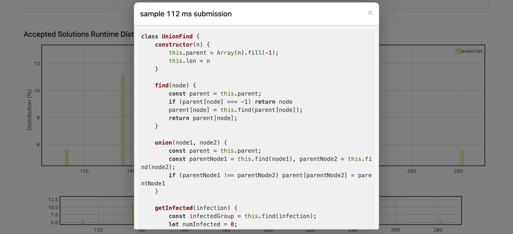

# JavaScript Union Find  No. 1 JS Solution Per LC 100% | 93%

**Author:** casmith1987
**Votes:** 1
**Link:** [https://leetcode.com/problems/minimize-malware-spread-ii/solutions/1105242/](https://leetcode.com/problems/minimize-malware-spread-ii/solutions/1105242/)

---



Uncommented Version:
```
function UnionFind(length) {
  const parent = new Array(length).fill(-1)
  return {
    find(node) {
      if (parent[node] === -1) return node
      parent[node] = this.find(parent[node])
      return parent[node]
    },
    union(node1, node2) {
      const parent1 = this.find(node1)
      const parent2 = this.find(node2)
      if (parent1 !== parent2) parent[parent2] = parent1
    },
    getInfected(infection) {
      const infectedGroup = this.find(infection)
      let infected = 0
      for (let i = 0; i < length; i++) {
        if (this.find(i) === infectedGroup) infected++
      }
      return infected
    }
  }
}

const getInfected = (graph, initial, ignore) => {
  const uf = new UnionFind(graph.length)
  for (let i = 1; i < initial.length; i++) {
    uf.union(initial[i - 1], initial[i])
  }
  for (let node = 0; node < graph.length; node++) {
    if (node === ignore) continue
    for (let connection = node + 1; connection < graph.length; connection++) {
      if (connection === ignore) continue
      if (graph[node][connection]) uf.union(node, connection)
    }
  }
  return uf.getInfected(initial[0])
}

const minMalwareSpread = (graph, initial) => {
  if (initial.length === 1) return initial[0]
  initial.sort((x,y)=>x-y)
  let numInfected = graph.length, nodeToRemove = initial[0]
  for (let node of initial) {
    const curInfected = getInfected(graph, initial.filter(check=>check!=node), node)
    if (curInfected < numInfected) {
      numInfected = curInfected
      nodeToRemove = node
    }
  }
  return nodeToRemove
}
```


With comments:
```
//Union Find is a Very useful DS that's fairly easy to learn to code.  This is a pretty basic implementation.
//Can be made even faster with Union by Rank too.  A quick google search will return plenty of results and
//explanations.  Basics are though, we can union all the nodes with connections, then run a find to see which
//nodes belong to which groups.  Great for disconnected graphs.  We initialize an array that's the same length
//as the # of nodes.  Array index = how we identify the node.  Value stored at that index indicates which group
//the node belongs to.  If -1, it belongs to itself (it's in its own group).  If it's changed, it belongs in the same 
//group as the node at that index.  [-1,-1,-1,-1,2,-1] - All nodes belong in own groups except node 2 and 4. 
//The 2 at index four indicates node 4 and 2 are in same group. 

class UnionFind {
  constructor(n) {
    this.parent = new Array(n).fill(-1);
    this.len = n;
  }
  
  find(node) {
    if (this.parent[node] === -1) return node;
    this.parent[node] = this.find(this.parent[node]);
    return this.parent[node];
  }
  
  union(node1, node2) {
    const parent1 = this.find(node1), parent2 = this.find(node2);
    if (parent1 !== parent2) this.parent[parent2] = parent1;
  }
  
  //This is simply a helper function specific to this problem.  We can pass it an infected node,
  //find will then tell us what group that node is in.  We then just check what group the rest of 
  //the nodes are in.  If they're in the same group, increment a counter and return.
  getInfected(infection) {
    const infectedGroup = this.find(infection);
    let infected = 0;
    for (let i = 0; i < this.len; i++) {
      if (this.find(i) === infectedGroup) infected++;
    }
    return infected;
  }
}

const minMalwareSpread = function(graph, initial) {
    if (initial.length === 1) return initial[0];
	
	//Sort gets by a 'trick' edge case in the LC tests where initial [3,0].
	//Both infections have the same results, but they expect the 0 returned.
    initial.sort((x, y) => x - y);
	
    let minInfected = graph.length, toRemove = initial[0];
	
	//For each infection, we run our helper function to see how many nodes would ultimately
	//end up infected if the node were to be removed from the group.  We're looking for the lowest
	//total infected to see which node to remove.
    for (let infection of initial) {
        const numInfected = getInfected(graph, initial.filter(val => val !== infection), infection);
        if (numInfected < minInfected) {
            minInfected = numInfected;
            toRemove = infection;
        }
    }
    return toRemove;
};

function getInfected(graph, initial, ignore) {

	//UF is very simple to use.  Initialize, union everything with connections, 
	//then use find to see which group individual nodes belong to.
	
    const unionFind = new UnionFind(graph.length);
	
	//Union all infected.  This lets us identify all infected nodes more easily.
    for (let infected = 1; infected < initial.length; infected++) {
        unionFind.union(initial[infected], initial[infected - 1]);
    }
	
	//Union all other nodes minus the one to be removed (ignore in this case).
    for (let node = 0; node < graph.length; node++) {
        if (node === ignore) continue;
        for (let connection = node + 1; connection < graph.length; connection++) {
            if (connection == ignore) continue;
            graph[node][connection] && unionFind.union(node, connection);
        }
    }
	
	//Return our helper function on the union find class which just loops through
	//all nodes and gets a count of all that belong to the same group as the infection.
    return unionFind.getInfected(initial[0]);
}
```