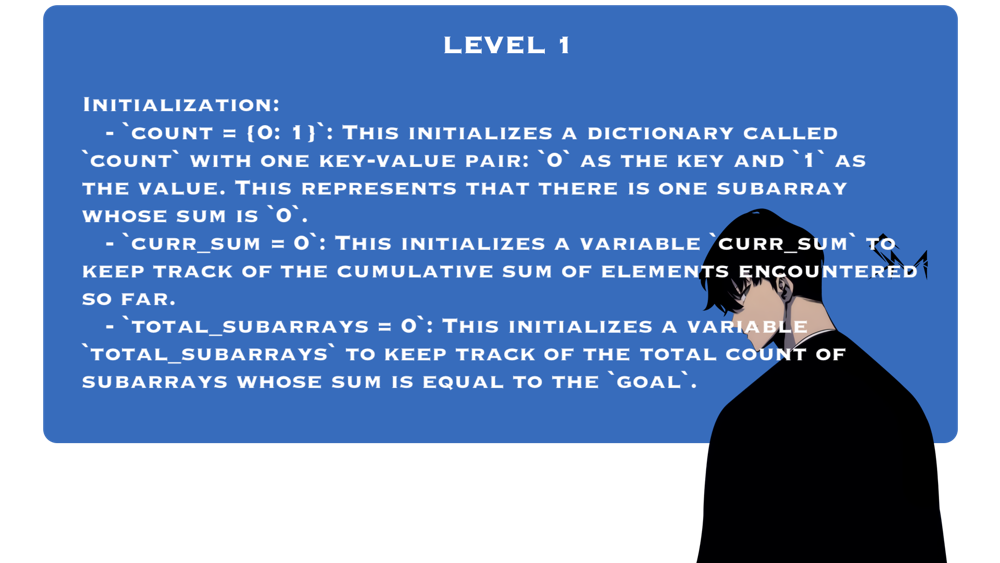
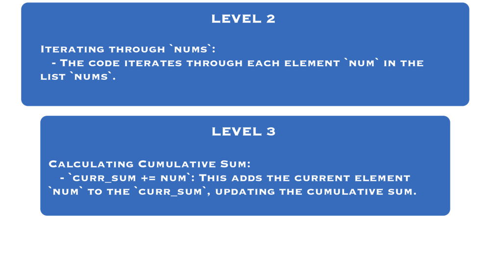
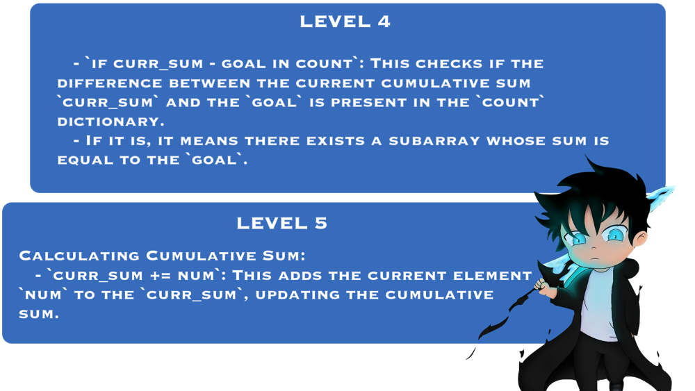
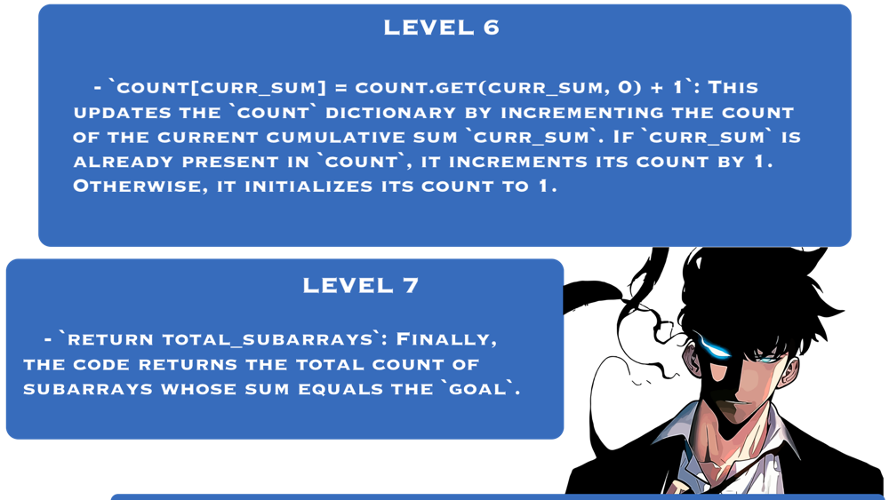

# 🔥✅✅ Beat 80.20% | ✅ Full explanation with pictures ✅✅🔥

**Author:** DevOgabek
**Votes:** 214
**Link:** [https://leetcode.com/problems/binary-subarrays-with-sum/solutions/4872569/](https://leetcode.com/problems/binary-subarrays-with-sum/solutions/4872569/)

---


[](https://leetcode.com/problems/binary-subarrays-with-sum/submissions/1202998624?envType=daily-question&envId=2024-03-14)










<hr>

(For TTS)

1. **Initialization**: 
   - `count = {0: 1}`: This initializes a dictionary called `count` with one key-value pair: `0` as the key and `1` as the value. This represents that there is one subarray whose sum is `0`.
   - `curr_sum = 0`: This initializes a variable `curr_sum` to keep track of the cumulative sum of elements encountered so far.
   - `total_subarrays = 0`: This initializes a variable `total_subarrays` to keep track of the total count of subarrays whose sum is equal to the `goal`.

2. **Iterating through `nums`**:
   - The code iterates through each element `num` in the list `nums`.

3. **Calculating Cumulative Sum**:
   - `curr_sum += num`: This adds the current element `num` to the `curr_sum`, updating the cumulative sum.

4. **Checking for Subarrays with the Desired Sum**:
   - `if curr_sum - goal in count`: This checks if the difference between the current cumulative sum `curr_sum` and the `goal` is present in the `count` dictionary.
   - If it is, it means there exists a subarray whose sum is equal to the `goal`.

5. **Updating `total_subarrays`**:
   - `total_subarrays += count[curr_sum - goal]`: If there is such a subarray, the code increments `total_subarrays` by the count of subarrays found in `count[curr_sum - goal]`.

6. **Updating Count Dictionary**:
   - `count[curr_sum] = count.get(curr_sum, 0) + 1`: This updates the `count` dictionary by incrementing the count of the current cumulative sum `curr_sum`. If `curr_sum` is already present in `count`, it increments its count by 1. Otherwise, it initializes its count to 1.

7. **Returning the Result**:
   - `return total_subarrays`: Finally, the code returns the total count of subarrays whose sum equals the `goal`.

```python []
class Solution(object):
    def numSubarraysWithSum(self, nums, goal):
        count = {0: 1}
        curr_sum = 0
        total_subarrays = 0
        
        for num in nums:
            curr_sum += num
            if curr_sum - goal in count:
                total_subarrays += count[curr_sum - goal]
            count[curr_sum] = count.get(curr_sum, 0) + 1

        return total_subarrays
```
```python3 []
class Solution:
    def numSubarraysWithSum(self, nums: List[int], goal: int) -> int:
        count = {0: 1}
        curr_sum = 0
        total_subarrays = 0
        
        for num in nums:
            curr_sum += num
            if curr_sum - goal in count:
                total_subarrays += count[curr_sum - goal]
            count[curr_sum] = count.get(curr_sum, 0) + 1

        return total_subarrays
```
```C++ []
class Solution {
public:
    int numSubarraysWithSum(vector<int>& nums, int goal) {
        unordered_map<int, int> count;
        count[0] = 1;
        int curr_sum = 0;
        int total_subarrays = 0;

        for (int num : nums) {
            curr_sum += num;
            if (count.find(curr_sum - goal) != count.end()) {
                total_subarrays += count[curr_sum - goal];
            }
            count[curr_sum]++;
        }

        return total_subarrays;
    }
};
```
```javascript []
var numSubarraysWithSum = function(nums, goal) {
    let count = new Map();
    count.set(0, 1);
    let currSum = 0;
    let totalSubarrays = 0;

    for (let num of nums) {
        currSum += num;
        if (count.has(currSum - goal)) {
            totalSubarrays += count.get(currSum - goal);
        }
        count.set(currSum, (count.get(currSum) || 0) + 1);
    }

    return totalSubarrays;
};
```


## **My solutions**

\uD83D\uDFE2 - $$easy$$  
\uD83D\uDFE1 - $$medium$$ 
\uD83D\uDD34 - $$hard$$

\uD83D\uDFE1 [46. Permutations](https://leetcode.com/problems/permutations/solutions/4853218/beat-98-64-full-explanation-with-pictures)
\uD83D\uDFE1 [17. Letter Combinations of a Phone Number](https://leetcode.com/problems/letter-combinations-of-a-phone-number/solutions/4845532/there-is-an-80-chance-of-being-in-the-interview-full-problem-explanation)
\uD83D\uDFE1 [22. Generate Parentheses](https://leetcode.com/problems/generate-parentheses/solutions/4845742/simple-explanation-with-pictures)
\uD83D\uDFE1 [39. Combination Sum](https://leetcode.com/problems/combination-sum/solutions/4847482/beat-8292-full-explanation-with-pictures)
\uD83D\uDFE2 [2540. Minimum Common Value](https://leetcode.com/problems/minimum-common-value/solutions/4845076/beat-9759-full-explanation-with-pictures)
\uD83D\uDFE2 [3005. Count Elements With Maximum Frequency](https://leetcode.com/problems/count-elements-with-maximum-frequency/solutions/4839796/beat-8369-full-explanation-with-pictures)
\uD83D\uDFE2 [3028. Ant on the Boundary](https://leetcode.com/problems/ant-on-the-boundary/solutions/4837433/full-explanation-with-pictures)
\uD83D\uDFE2 [876. Middle of the Linked List](https://leetcode.com/problems/middle-of-the-linked-list/solutions/4834682/beat-10000-full-explanation-with-pictures)
\uD83D\uDFE1 [1750. Minimum Length of String After Deleting Similar Ends](https://leetcode.com/problems/minimum-length-of-string-after-deleting-similar-ends/solutions/4824224/beat-10000-full-explanation-with-pictures)
\uD83D\uDFE1 [948. Bag of Tokens](https://leetcode.com/problems/bag-of-tokens/solutions/4818912/beat-10000-full-explanation-with-pictures)
\uD83D\uDFE1 [19. Remove Nth Node From End of List](https://leetcode.com/problems/remove-nth-node-from-end-of-list/solutions/4813340/beat-10000-full-explanation-with-pictures)
\uD83D\uDFE2 [977. Squares of a Sorted Array](https://leetcode.com/problems/squares-of-a-sorted-array/solutions/4807704/square-sorter-python-python3-javascript-c)
\uD83D\uDFE2 [2864. Maximum Odd Binary Number](https://leetcode.com/problems/maximum-odd-binary-number/solutions/4802402/visual-max-odd-binary-solver-python-python3-javascript-c)
\uD83D\uDFE1 [1609. Even Odd Tree](https://leetcode.com/problems/even-odd-tree/solutions/4797529/even-odd-tree-validator-python-python3-javascript-c)
\uD83D\uDFE2 [9. Palindrome Number](https://leetcode.com/problems/palindrome-number/solutions/4795373/why-not-1-line-of-code-python-python3-c-everyone-can-understand)
\uD83D\uDFE1 [513. Find Bottom Left Tree Value](https://leetcode.com/problems/find-bottom-left-tree-value/solutions/4792022/binary-tree-explorer-mastered-javascript-python-python3-c-10000-efficiency-seeker)
\uD83D\uDFE2 [1. Two Sum](https://leetcode.com/problems/two-sum/solutions/4791305/5-methods-python-c-python3-from-easy-to-difficult)
\uD83D\uDFE2 [543. Diameter of Binary Tree](https://leetcode.com/problems/diameter-of-binary-tree/solutions/4787634/surpassing-9793-memory-magician-excelling-at-9723)
\uD83D\uDFE2 [101. Symmetric Tree](https://leetcode.com/problems/symmetric-tree/solutions/4848126/beat-100-full-explanation-with-pictures)
\uD83D\uDFE2 [136. Single Number](https://leetcode.com/problems/single-number/solutions/4862807/master-the-xor-trick-beat-97-20-with-full-explanation)
\uD83D\uDFE2 [283. Move Zeroes](https://leetcode.com/problems/move-zeroes/solutions/4864068/mastering-efficiency-beat-98-71)
\uD83D\uDFE2 [108. Convert Sorted Array to Binary Search Tree](https://leetcode.com/problems/convert-sorted-array-to-binary-search-tree/solutions/4864578/beat-89-74-full-explanation-with-pictures)

[More...](https://leetcode.com/DevOgabek/)