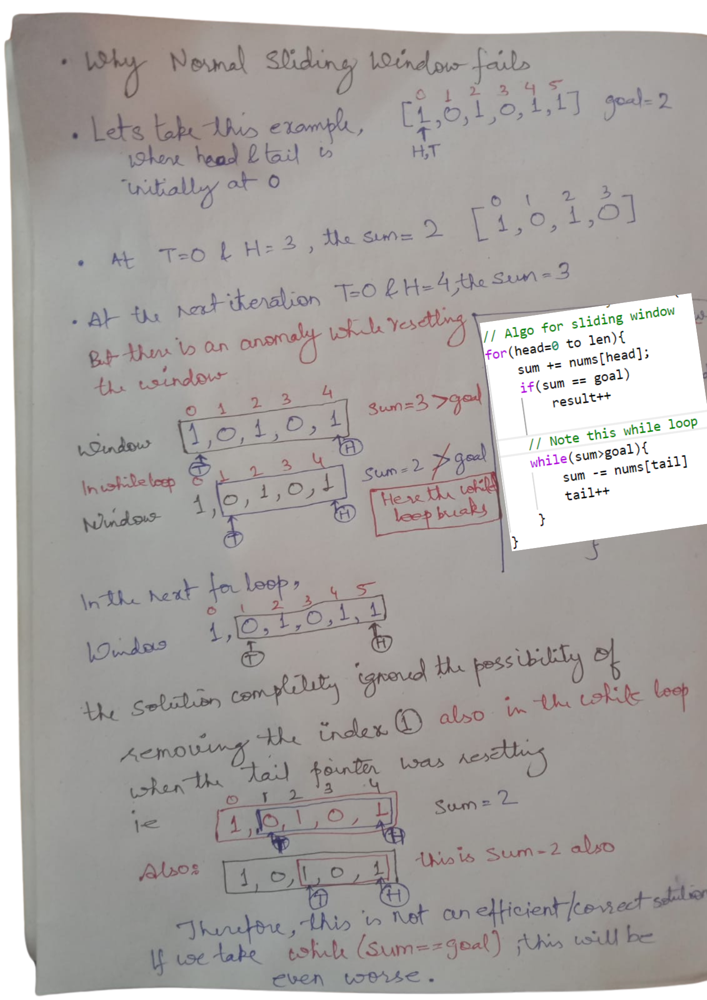

# Why Usual Sliding 🪟Window Fails? Approach Explained | Beats 🚀100%

**Author:** olifarhaan
**Votes:** 165
**Link:** [https://leetcode.com/problems/binary-subarrays-with-sum/solutions/4873917/](https://leetcode.com/problems/binary-subarrays-with-sum/solutions/4873917/)

---


# Why Usual Sliding Window Fails




# Approach Explanation:

1. **Breaking Down the Solution:**
   - The solution employs a helper function `atMost(nums, goal)` to find the number of subarrays with sum at most equal to `goal`.
   - The `numSubarraysWithSum` function returns the difference between `atMost(nums, goal)` and `atMost(nums, goal - 1)`, effectively finding the number of subarrays with sum exactly equal to `goal`.

2. **Understanding `atMost` Function:**
   - This function iterates through the `nums` array from left to right using two pointers (`head` and `tail`) to define a sliding window.
   - `sum` keeps track of the current sum of elements within the window.
   - Whenever `sum` exceeds `goal`, it shrinks the window from the left (`tail`) until `sum` is less than or equal to `goal`.
   - For each valid window, it calculates the number of subarrays it can form and adds it to the `result`.

3. **Understanding `numSubarraysWithSum` Function:**
   - It computes the total number of subarrays with sum equal to `goal` by subtracting the count of subarrays with sum less than `goal` from the count of subarrays with sum less than or equal to `goal - 1`.
   - This is based on the idea that by subtracting `atMost(nums, goal - 1)` from `atMost(nums, goal)`, we are effectively removing subarrays whose sum is strictly less than `goal`.

4. **Understanding the Algorithm's Efficiency:**
   - The algorithm utilizes a sliding window technique, which allows it to traverse the `nums` array only once, resulting in a time complexity of O(N), where N is the length of the input array.
   - It uses constant space for storing variables like `head`, `tail`, `sum`, and `result`, leading to an overall space complexity of O(1).

# If you are not able to understand, I have made a video too.

https://youtu.be/_uA-1qRQ6kc?si=aj3Ha_LDD-dECbCy


# Upvote the solution:


```java []
class Solution {
    public int numSubarraysWithSum(int[] nums, int goal) {
        return atMost(nums, goal) - atMost(nums, goal - 1);
    }
    private int atMost(int[] nums, int goal) {
        int head, tail = 0, sum = 0, result = 0;
        for (head = 0; head < nums.length; head++) {
            sum += nums[head];
            while (sum > goal && tail <= head) {
                sum -= nums[tail];
                tail++;
            }
            result += head - tail + 1;
        }
        return result;
    }
}
```
```C++ []
class Solution {
public:
    int numSubarraysWithSum(vector<int>& nums, int goal) {
        return atMost(nums, goal) - atMost(nums, goal-1);
    }
    int atMost(vector<int>& nums, int goal){
        int head, tail = 0, sum = 0, result = 0;
        for (head = 0; head < nums.size(); head++) {
            sum += nums[head];
            while (sum > goal && tail <= head) {
                sum -= nums[tail];
                tail++;
            }
            result += head - tail + 1;
        }
        return result;
    }
};
```
```Python []
class Solution:
    def numSubarraysWithSum(self, nums: List[int], goal: int) -> int:
        return self.atMost(nums, goal)- self.atMost(nums, goal-1)

    def atMost(self, nums: List[int], goal: int) -> int:
        head, tail, total, result = 0, 0, 0, 0
        for head in range(len(nums)):
            total += nums[head]
            while total > goal and tail <= head:
                total -= nums[tail]
                tail += 1
            result += head - tail + 1
        return result
```


