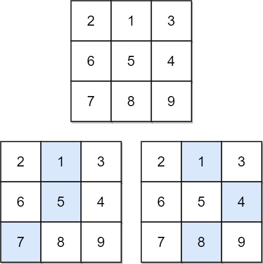
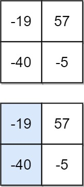

# [931. Minimum Falling Path Sum](https://leetcode.com/problems/minimum-falling-path-sum/)

| Category | Difficulty | Likes | Dislikes |
| :------: | :--------: | :---: | :------: |
| Algorithms | Medium | 6901 | 169 |

**Tags:** [`array`](https://leetcode.com/tag/array), [`dynamic-programming`](https://leetcode.com/tag/dynamic-programming), [`matrix`](https://leetcode.com/tag/matrix)

**Companies:** `amazon`, `facebook`, `bloomberg`, `google`, `microsoft`, `uber`, `goldman-sachs`

## Description

Given an `n x n` array of integers `matrix`, return *the **minimum sum** of any **falling path** through* `matrix`.

A **falling path** starts at any element in the first row and chooses the element in the next row that is either directly below or diagonally left/right. Specifically, the next element from position `(row, col)` will be `(row + 1, col - 1)`, `(row + 1, col)`, or `(row + 1, col + 1)`.

 

**Example 1:**


```

Input: matrix = [[2,1,3],[6,5,4],[7,8,9]]
Output: 13
Explanation: There are two falling paths with a minimum sum as shown.

```

**Example 2:**


```

Input: matrix = [[-19,57],[-40,-5]]
Output: -59
Explanation: The falling path with a minimum sum is shown.

```

 

**Constraints:**

	- `n == matrix.length == matrix[i].length`

	- `1 <= n <= 100`

	- `-100 <= matrix[i][j] <= 100`

---

**Links:** [Submissions](https://leetcode.com/problems/minimum-falling-path-sum/) | [Solutions](https://leetcode.com/problems/minimum-falling-path-sum/)
