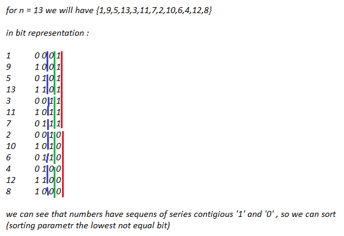

# c++(0ms 100%) bit sorting (with comments)

**Author:** ZX007PI
**Votes:** 20
**Link:** [https://leetcode.com/problems/beautiful-array/solutions/1367982/](https://leetcode.com/problems/beautiful-array/solutions/1367982/)

---

Runtime: 0 ms, faster than 100.00% of C++ online submissions for Beautiful Array.
Memory Usage: 6.8 MB, less than 97.21% of C++ online submissions for Beautiful Array.

**note** we will have other right answer = {7, 11, 3, 13, 5, 9, 1, 6, 10, 2, 12, 4, 8}, because we sort strictly (for not equal bit position we give preference for bit '1'). We also can change condition in sorting comparator and we will have in answer firstly numbers with '0' in bit position. 

```
class Solution {
public:
  static bool comp(const int &a, const int &b){
    int mask = 1;
    while(true)
      if((a&mask) == (b&mask)) mask = mask<<1;
      else return (a&mask) > (b&mask); 
  }
  
  vector<int> beautifulArray(int n) {
    vector<int> answer;
    while(n) answer.push_back(n--);
    
    sort(answer.begin(), answer.end(), comp);
    
    return answer;
  }
};
```
**p.s.** I think we also can find out "sorting condition" in bit operation for this bit problem.

**and I done it :**
Runtime: 0 ms, faster than 100.00% of C++ online submissions for Beautiful Array.
Memory Usage: 6.8 MB, less than 93.03% of C++ online submissions for Beautiful Array.
```
class Solution {
public:
  static bool comp(const int &a, const int &b){
 \xA0 \xA0int mask = (a^b); \xA0 \xA0 \xA0 \xA0 \xA0 \xA0 \xA0 \xA0  //xOr for transform the same right most positions into '0'
    mask = mask & (-mask);             //fetch the most right '1'
    return a & mask;                     //check if the right most '1' is belonged a or b   
  }
  
  
  vector<int> beautifulArray(int n) {
    vector<int> answer;
    while(n) answer.push_back(n--);
    
    sort(answer.begin(), answer.end(), comp);
    
    return answer;
  }
};
```

