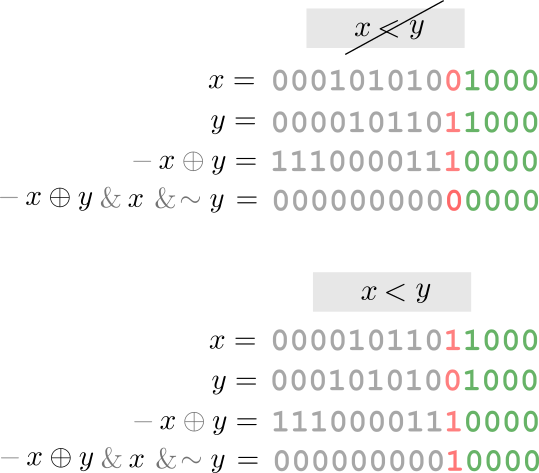

# ✅ Beautiful Array || Easy & Clean || W/ 2 Approach

**Author:** Maango16
**Votes:** 17
**Link:** [https://leetcode.com/problems/beautiful-array/solutions/1367779/](https://leetcode.com/problems/beautiful-array/solutions/1367779/)

---

# **APPROACH 1:**
* **Iterative/sorting-**



```
vector<int> beautifulArray(int n) 
{
	vector<int> ans(n);
	iota(begin(out), end(out), 1);
	sort(begin(out), end(out), [](auto & x, auto & y){ return -(x^y)&x&~y; });
	return ans;  
}
```
**Time Complexity: O(NlogN)
Space Complexity: O(1)**


# **APPROACH 2:**
**ALGORITHM:**
* Create a vector called ans, insert 1 into ans
* While size of ans < N
	* create a vector temp
	* for i in range 0 to size of ans \u2013 1 
		* if ans[i] * 2 \u2013 1 <= N, then insert ans[i] * 2 \u2013 1 into temp array 
	* for i in range 0 to size of ans \u2013 1
		* if ans[i] * 2 <= N, then insert ans[i] * 2 into temp array
	* set ans := temp
* return ans

**SOLUTION:**
`In C++`
```
class Solution {
public:
    vector<int> beautifulArray(int n) {
        vector<int> ans ;
        ans.push_back(1) ;
        while(ans.size() < n)
        {
            vector<int> temp ;
            for(auto i:ans)
            {
                if(i*2 - 1 <= n)
                {
                    temp.push_back(i*2 - 1) ;
                }
            }
            for(auto i:ans)
            {
                if(i*2 <= n)
                {
                    temp.push_back(i*2) ;
                }
            }
            ans = temp ;
        }
        return ans ;
    }
};
```