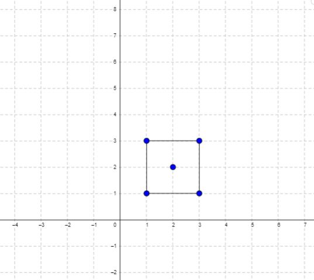
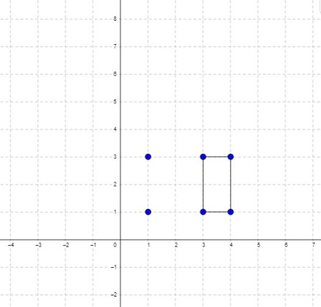

# [939. Minimum Area Rectangle](https://leetcode.com/problems/minimum-area-rectangle/)

| Category | Difficulty | Likes | Dislikes |
| :------: | :--------: | :---: | :------: |
| Algorithms | Medium | 2089 | 298 |

**Tags:** [`array`](https://leetcode.com/tag/array), [`hash-table`](https://leetcode.com/tag/hash-table), [`math`](https://leetcode.com/tag/math), [`geometry`](https://leetcode.com/tag/geometry), [`sorting`](https://leetcode.com/tag/sorting)

**Companies:** `flipkart`, `google`, `verily`

## Description

You are given an array of points in the **X-Y** plane `points` where `points[i] = [x_i, y_i]`.

Return *the minimum area of a rectangle formed from these points, with sides parallel to the X and Y axes*. If there is not any such rectangle, return `0`.

 

**Example 1:**


```

Input: points = [[1,1],[1,3],[3,1],[3,3],[2,2]]
Output: 4

```

**Example 2:**


```

Input: points = [[1,1],[1,3],[3,1],[3,3],[4,1],[4,3]]
Output: 2

```

 

**Constraints:**

	- `1 <= points.length <= 500`

	- `points[i].length == 2`

	- `0 <= x_i, y_i <= 4 * 10^4`

	- All the given points are **unique**.

---

**Links:** [Submissions](https://leetcode.com/problems/minimum-area-rectangle/) | [Solutions](https://leetcode.com/problems/minimum-area-rectangle/)
