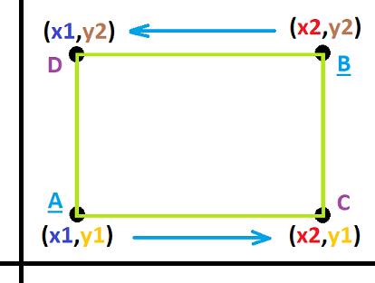
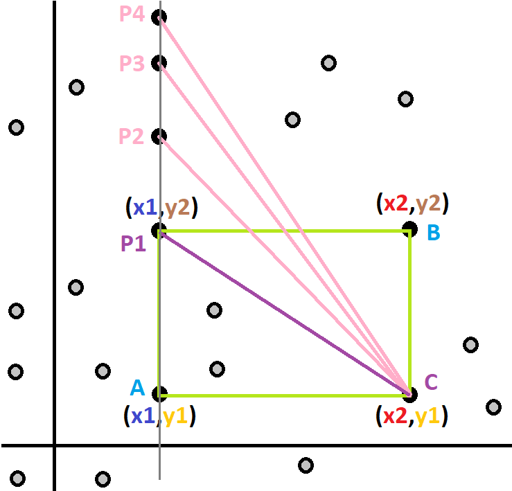
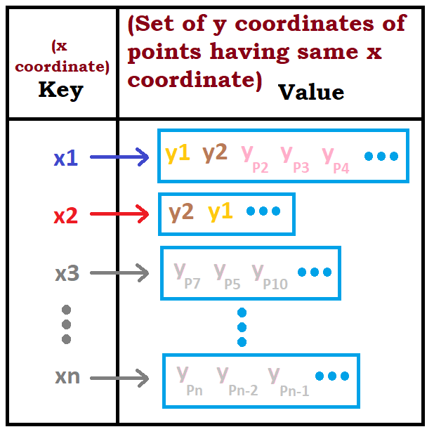
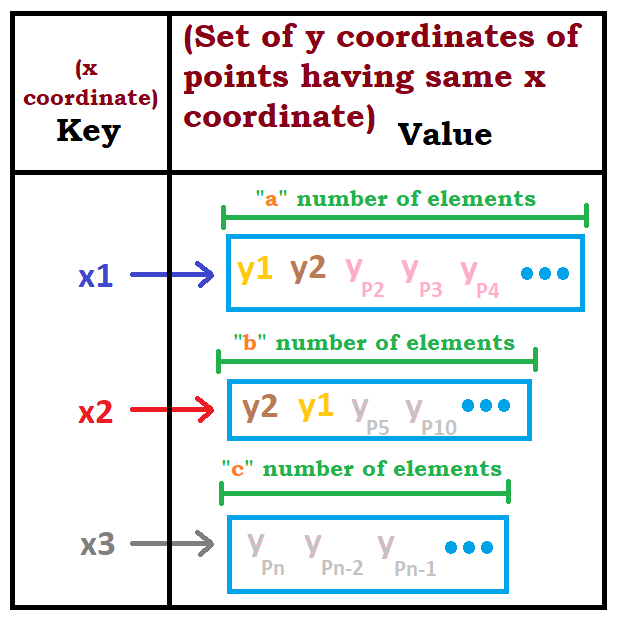

# Intuition w/ Pictures w/ Comments in C++, Java, Python

**Author:** kunal-chand
**Votes:** 456
**Link:** [https://leetcode.com/problems/minimum-area-rectangle/solutions/900264/](https://leetcode.com/problems/minimum-area-rectangle/solutions/900264/)

---

**Brute Force Approach** :

The naive approach would be to look for every possible pair.
Since each pair consists 4 points, hence 4 "for" loops will be required to iterate through every pair.
Pseudo Code :

```
 for ( a : 1 -> n) 
	 for ( b : 1 -> n)
		  for ( c : 1 -> n)
			   for ( d : 1 -> n)
				   Area = Area of Rectangle formed by point[a], point[b], point[c], point[d]
				   if (Minimum_Area > Area)
					   Minimum_Area = Area

 return Minimum_Area
```

Time Complexity : O(n^4)
Space Complexity : O(1)


**Optimal Approach** (Using HashMap) :

We can store values in a structured manner to reduce the number of iterations.
One interesting obsevation about the **rectangle having sides parallel to x & y axis** is :
*Given two points of a diagonal, we can calculate the remaining two points of the second diagonal.*



Suppose we fix two points A & B out of N points in a plane, its possible to have AB as a diagonal of a rectangle only if
the x & y coordinates of points A & B are different ie. `x1 is not equal to x2` AND  `y1 is not equal to y2`.

Having A & B fixed, we can calculate coordinates of points C & D which can possibly form a rectangle. 
`x coordinate of C = x coordinate of B = x2`
`y coordinate of C = y coordinate of A = y1`
`x coordinate of D = x coordinate of A = x1`
`y coordinate of D = y coordinate of B = y2`
The above coordinates are the possible coordinates of points C & D.
Now we have to search for the points (out of all the points) having same coordinates as that of the calculated possible coordinates.

So far, our approach is to iterate through different (A,B) pairs and for each pair, we have to search for points C & D. 
Speaking of Time Complexity : 
O(n^2) *[iterate through different (A,B) pairs]* x O(n^2) *[iterate through all possible (C,D) points]*.
Which still makes the Time Complexity as O(n^4).
Basically for figuring out points C & D out of the remaining points, we are iterating through all the remaining points which is same as the brute force approach. 
This gives us an intuition that we need to somehow eliminate few set of points without iterating through each of them.



In the above diagram, P1, P2, P3 & P4 all have x coordinate same as of point A. Altough each of them have different y coordinates.
But only P1 is resposible for the formation of rectangle because the y coordinate of P1 is same as that of B.

Hence we quickly found out a point (out of 4 points) that was having x coordinate of A & y coordinate of B.
This idea can be implemented using a HashMap where the lookup time will be of O(1) on average.
So if we group the y coordinates on the basis of same x coordinate, using a HashSet we can search for corresponding y coordinate in O(1) time.

So lets create a HashMap having 
Key => *Different x coordinates*
Value => *HashSet of y coordinates of points having same x coordinate*



So while iterating through different (A,B) pairs, we can check whether there exists value cooresponding to C & D points in the hashmap.
Lets say we check whether there exists a point D in the hashmap,
Step 1 : Key => *x coordinate of point A* (x1)
Step 2 : Value => Corresponding to Key(x1), search for *y coordinate of point B* (y2) in *HashSet*
If coordinates of D exists in the HashMap, then a rectangle is possible.
If coordinates of D doesn't exists in the HashMap, then a rectangle is NOT possible, and we **iterate to a different (A,B) pair**.

**C++/Java/Python** code with explanation:

```cpp []
// Note : 
// In C++, we use Unordered Map & Unordered Set because there is no need to sort the values inside the map or set. 
// Using Ordered Map & Ordered Set would give TLE (Time Limit Exceeded), because those data structures consume time for  unnecessary internal sorting

class Solution {
public:
    int minAreaRect(vector<vector<int>>& points) {
        unordered_map<int, unordered_set<int>> hashmap; // Key => Integer | Value => Set
        
        for(auto& single_point: points) // Iterate through every single point & store the coordinates in map.
            hashmap[single_point[0]].insert(single_point[1]); // Insert y coordinate into Value (HashSet) corresponding to Key (equal to x coordinate)
			// Explanation : 
			//		single_point => refering to a single point [x,y] in vector
			//		x-coordinate of a single point => single_point[0]
			//		y-coordinate of a single point => single_point[1]

			//		Key => x coordinate of a point 
			//			=> single_point[0]

			//		Value => HashSet of y coordinates 
			//			=> hashmap[Key]
			//			=> hashmap[x-coordinate of a single point]
			//			=> hashmap[single_point[0]]

			//		Insert y coordinate into corresponding Value (HashSet)
			//			=> Value.insert(y-coordinate of a single point)
			//			=> hashmap[Key].insert(y-coordinate of a single point)
			//			=> hashmap[x-coordinate of a single point].insert(y-coordinate of a single point)
			//			=> hashmap[single_point[0]].insert(single_point[1])
			
        int minimum_area = INT_MAX; // Vairable to store the minimum area
        
        for(int i = 0; i < points.size(); i++) { // Iterator corresponding to different A points
            for(int j = i + 1; j < points.size(); j++) { // Iterator corresponding to different B points
			
                int x1 = points[i][0], y1 = points[i][1];  // Coordinates of Point A
				int x2 = points[j][0], y2 = points[j][1];  // Coordinates of Point B
                
                if(x1 != x2 && y1 != y2) // Point A & B must form a diagonal of the rectangle.
                    if( hashmap[x1].find(y2) != hashmap[x1].end() // Check if D exists in hashmap
											&& 
					hashmap[x2].find(y1) != hashmap[x2].end() ) // Check if C exists in hashmap
					// Explanation : 
					//		Check existence of y2 in Value (HashSet) corresponding to x1 Key
					//			=> Value.find(y-coordinate of point B)
					//			=> hashmap[Key].find(y-coordinate of point B)
					//			=> hashmap[x-coordinate of point A].find(y-coordinate of point B)
					//			=> hashmap[x1].find(y2) => Checks if point D exists in hashmap 
					//		Check existence of y1 in Value (HashSet) corresponding to x2 Key
					//			=> Value.find(y-coordinate of point A)
					//			=> hashmap[Key].find(y-coordinate of point A)
					//			=> hashmap[x-coordinate of point B].find(y-coordinate of point A)
					//			=> hashmap[x2].find(y1) => Checks if point C exists in hashmap 

                        minimum_area = min( minimum_area , abs(x1-x2) * abs(y1-y2) ); // Store the minimum area possible
            }
        }
        return minimum_area != INT_MAX ? minimum_area : 0; // Return 0 if no rectangle exists
    }
};
```
```java []
class Solution {
    public int minAreaRect(int[][] points) {
        HashMap<Integer, Set<Integer>> hashmap = new HashMap<>();  // Key => Integer | Value => Set
        
        for(int single_point[] : points) // Iterate through every single point & store the coordinates in map
        {
            if(!hashmap.containsKey(single_point[0])){ // Check if x coordinate of the single point already exisits as a Key in hasmap.
                hashmap.put(single_point[0], new HashSet<Integer>()); // Insert a new Key (equal to x coordinate) in the hashmap with corresponding Value (equal to newly created empty HashSet).
            }
            hashmap.get(single_point[0]).add(single_point[1]); // Insert y coordinate into Value (HashSet) corresponding to Key (equal to x coordinate)
			// Explanation : 
			//		single_point => refering to a single point [x,y]
			//		x-coordinate of a single point => single_point[0]
			//		y-coordinate of a single point => single_point[1]

			//		Key => x coordinate of a point 
			//			=> single_point[0]

			//		Value => HashSet of y coordinates 
			//			=> hashmap.get(Key)
			//			=> hashmap.get(x-coordinate of a single point)
			//			=> hashmap.get(single_point[0])

			//		Insert y coordinate into corresponding Value (HashSet)
			//			=> Value.add(y-coordinate of a single point)
			//			=> hashmap.get(Key).add(y-coordinate of a single point)
			//			=> hashmap.get(x-coordinate of a single point).add(y-coordinate of a single point)
			//			=> hashmap.get(single_point[0]).add(single_point[1])
        }
        
        int minimum_area = Integer.MAX_VALUE; // Vairable to store the minimum area
        
        for(int i=0; i<points.length; i++){  // Iterator corresponding to different A points
            for(int j=0; j<points.length; j++){ // Iterator corresponding to different B points
                
                int x1 = points[i][0], y1 = points[i][1]; // Coordinates of Point A
                
                int x2 = points[j][0], y2 = points[j][1]; // Coordinates of Point B
                
                if(x1 != x2 && y1 != y2) // Point A & B must form a diagonal of the rectangle.
                    if( hashmap.get(x1).contains(y2)  // Check if D exists in hashmap
									&& 
					hashmap.get(x2).contains(y1) ) // Check if C exists in hashmap
					// Explanation : 
					//		Check existence of y2 in Value (HashSet) corresponding to x1 Key
					//			=> Value.contains(y-coordinate of point B)
					//			=> hashmap.get(Key).contains(y-coordinate of point B)
					//			=> hashmap.get(x-coordinate of point A).contains(y-coordinate of point B)
					//			=> hashmap.get(x1).contains(y2) => Checks if point D exists in hashmap 
					//		Check existence of y1 in Value (HashSet) corresponding to x2 Key
					//			=> Value.contains(y-coordinate of point A)
					//			=> hashmap.get(Key).contains(y-coordinate of point A)
					//			=> hashmap.get(x-coordinate of point B).contains(y-coordinate of point A)
					//			=> hashmap.get(x2).contains(y1) => Checks if point C exists in hashmap 
					
                        minimum_area = Math.min(minimum_area, Math.abs(x1-x2) * Math.abs(y1-y2)); // Store the minimum area possible
            }
        }
        return minimum_area != Integer.MAX_VALUE ? minimum_area : 0; // Return 0 if no rectangle exists
    }
}
```
```python []
class Solution:
    def minAreaRect(self, points: List[List[int]]) -> int:
        hashmap = {} # Key => Integer | Value => Set

        for single_point in points: # Iterate through every single point & store the coordinates in map
            if single_point[0] not in hashmap: # Check if x coordinate of the single point already exisits as a Key in hasmap
                hashmap[single_point[0]] = set() # Insert a new Key (equal to x coordinate) in the hashmap with corresponding Value (equal to newly created empty HashSet)
            hashmap[single_point[0]].add(single_point[1]) # Insert y coordinate into Value (HashSet) corresponding to Key (equal to x coordinate)
			# Explanation : 
			#		single_point => refering to a single point [x,y]
			#		x-coordinate of a single point => single_point[0]
			#		y-coordinate of a single point => single_point[1]

			#		Key => x coordinate of a point 
			#			=> single_point[0]

			#		Value => HashSet of y coordinates 
			#			=> hashmap[Key]
			#			=> hashmap[x-coordinate of a single point]
			#			=> hashmap[single_point[0]]

			#		Insert y coordinate into corresponding Value (HashSet)
			#			=> Value.add(y-coordinate of a single point)
			#			=> hashmap[Key].add(y-coordinate of a single point)
			#			=> hashmap[x-coordinate of a single point].add(y-coordinate of a single point)
			#			=> hashmap[single_point[0]].add(single_point[1])

        minimum_area = inf # Vairable to store the minimum area

        for i in range(len(points)): # Iterator corresponding to different A points
            for j in range(len(points)): # Iterator corresponding to different B points

                x1, y1 = points[i][0], points[i][1] # Coordinates of Point A
                
                x2, y2 = points[j][0], points[j][1] # Coordinates of Point B

                if x1 != x2 and y1 != y2: # Point A & B must form a diagonal of the rectangle.
                    if (y2 in hashmap[x1] # Check if D exists in hashmap
                            and 
                    y1 in hashmap[x2]): # Check if C exists in hashmap
                    # Explanation :
                    #		Check existence of y2 in Value (HashSet) corresponding to x1 Key
					#			=> (y-coordinate of point B) in Value
					#			=> (y-coordinate of point B) in hashmap[Key]
					#			=> (y-coordinate of point B) in hashmap[x-coordinate of point A]
                    #			=> y2 in hashmap[x1] => Checks if point D exists in hashmap
					#		Check existence of y1 in Value (HashSet) corresponding to x2 Key
					#			=> (y-coordinate of point A) in Value
					#			=> (y-coordinate of point A) in hashmap[Key]
					#			=> (y-coordinate of point A) in hashmap[x-coordinate of point B]
                    #			=> y1 in hashmap[x2] => Checks if point C exists in hashmap
                        minimum_area = min(minimum_area, abs(x1-x2) * abs(y1-y2)) # Store the minimum area possible
        
        return minimum_area if minimum_area != inf else 0 # Return 0 if no rectangle exists
```

**Time Complexity : O(n^2)**
where n = Total number of points
Explanation :
Iteration Time: Iterating through different (A,B) pairs => O(n^2)
Search Time: Searching for y coordinate corresponding to x coordinate => O(n) {Worst case for searching in HashSet} + O(n) {Worst case for searching in HashMap} => O(n)
*Time Complexity = Iteration Time * Search Time, since we are searching for point C & D for each pair of point A & B*
So in this case the time complexity will be O(n^2) * O(n) = O(n^3)
But usually, we consider the search operation in a HashMap & HashSet to run in constant time i.e. O(1).
Hence the time complexity will be O(n^2) * O(1) = O(n^2)

**Space Complexity : O(n)**
where n = Total number of points
Explanation :
Lets assume we have 3 Keys in the hashmap & have corresposing y values mapped to it.

Space Complexity = ["a" number of elements] + ["b" number of elements] + ["c" number of elements]
=> Space Complexity = [Number of y coordinates having same x coordinate (**x1**)] +[Number of y coordinates having same x coordinate (**x2**)]  + [Number of y coordinates having same x coordinate (**x3**)]
=> Space Complexity = Total number of y coordinates of all the points
=> Space Complexity = Total number of points
Hence, Space Complexity : O(n)