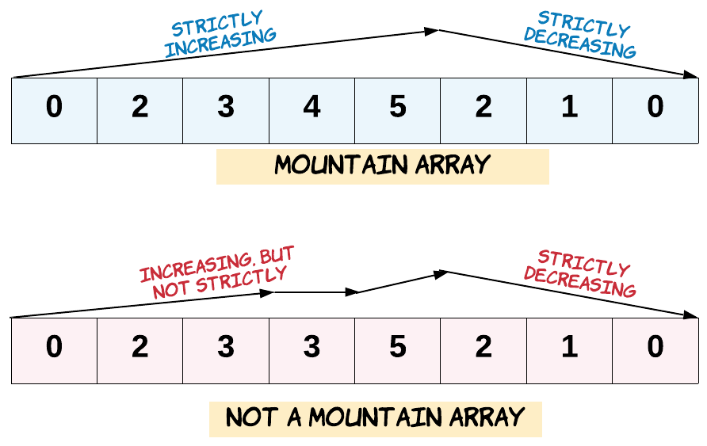

# [941. Valid Mountain Array](https://leetcode.com/problems/valid-mountain-array/)

| Category | Difficulty | Likes | Dislikes |
| :------: | :--------: | :---: | :------: |
| Algorithms | Easy | 3097 | 201 |

**Tags:** [`array`](https://leetcode.com/tag/array)

**Companies:** `facebook`, `amazon`, `google`, `tiktok`

## Description

Given an array of integers `arr`, return *`true` if and only if it is a valid mountain array*.

Recall that arr is a mountain array if and only if:

	- `arr.length >= 3`

	- There exists some `i` with `0 `arr[0]  arr[i + 1] > ... > arr[arr.length - 1]`

	
	



 

**Example 1:**

```
Input: arr = [2,1]
Output: false

```
**Example 2:**

```
Input: arr = [3,5,5]
Output: false

```
**Example 3:**

```
Input: arr = [0,3,2,1]
Output: true

```

 

**Constraints:**

	- `1 <= arr.length <= 10^4`

	- `0 <= arr[i] <= 10^4`

---

**Links:** [Submissions](https://leetcode.com/problems/valid-mountain-array/) | [Solutions](https://leetcode.com/problems/valid-mountain-array/)
