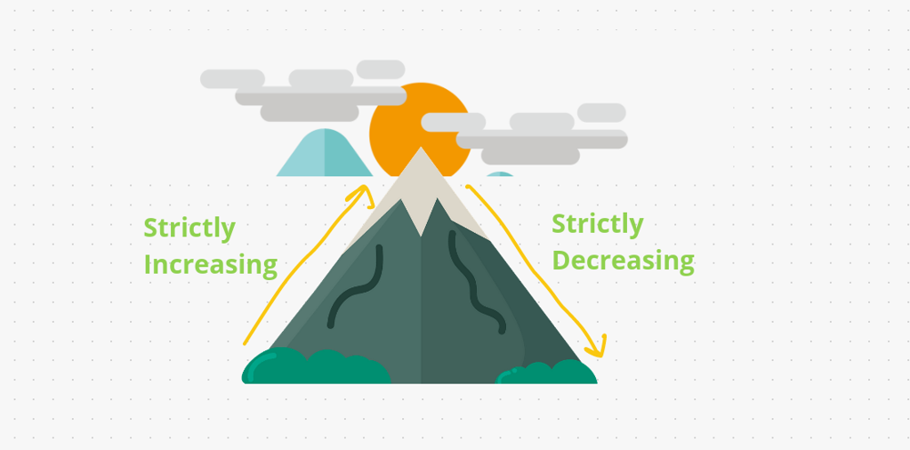
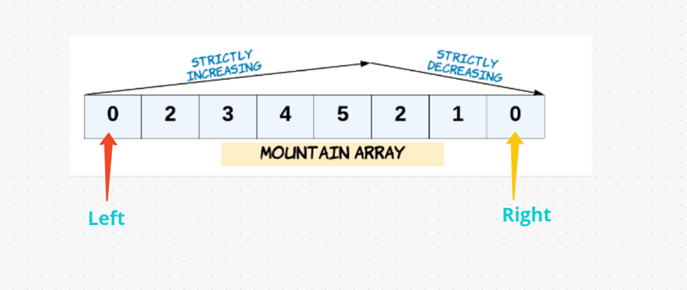

# [Java/C++/Python] EASY to go through solution & EXPLANATION

**Author:** hi-malik
**Votes:** 203
**Link:** [https://leetcode.com/problems/valid-mountain-array/solutions/1717377/](https://leetcode.com/problems/valid-mountain-array/solutions/1717377/)

---

```
What the question is saying, We have Given an array of integers arr, return true if and only if it is a valid mountain array.
```
**So, how's the mountain we want, something like this:**



Similarly, we have given some **arrays value** and we have to check by that array Is our **mountain can possible or not.**
`There are some conditons as well to form a mountain:`
* The **array size** has to be **> 3**
* It has to be **strictly increasing** like **[0, 3, 5]** and the values has to be different not same
* Similarly it has to be **strictly decreasing** like **[4 , 2, 1]** amd the values has to be different not same

So, how we can check it. For that one we will use the help of **2 pointers** one will start from **left** & another will start from **right**. If left and right **meets on same index value** then we **return true**, because it's a **stricly increasing and decreasing mountain**.



*I hope you got the idea.* **Now let's code it up**

*code each line explained :* `Similar for C++, Java, Python` **{Only Syntax Difference}** approach same
```
{
        if(arr.length < 3) return false; // if length is less then 3, as mention in the question we simply return false;
        // Now we create 2 pointers,
        int l = 0; // left pointer starting from 0th index
        int r = arr.length - 1; // right pointer starting from end of that array
        // 1st we will check the strictly incresing part. We check the current pointer value has to be smaller then the next pointer value
        // to handle index out of bound error. we will go till arr.length - 1, not arr.length
        while(l + 1 < arr.length - 1 && arr[l] < arr[l + 1]) l++;
        // Now we will check the strictly decreasing part. We check the current pointer value has to be smaller then the previous pointer value
        while(r - 1 > 0 && arr[r] < arr[r - 1]) r--;
        return l == r; 
    }
```

**Java**
```
class Solution {
    public boolean validMountainArray(int[] arr) {
        if(arr.length < 3) return false;
        int l = 0;
        int r = arr.length - 1;
        while(l + 1 < arr.length - 1 && arr[l] < arr[l + 1]) l++;
        while(r - 1 > 0 && arr[r] < arr[r - 1]) r--;
        return l == r;
    }
}
```
**C++**
```
class Solution {
public:
    bool validMountainArray(vector<int>& arr) {
        if(arr.size() < 3) return false;
        int l = 0;
        int r = arr.size() - 1;
        while(l + 1 < arr.size() - 1 && arr[l] < arr[l + 1]) l++;
        while(r - 1 > 0 && arr[r] < arr[r - 1]) r--;
        return l == r;
    }
};
```
**Python**
```
class Solution:
    def validMountainArray(self, arr: List[int]) -> bool:
        if len(arr) < 3: return False;
        l = 0;
        r = len(arr) - 1
        while l + 1 < len(arr) - 1 and arr[l] < arr[l + 1]: 
            l += 1
        while r - 1 > 0 and arr[r] < arr[r - 1]: 
            r -= 1
        return l == r
```
ANALYSIS :-
* **Time Complexity :-** BigO(N) as we are traversing the array only once.

* **Space Complexity :-** BigO(1) as we are not using any extra space