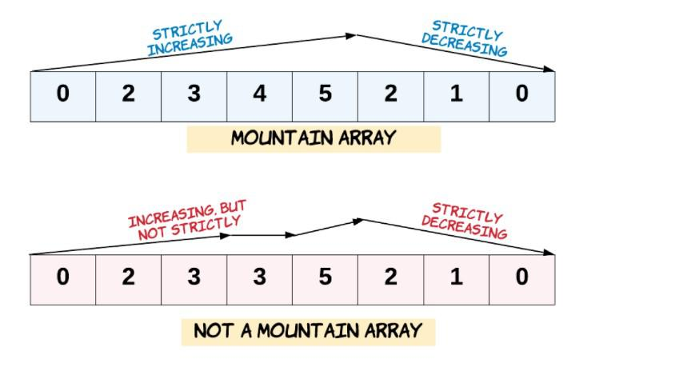

# 🗻 C++ || Best easy explanation || O(N)

**Author:** intellisense
**Votes:** 46
**Link:** [https://leetcode.com/problems/valid-mountain-array/solutions/1717169/](https://leetcode.com/problems/valid-mountain-array/solutions/1717169/)

---

**\uD83D\uDC68\u200D\uD83D\uDCBB Friend's if you find this solution helpful \uD83D\uDE0A, PLEASE do UPVOTE. By doing that motivates me to create a better post like this \u270D\uFE0F**
____________________________________________________________________________________________________________
____________________________________________________________________________________________________________


#### \u2714\uFE0F **Question Conclusion**
* we have given a array of numbers we have to find that wheather it is making a mountain or not. It should only consist of single peak.
#### \u2714\uFE0F **Solution - I (Best Approach)**
##### **Intuition :-**
* As we know the array should be start from increasing order and at some point follow decreasing order to make a peak for mountain.
* We will run a while loop until `arr[i] > arr[i+1]` and store the count in a variable after the loop exit we need to check two condition wheather` count == array length or count == 0 `if any of them is true we will return false as there will be no peak formed.
* Again we will run the while loop until` arr[i] > arr[i+1] `and continue to increment of the count variable that we intialized earlier after the loop exit we will check weather `count == array length` return true because there is no other peak formed in the array. But if` count != array length` than there can be any other formation of peak so return false.
##### **Code :-**
```
class Solution
{
public:
     bool validMountainArray(vector<int> &arr)
     {

          int length = arr.size();
          int i = 0;
          while (i < length - 1 && arr[i] < arr[i + 1])
          {
               i++;
          }
          if (i == length - 1 || i == 0)
          {
               return false;
          }
          while (i < length - 1 && arr[i] > arr[i + 1])
          {
               i++;
          }
          if (i == length - 1)
          {
               return true;
          }
          else
          {
               return false;
          }
     }
};
```
**Time Complexity** : `O(N)`, we are traversing the array only once.
**Space Complexity** : `O(1)`, No extra space is used. 
_____________________________________________________________________________________________________________
_____________________________________________________________________________________________________________

\uD83D\uDCBBIf there are any suggestions/questions in my post, comment below \uD83D\uDC47