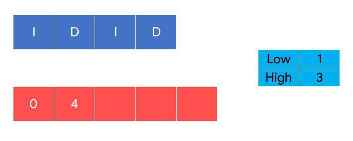
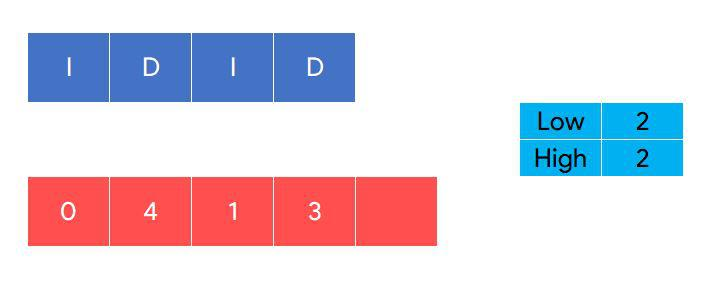
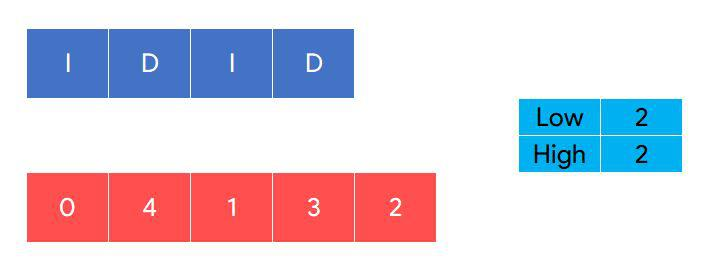

# Simple Explanation and solution with go

**Author:** alucardmmc
**Votes:** 6
**Link:** [https://leetcode.com/problems/di-string-match/solutions/1866525/](https://leetcode.com/problems/di-string-match/solutions/1866525/)

---

The description for this question is horrible honestly, so let's try to break it down in simple terms. Here is also an article on [greedy algorithms]("https://brilliant.org/wiki/greedy-algorithm/") to understand the solution a bit more.

* `n` is the length of the `input`.
* We need to return an array of `ints` of length `n + 1`.
* This array has integers in the range of `[0, n]`.
* The `input` only has `D`'s and `I`s.
* When the element is `I`, add the **lowest** `int` in the range of `[0, n]` to our resulting array.
* When the element is `D`, add the **highest** `int` in the range of `[0, n]` to out resulting array.

Let's try to solve this using the first example:


**First Iteration:** We check the first element in the string. Since the value is `I`, we put the `lowest number` in our array. We increment the `lowest number` by 1.


**Second Iteration:** We check the second element in the string. Since the value is `D`, we put the `highest number` in our array. We subtract the `highest number` by 1.



**Third Iteration:** We check the third element in the string. Since the value is `I`, we put the `lowest number` in our array. We increment the `lowest number` by 1.


**Fourth Iteration:** We check the fourth element in the string. Since the value is `D`, we put the `highest number` in our array. We subtract the `highest number` by 1.



For the last element in our array, we add either the `lowest number` or `highest number`. Both should be the same at this point.



Now, here's the code:

```go
func diStringMatch(s string) []int {
	result := make([]int, len(s)+1)
	low, high := 0, len(s)

	for i, v := range s {
		if v == 'I' {
			result[i] = low
			low++
		} else {
			result[i] = high
			high--
		}
	}
	result[len(s)] = low

	return result
}
```
