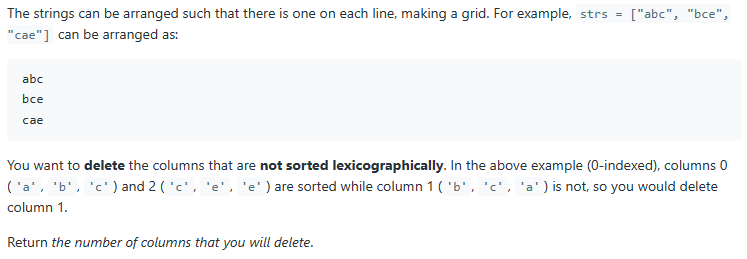

# ✅ Easiest C++ solution with detailed explanation

**Author:** ayushsenapati123
**Votes:** 194
**Link:** [https://leetcode.com/problems/delete-columns-to-make-sorted/solutions/2989470/](https://leetcode.com/problems/delete-columns-to-make-sorted/solutions/2989470/)

---

**PLEASE UPVOTE IF YOU FIND MY APPROACH HELPFUL, MEANS A LOT \uD83D\uDE0A**

**Intuition:** use a counter and if each char is lexicographically sorted column-wise.

**Approach:**
First lets observe the given test example

* We can see that we are going through all the columns for comparision, so this is point 1. 
* We need to compare the current char with the next char row-wise thus traversing will row-1, so this is point 2.
* If we find at any traversal that the order is not maintained, we need to delete the column according to the ques. So increment the counter and use break since the order is broken and we do not want to check that column any more, this is point 3.
* That's it, just return the counter value now.

```
class Solution {
public:
    int minDeletionSize(vector<string>& strs) {
        int delete_count=0;
        int row = strs.size();
        int col = strs[0].size();
        
        for(int j=0; j<col; j++)
        {
            for(int i=0; i<row-1; i++)
            {
                if(strs[i][j]>strs[i+1][j])
                {
                    delete_count++;
                    break;
                }
            }
        }
        return delete_count;
    }
};
```
**Time Complexity** => `O(row * col)`
**Space Complexity** => `O(1)`


