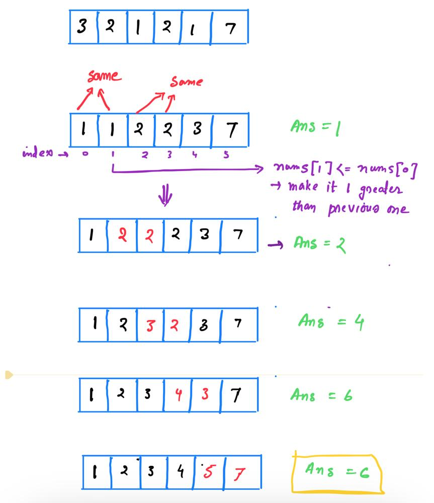

# Why sorting 🤔? Visualize sorting algorithm🔥 | C++✔️ | java ✔️| Python ✔️|

**Author:** Recode_-1
**Votes:** 130
**Link:** [https://leetcode.com/problems/minimum-increment-to-make-array-unique/solutions/5310028/](https://leetcode.com/problems/minimum-increment-to-make-array-unique/solutions/5310028/)

---

# If u like the solution , please upvote it \uD83D\uDE0A

---




# Intuition
Sort to find the minimum increment needed to make it uniunique

---


## But why sorting ?
1. When the array is sorted, any duplicate values will be adjacent. This allows us to easily identify and resolve conflicts by ensuring that each value is greater than the previous one.
2. In a sorted array, if nums[i] is not greater than nums[i-1], we know exactly how much to increment nums[i] to make it unique with minimal effort.

---


# Approach
1. Sort the array
2. traverse from index 1 to the last 
3. for each iteration find
    -  `if array[present_index] <= array[present_index - 1]`
            - Increase `count = count + array[present_index - 1] - array[present_index] + 1`
            - make `array[present_index] = array[present_index - 1] + 1`
    - else Do nothing and continue traversing
4. Return count value

---


# Complexity
- Time complexity:`O(nlog(n))`

- Space complexity:`O(log(n))` (*for recursive calls*)

# Code

```C++ []

class Solution {
public:
    int minIncrementForUnique(vector<int>& nums) {
        sort(nums.begin(),nums.end());
        int ans = 0;
        for(int i=1;i<nums.size();i++){
            if(nums[i]<=nums[i-1]){
                ans += nums[i-1]-nums[i]+1;
                nums[i]= nums[i-1]+1;
            }
        }
        return ans;
        }
};
```
```java []
class Solution {
    public int minIncrementForUnique(int[] nums) {
        Arrays.sort(nums);
        int ans = 0;
        for (int i = 1; i < nums.length; i++) {
            if (nums[i] <= nums[i - 1]) {
                ans += nums[i - 1] - nums[i] + 1;
                nums[i] = nums[i - 1] + 1;
            }
        }
        return ans;
    }
}
```
```python []
class Solution(object):
    def minIncrementForUnique(self, nums):
        nums.sort()
        ans = 0
        for i in range(1, len(nums)):
            if nums[i] <= nums[i - 1]:
                ans += nums[i - 1] - nums[i] + 1
                nums[i] = nums[i - 1] + 1
        return ans
        
```

```