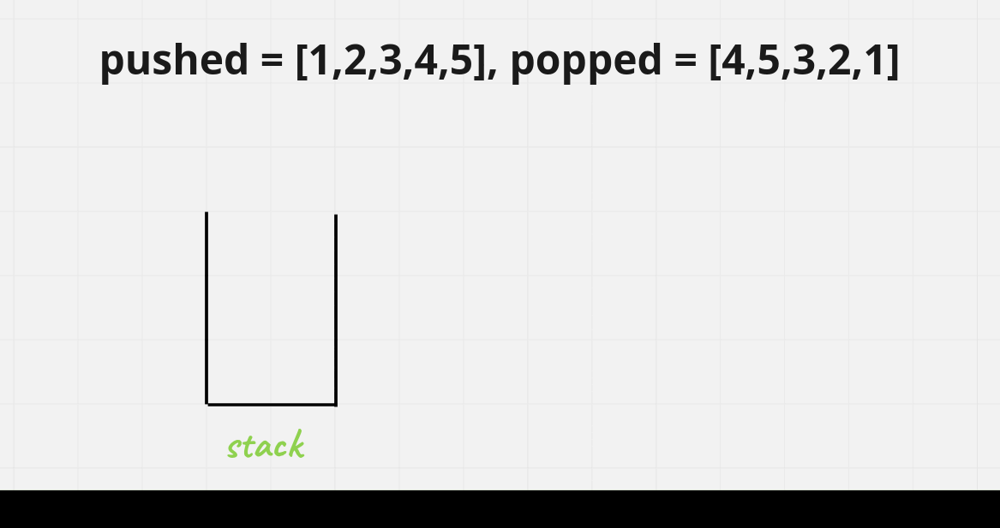

# [Java/C++] Space Complexity going from O(N) -> O(1)

**Author:** hi-malik
**Votes:** 307
**Link:** [https://leetcode.com/problems/validate-stack-sequences/solutions/1853250/](https://leetcode.com/problems/validate-stack-sequences/solutions/1853250/)

---

How's going ladies n gentlemen, today we are going to solve another coolest problem i.e. **Validate Stack Sequences**
```
So, the problem statement is very simple we have given 2 arrays :- **Pushed** & **Popped**
each with distinct values,
return true if this could have been the result of a sequence of push and pop operations on an initially empty stack, or false otherwise.
```

Let's take one example,

**Input**: pushed = [1,2,3,4,5], popped = [4,5,3,2,1]
**Output**: true

The very first thought came in your mind after looking at this problem is let's solve it using Stack. So, ya we'll solve it using stack as well.

Let's understand it Visually:-



**Let's code it up,**

**Java**
```
class Solution {
    public boolean validateStackSequences(int[] pushed, int[] popped) {
        Stack<Integer> st = new Stack<>(); // Create a stack
        
        int j = 0; // Intialise one pointer pointing on popped array
        
        for(int val : pushed){
            st.push(val); // insert the values in stack
            while(!st.isEmpty() && st.peek() == popped[j]){ // if st.peek() values equal to popped[j];
                st.pop(); // then pop out
                j++; // increment j
            }
        }
        return st.isEmpty(); // check if stack is empty return true else false
    }
}
```

**C++**
```
class Solution {
public:
    bool validateStackSequences(vector<int>& pushed, vector<int>& popped) {
        stack<int> st; // Create a stack
        
        int j = 0; // Intialise one pointer pointing on popped array
        
        for(auto val : pushed){
            st.push(val); // insert the values in stack
            while(st.size() > 0 && st.top() == popped[j]){ // if st.peek() values equal to popped[j];
                st.pop(); // then pop out
                j++; // increment j
            }
        }
        return st.size() == 0; // check if stack is empty return true else false
    }
};
```

ANALYSIS:-
* **Time Complexity :-** BigO(N)

* **Space Complexity :-** BigO(N)

`Let's reduce it space complexity, we'll not gonna use stack. Instead we'll use Array as a stack & play with pointer :-`

Instead of using stack we gonna using **pushed as the stack.**

Everything is, Same as above, the only difference is rather than using a new stack we can use the pushed ARRAY as a stack, using a pointer i. `Initially i = 0`, that means stack is empty.

**Let's code it :-**

**Java**
```
class Solution {
    public boolean validateStackSequences(int[] pushed, int[] popped) {
        int i = 0; // Intialise one pointer pointing on pushed array
        int j = 0; // Intialise one pointer pointing on popped array
        
        for(int val : pushed){
            pushed[i++] = val; // using pushed as the stack.
            while(i > 0 && pushed[i - 1] == popped[j]){ // pushed[i - 1] values equal to popped[j];
                i--; // decrement i
                j++; // increment j
            }
        }
        return i == 0; // Since pushed is a permutation of popped so at the end we are supposed to be left with an empty stack
    }
}
```

**C++**
```
class Solution {
public:
    bool validateStackSequences(vector<int>& pushed, vector<int>& popped) {
        int i = 0; // Intialise one pointer pointing on pushed array
        int j = 0; // Intialise one pointer pointing on popped array
        
        for(auto val : pushed){
            pushed[i++] = val; // using pushed as the stack.
            while(i > 0 && pushed[i - 1] == popped[j]){ // pushed[i - 1] values equal to popped[j];
                i--; // decrement i
                j++; // increment j
            }
        }
        return i == 0; // Since pushed is a permutation of popped so at the end we are supposed to be left with an empty stack
    }
};
```
ANALYSIS:-
* **Time Complexity :-** BigO(N)

* **Space Complexity :-** BigO(1) extra space, O(N) modified space