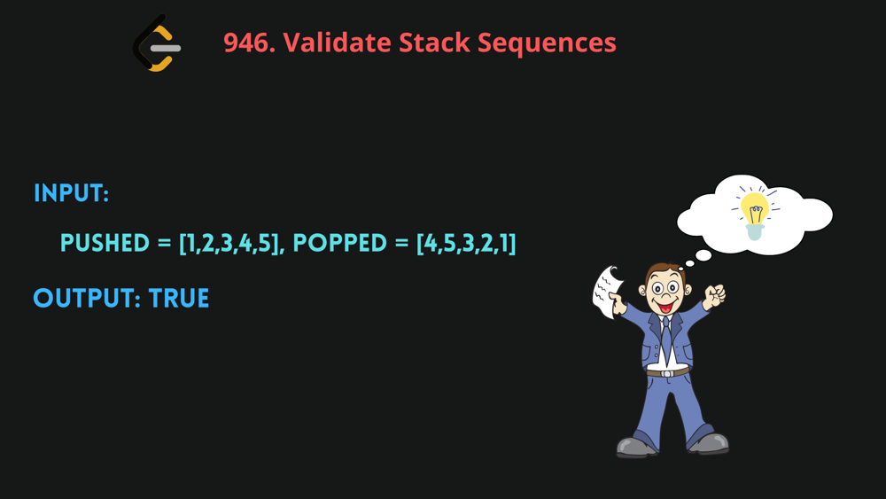

# [Python , Javascript]  Easy solution with very clear Explanation

**Author:** mageshyt
**Votes:** 124
**Link:** [https://leetcode.com/problems/validate-stack-sequences/solutions/1853544/](https://leetcode.com/problems/validate-stack-sequences/solutions/1853544/)

---

**Please dont downvote guys if cannot support,We are putting lot of effort in it\uD83D\uDE42**
```
What the question is asking us to do ?
     return true if this could have been the result of a sequence of push and pop operations on an initially empty stack, or false otherwise.


Big O:
    Time: O(n) # n is the length of push and pop array
    Space: O(n)
```


**i made the animation slow, now you can understand well \uD83D\uDE07**

[https://youtu.be/b_kmdkPLcQU]()


`Javascript`

```
const validateStackSequences = (pushed, popped) => {
  let stack = [];
  let i = 0;
  for (let num of pushed) {
    stack.push(num); // we are pushing the number to the stack
    console.log(stack);
    while (stack.length > 0 && stack[stack.length - 1] === popped[i]) {
      // if the last element of the stack is equal to the popped element
      stack.pop(); // we are popping the element

      i++; // we are incrementing the index of the popped element
    }
  }
  return stack.length === 0; // if the stack is empty then we have a valid sequence
};

```


`Python`

```
class Solution:
    def validateStackSequences(self, pushed: List[int], popped: List[int]) -> bool:
        stack=[]
        i=0
        for num in pushed:
            stack.append(num) #we are pushing the number to the stack
            while  len(stack) >0 and stack[len(stack)-1] == popped[i] :
                #if the last element of the stack is equal to the popped element
                stack.pop()
                i+=1 #we are incrementing i
        return True if len(stack) ==0 else False
		
```

`UPVOTE if you like \uD83D\uDE03 , If you have any question, feel free to ask.
`