# Image Explanation🏆- [2 Approaches: 2 Pointer O(1) & Stack O(N)] - C++/Java/Python

**Author:** aryan_0077
**Votes:** 32
**Link:** [https://leetcode.com/problems/validate-stack-sequences/solutions/3410723/](https://leetcode.com/problems/validate-stack-sequences/solutions/3410723/)

---

# Video Solution (`Aryan Mittal`) - Link in LeetCode Profile
`Validate Stack Sequences` by `Aryan Mittal`
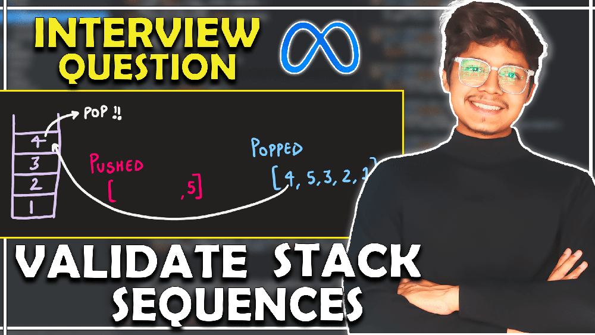


# Approach & Intution
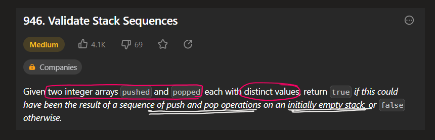
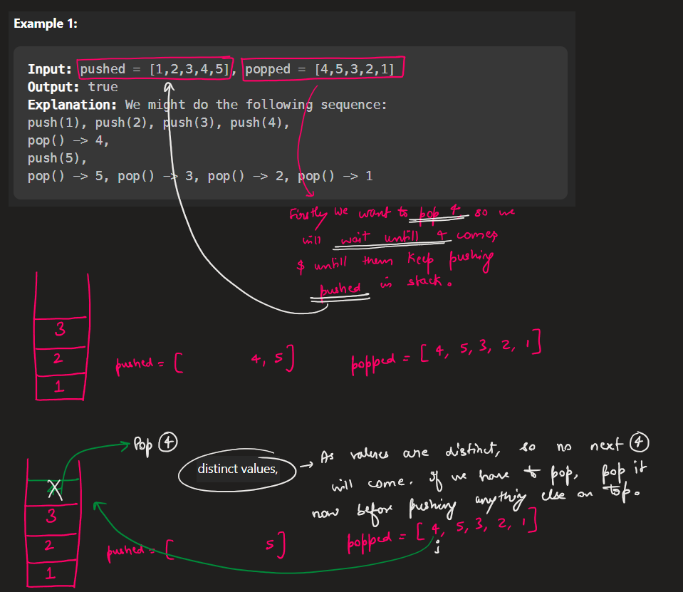
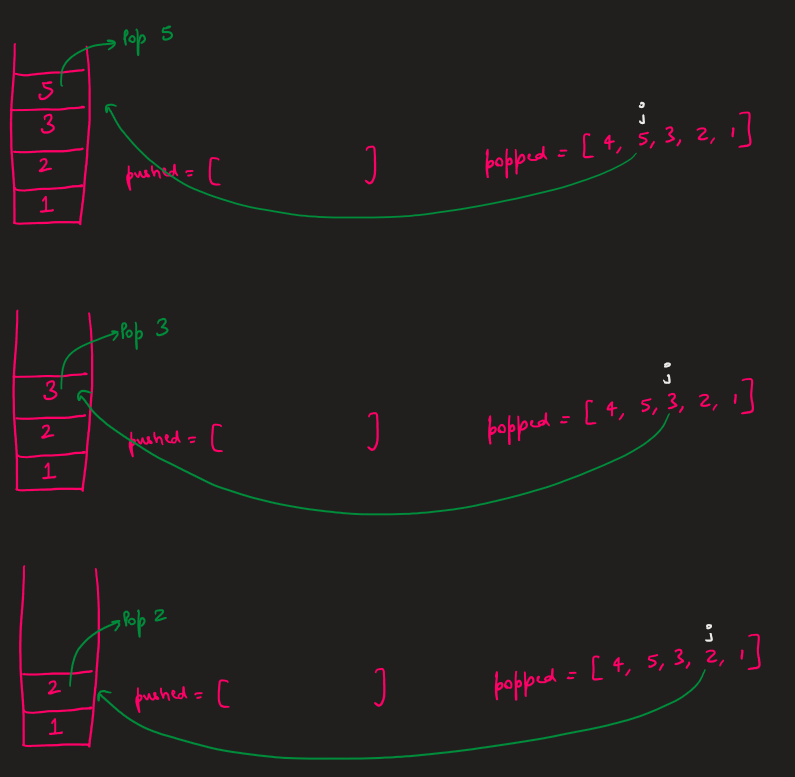
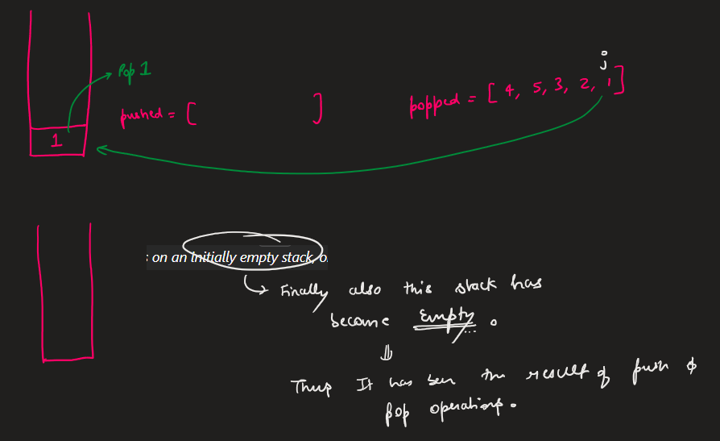
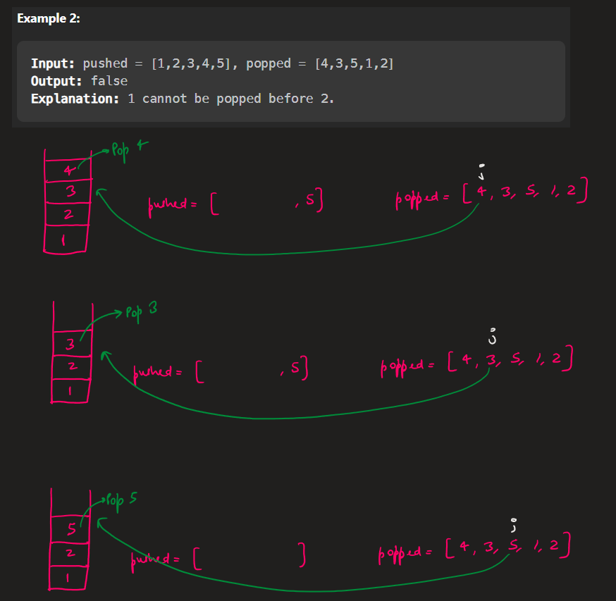
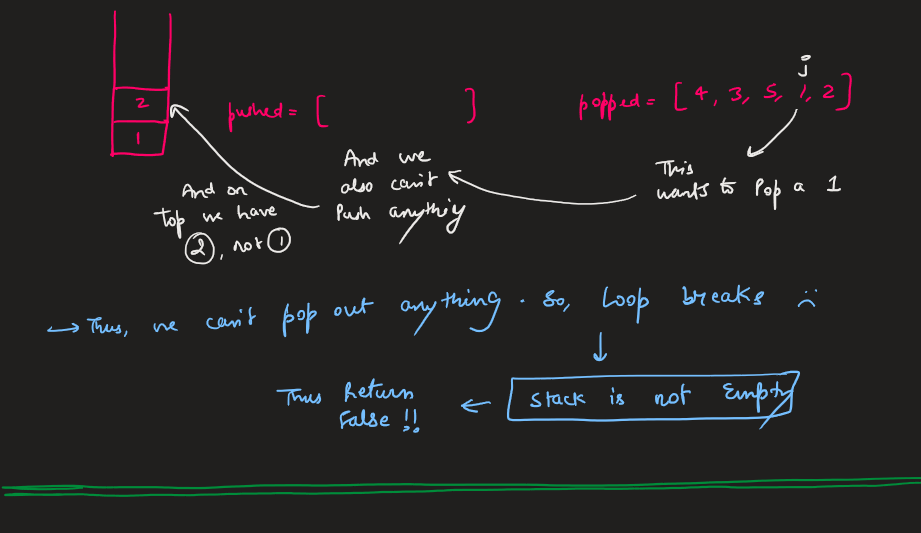
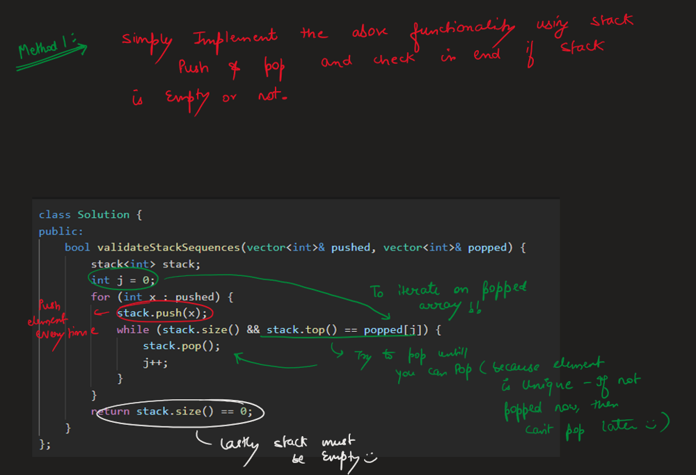
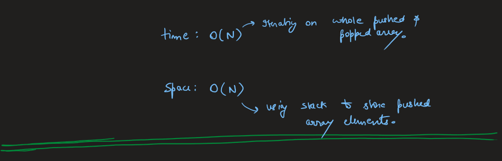
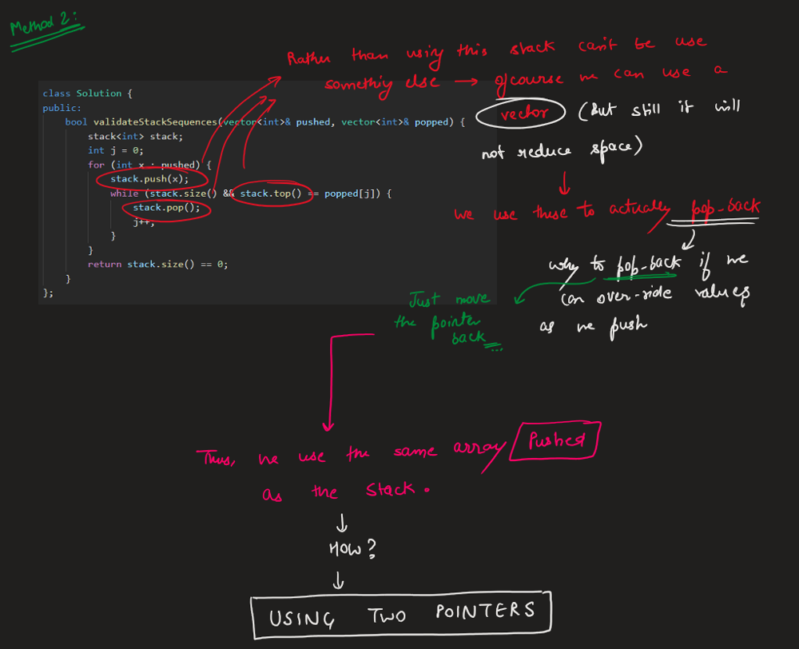
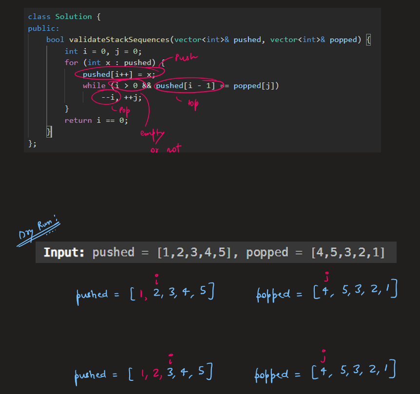
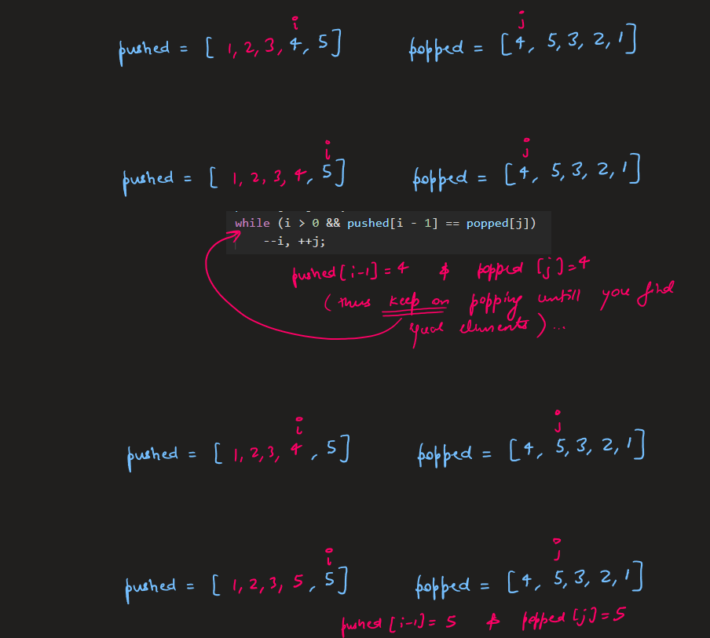
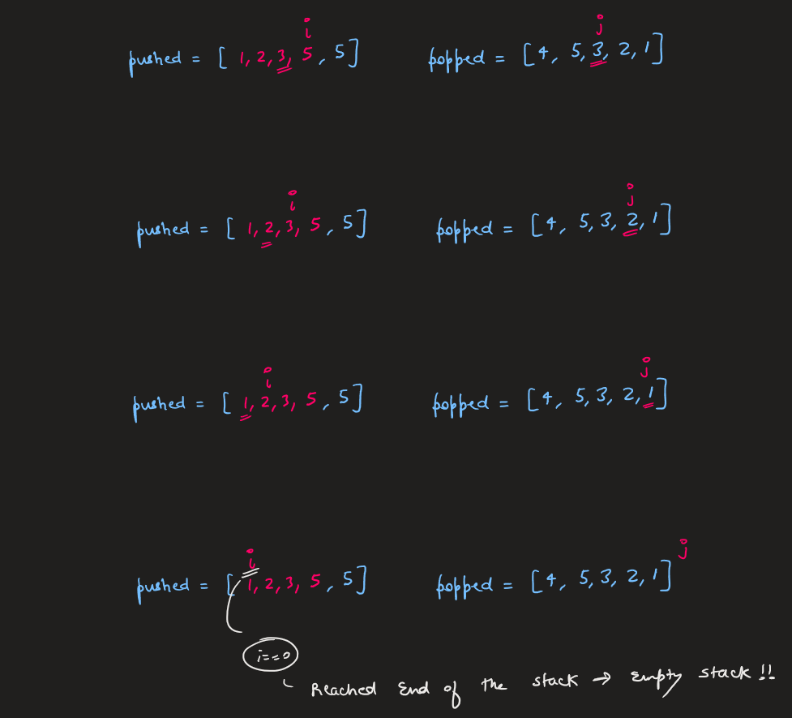
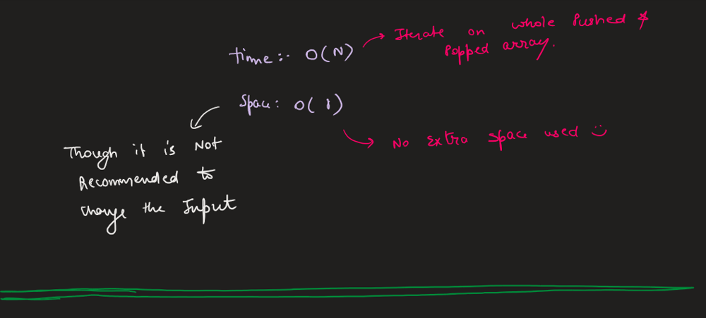


# 2 Pointer O(1) Code
```C++ []
class Solution {
public:
    bool validateStackSequences(vector<int>& pushed, vector<int>& popped) {
        int i = 0, j = 0;
        for (int x : pushed) {
            pushed[i++] = x;
            while (i > 0 && pushed[i - 1] == popped[j])
                --i, ++j;
        }
        return i == 0;
    }
};
```
```Java []
class Solution {
    public boolean validateStackSequences(int[] pushed, int[] popped) {
        int i = 0, j = 0;
        for (int x : pushed) {
            pushed[i++] = x;
            while (i > 0 && pushed[i - 1] == popped[j]) {
                --i; ++j;
            }
        }
        return i == 0;
    }
}
```
```Python []
class Solution:
    def validateStackSequences(self, pushed, popped):
        i = j = 0
        for x in pushed:
            pushed[i] = x
            while i >= 0 and pushed[i] == popped[j]:
                i, j = i - 1, j + 1
            i += 1
        return i == 0
```

# Stack O(N) Code
```C++ []
class Solution {
public:
    bool validateStackSequences(vector<int>& pushed, vector<int>& popped) {
        stack<int> stack;
        int j = 0;
        for (int x : pushed) {
            stack.push(x);
            while (stack.size() && stack.top() == popped[j]) {
                stack.pop();
                j++;
            }
        }
        return stack.size() == 0;
    }
};
```
```Java []
class Solution {
    public boolean validateStackSequences(int[] pushed, int[] popped) {
        Stack<Integer> stack = new Stack<>();
        int j = 0;
        for (int x : pushed) {
            stack.push(x);
            while (!stack.empty() && stack.peek() == popped[j]) {
                stack.pop();
                j++;
            }
        }
        return stack.empty();
    }
}
```
```Python []
class Solution:
    def validateStackSequences(self, pushed, popped):
        stack = []
        j = 0
        for x in pushed:
            stack.append(x)
            while stack and stack[-1] == popped[j]:
                j += 1
                stack.pop()
        return len(stack) == 0
```