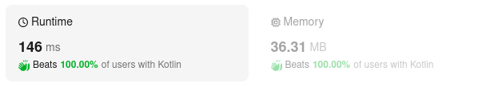

# Kotlin. Beats 100% (146 ms). Two pointers.

**Author:** mobdev778
**Votes:** 3
**Link:** [https://leetcode.com/problems/bag-of-tokens/solutions/4819948/](https://leetcode.com/problems/bag-of-tokens/solutions/4819948/)

---



# Code
```
class Solution {
    fun bagOfTokensScore(tokens: IntArray, power: Int): Int {
        Arrays.sort(tokens)
        var score = 0
        var power = power
        
        var left = 0
        var right = tokens.size - 1
        while (true) {
            val diff = right - left
            when {
                diff < 0 -> break
                power >= tokens[left] -> {
                    power -= tokens[left]
                    left++
                    score++
                }
                score > 0 && diff > 0 -> { // right > left means we have one extra move
                    power += tokens[right]
                    right--
                    score--
                }
                else -> break
            }
        }

        return score
    }
}
```