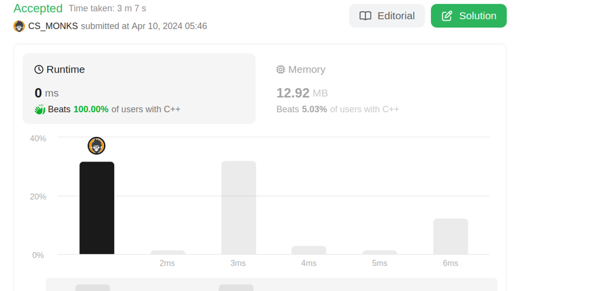

# Beat 100%| Using Deque

**Author:** CS_MONKS
**Votes:** 31
**Link:** [https://leetcode.com/problems/reveal-cards-in-increasing-order/solutions/5001130/](https://leetcode.com/problems/reveal-cards-in-increasing-order/solutions/5001130/)

---



# Intuition
1. To solve this problem, we can simulate the process described in the prompt.
   
# Approach
- **Sort the deck in descending order**: 
   1. Sort the deck in descending order so that the largest cards are placed at the beginning of the deck.
   2. Use `sort(rbegin(deck), rend(deck))` to sort the deck in descending order.

- **Prepare a deque to simulate the card revealing process**: 
   1. Use a deque (`deque<int> dq`) to simulate the process of revealing cards.
   2. A deque is chosen because it allows efficient insertion and removal of elements from both ends. 

- **Initialize deque with the largest card**: 
   1. Add the largest card from the sorted deck to the front of the deque using `dq.push_front(deck[0])`.

- **Simulate the revealing process**: 
   1. Starting from the second largest card, iterate through the sorted deck.
   2. For each card:
      - Take the top card from the back of the deque to simulate revealing a card (`int x = dq.back()`).
      - Remove this card from the deque (`dq.pop_back()`).
      - Place this revealed card at the front of the deque (`dq.push_front(x)`).
      - Add the current card from the sorted deck to the front of the deque (`dq.push_front(deck[i])`).

- **Retrieve the revealed cards in increasing order**: 
   1. After simulating the revealing process for all cards, retrieve the revealed cards from the front of the deque one by one.
   2. Add them to a vector (`vector<int> ans`).
   3. Continue this process until the deque is empty.

- **Return the ordered deck**: 
   1. Return the vector containing the ordered deck, where the order represents the sequence in which the cards are revealed.


# Complexity
- **Time complexity**: 
   - Sorting the deck takes $$O(n \\log n)$$ time.
   - Revealing each card and updating the deque takes $$O(n)$$ time.
   - Overall time complexity is $$O(n \\log n)$$.
- **Space complexity**:
   - We use a deque of size $$n$$ to store the revealed cards, so the space complexity is $$O(n)$$.
# Dry Run
Original deck: [17, 13, 11, 2, 3, 5, 7]
After sorting: [17, 13, 11, 7, 5, 3, 2]

nitialize deque with the largest card:
Deque: [17]

Card 13: First, move 17 to the front, then insert 13 at the front: [13, 17]
Card 11: First, move 17 to the front, then insert 13 at the front: [11, 17, 13]
Card 7: First, move 13 to the front, then insert 7 at the front: [7, 13, 11, 17]
Card 5:First, move 17 to the front, then insert 5 at the front: [5, 17,7, 13, 11]
Card 3: First, move 11 to the front, then insert 3 at the front: [3, 11,5, 17,7, 13]
Card 2: First, move 17 to the front, then insert 13 at the front: [2, 13, 3, 11,5, 17,7]
# Code
```c++ []
class Solution {
public:
    vector<int> deckRevealedIncreasing(vector<int>& deck) {
        // Sort the deck in descending order
        sort(rbegin(deck), rend(deck)); // Initialize a deque to simulate the card revealing process
        deque<int> dq; // Number of cards in the deck
        int n = deck.size(); // Initialize deque with the largest card
        dq.push_front(deck[0]); // Simulate the revealing process
        for(int i = 1; i < n; i++) {
            // Take the top card from the back of the deque
            int x = dq.back();
            // Remove this card from the deque
            dq.pop_back();
            // Place this revealed card at the front of the deque
            dq.push_front(x);
            // Add the current card from the sorted deck to the front of the deque
            dq.push_front(deck[i]);
        }
        // Retrieve the revealed cards in increasing order
        vector<int> ans;
        while(!dq.empty()) {
            ans.push_back(dq.front());
            dq.pop_front();
        }
        // Return the ordered deck
        return ans;
    }
};

```

```java []

class Solution {
    public int[] deckRevealedIncreasing(int[] deck) {
        Arrays.sort(deck);
        Deque<Integer> dq = new LinkedList<>();
        int n = deck.length;
        dq.offerFirst(deck[n - 1]);
        for (int i = n - 2; i >= 0; i--) {
            int x = dq.pollLast();
            dq.offerFirst(x);
            dq.offerFirst(deck[i]);
        }

        int[] ans = new int[n];
        int index = 0;
        while (!dq.isEmpty()) {
            ans[index++] = dq.pollFirst();
        }
        return ans;
    }
}

```
```python3 []
from typing import List
from collections import deque

class Solution:
    def deckRevealedIncreasing(self, deck: List[int]) -> List[int]:
        deck.sort(reverse=True)
        dq = deque()
        n = len(deck)
        dq.appendleft(deck[0])
        for i in range(1, n):
            x = dq.pop()
            dq.appendleft(x)
            dq.appendleft(deck[i])

        ans = []
        while dq:
            ans.append(dq.popleft())
        return ans

```
``` javascript []

var deckRevealedIncreasing = function(deck) {
    deck.sort((a, b) => b - a); // Sort the deck in descending order
    const dq = [];
    const n = deck.length;
    dq.push(deck[0]);
    for (let i = 1; i < n; i++) {
        const x = dq.pop();
        dq.unshift(x);
        dq.unshift(deck[i]);
    }

    const ans = [];
    while (dq.length > 0) {
        ans.push(dq.shift());
    }
    return ans;
};

```

