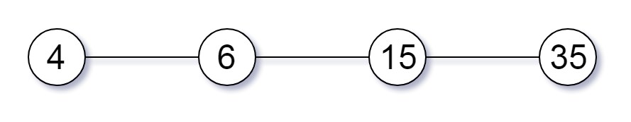
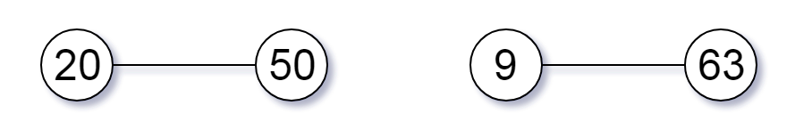
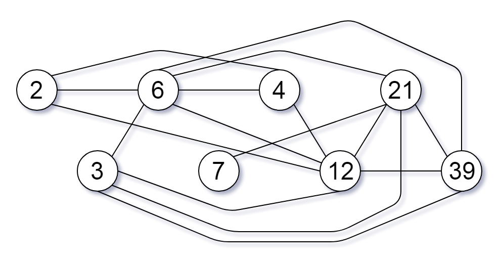

# [952. Largest Component Size by Common Factor](https://leetcode.com/problems/largest-component-size-by-common-factor/)

| Category | Difficulty | Likes | Dislikes |
| :------: | :--------: | :---: | :------: |
| Algorithms | Hard | 1707 | 95 |

**Tags:** [`array`](https://leetcode.com/tag/array), [`hash-table`](https://leetcode.com/tag/hash-table), [`math`](https://leetcode.com/tag/math), [`union-find`](https://leetcode.com/tag/union-find), [`number-theory`](https://leetcode.com/tag/number-theory)

**Companies:** `google`

## Description

You are given an integer array of unique positive integers `nums`. Consider the following graph:

	- There are `nums.length` nodes, labeled `nums[0]` to `nums[nums.length - 1]`,

	- There is an undirected edge between `nums[i]` and `nums[j]` if `nums[i]` and `nums[j]` share a common factor greater than `1`.

Return *the size of the largest connected component in the graph*.

 

**Example 1:**


```

Input: nums = [4,6,15,35]
Output: 4

```

**Example 2:**


```

Input: nums = [20,50,9,63]
Output: 2

```

**Example 3:**


```

Input: nums = [2,3,6,7,4,12,21,39]
Output: 8

```

 

**Constraints:**

	- `1 <= nums.length <= 2 * 10^4`

	- `1 <= nums[i] <= 10^5`

	- All the values of `nums` are **unique**.

---

**Links:** [Submissions](https://leetcode.com/problems/largest-component-size-by-common-factor/) | [Solutions](https://leetcode.com/problems/largest-component-size-by-common-factor/)
