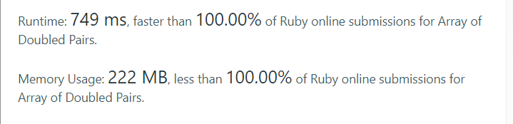
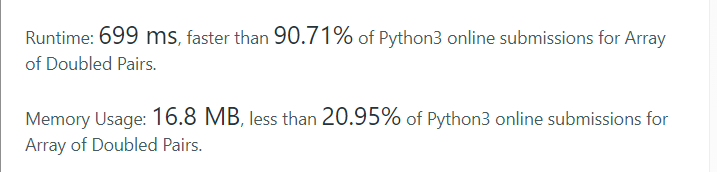

# ✔ | [Ruby, Python, Cpp] | Self Explanatory Code

**Author:** code_alone
**Votes:** 0
**Link:** [https://leetcode.com/problems/array-of-doubled-pairs/solutions/2580451/](https://leetcode.com/problems/array-of-doubled-pairs/solutions/2580451/)

---



------------------------------------------
# Ruby Code
```
def can_reorder_doubled(arr)
  hash = {};
  hash.default = 0;
  count = 0;
    
  arr.sort_by { |x| x.abs }.each do |x|
    if hash.key? x 
      count += 1;
      hash[x] -= 1;
      hash.delete(x) if (hash[x]).zero?;
    else
      hash[2*x] += 1;
    end
  end
    
  count == (arr.length / 2);
    
end
```

----------------------------------------------------


------------------------------------
# Python Code

```
class Solution:
    def canReorderDoubled(self, arr: List[int]) -> bool:
        hash = defaultdict(int)
        count = 0
        
        for x in sorted(arr, key = lambda a: abs(a)):
            if x in hash :
                count += 1
                hash[x] -= 1
                if not hash[x] : del hash[x]
            else : hash[2*x] += 1
        
        
        return count == len(arr)//2
```

---------------------------------
# C++ Code
```
class Solution {
public:
    bool canReorderDoubled(vector<int>& arr) {
        sort(begin(arr), end(arr), [](auto& a, auto& b){ return abs(a) < abs(b); });
        
        unordered_map<int,int> um;
        int count = 0;
        
        for(int& n : arr) {
            if ( um[n] ) {
                count++;
                um[n]--;
                if(!um[n]) um.erase(n);
            }else {
                um[2*n] += 1;
            }
        }
        
        return count == arr.size() / 2;
    }
};
```