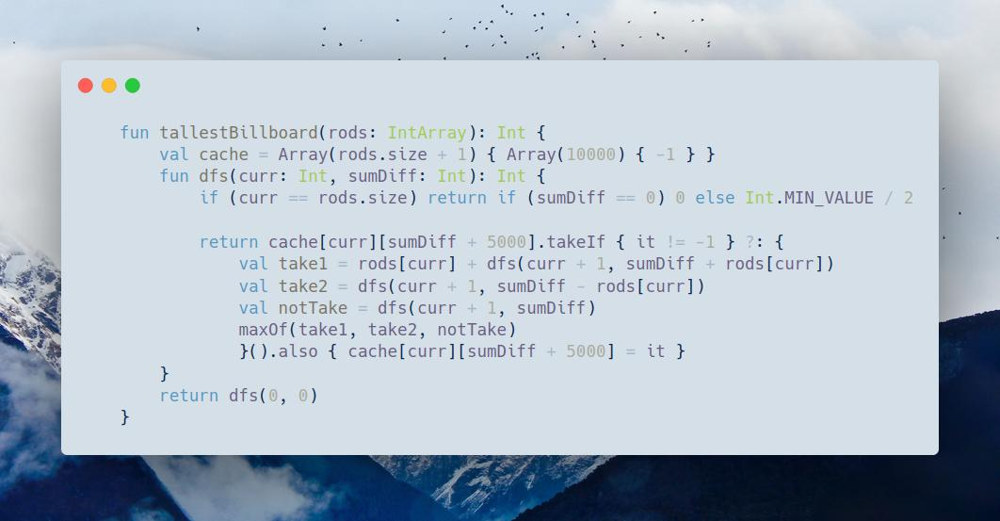

# Kotlin | dfs + memo + hard trick

**Author:** SamoylenkoDmitry
**Votes:** 1
**Link:** [https://leetcode.com/problems/tallest-billboard/solutions/3675652/](https://leetcode.com/problems/tallest-billboard/solutions/3675652/)

---



#### Join me on Telegram
https://t.me/leetcode_daily_unstoppable/255
#### Problem TLDR
Max sum of disjoint set in array
#### Intuition
Naive Dynamic Programming solution is to do a full search, adding to the first and to the second sums. That will give Out of Memory for this problem constraints.
```
dp[i][firstSum][secondSum] -> Out of Memory
```
The trick to make it work and consume less memory, is to cache only the difference `firstSum - secondSum`. It will slightly modify the code, but the principle is the same: try to add to the first, then to the second, otherwise skip. 

#### Approach
* we can compute the first sum, as when `diff == 0` then `sum1 == sum2`
#### Complexity
- Time complexity:
$$O(nm)$$, `m` is a max difference
- Space complexity:
$$O(nm)$$
#### Code
```

    fun tallestBillboard(rods: IntArray): Int {
        val cache = Array(rods.size + 1) { Array(10000) { -1 } }
        fun dfs(curr: Int, sumDiff: Int): Int {
            if (curr == rods.size) return if (sumDiff == 0) 0 else Int.MIN_VALUE / 2

            return cache[curr][sumDiff + 5000].takeIf { it != -1 } ?: {
                val take1 = rods[curr] + dfs(curr + 1, sumDiff + rods[curr])
                val take2 = dfs(curr + 1, sumDiff - rods[curr])
                val notTake = dfs(curr + 1, sumDiff)
                maxOf(take1, take2, notTake)
                }().also { cache[curr][sumDiff + 5000] = it }
        }
        return dfs(0, 0)
    }

```