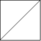
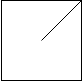
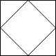

# [959. Regions Cut By Slashes](https://leetcode.com/problems/regions-cut-by-slashes/)

| Category | Difficulty | Likes | Dislikes |
| :------: | :--------: | :---: | :------: |
| Algorithms | Medium | 3973 | 871 |

**Tags:** [`array`](https://leetcode.com/tag/array), [`hash-table`](https://leetcode.com/tag/hash-table), [`depth-first-search`](https://leetcode.com/tag/depth-first-search), [`breadth-first-search`](https://leetcode.com/tag/breadth-first-search), [`union-find`](https://leetcode.com/tag/union-find), [`matrix`](https://leetcode.com/tag/matrix)

**Companies:** `tiktok`, `amazon`, `google`, `facebook`, `bloomberg`, `uber`

## Description

An `n x n` grid is composed of `1 x 1` squares where each `1 x 1` square consists of a `'/'`, `'\'`, or blank space `' '`. These characters divide the square into contiguous regions.

Given the grid `grid` represented as a string array, return *the number of regions*.

Note that backslash characters are escaped, so a `'\'` is represented as `'\\'`.

 

**Example 1:**


```

Input: grid = [&quot; /&quot;,&quot;/ &quot;]
Output: 2

```

**Example 2:**


```

Input: grid = [&quot; /&quot;,&quot;  &quot;]
Output: 1

```

**Example 3:**


```

Input: grid = [&quot;/\\&quot;,&quot;\\/&quot;]
Output: 5
Explanation: Recall that because \ characters are escaped, &quot;\\/&quot; refers to \/, and &quot;/\\&quot; refers to /\.

```

 

**Constraints:**

	- `n == grid.length == grid[i].length`

	- `1 <= n <= 30`

	- `grid[i][j]` is either `'/'`, `'\'`, or `' '`.

---

**Links:** [Submissions](https://leetcode.com/problems/regions-cut-by-slashes/) | [Solutions](https://leetcode.com/problems/regions-cut-by-slashes/)
