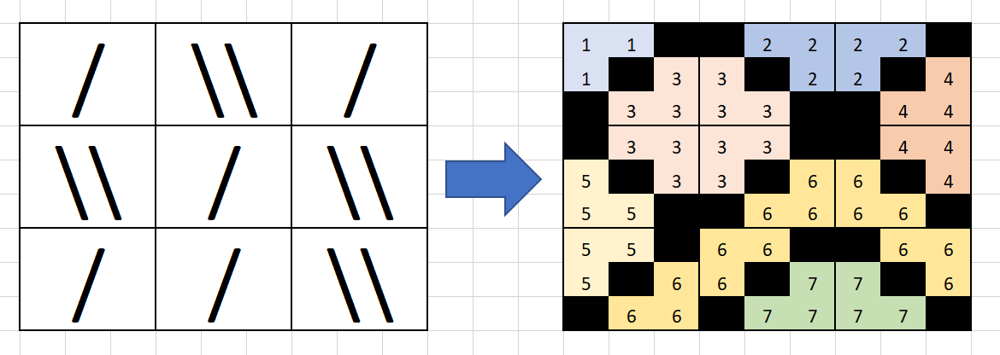

# DFS on upscaled grid

**Author:** votrubac
**Votes:** 940
**Link:** [https://leetcode.com/problems/regions-cut-by-slashes/solutions/205674/](https://leetcode.com/problems/regions-cut-by-slashes/solutions/205674/)

---

We can upscale the input grid to `[n * 3][n * 3]` grid and draw "lines" there. Then, we can paint empty regions using DFS and count them. Picture below says it all. Note that `[n * 2][n * 2]`  grid does not work as "lines" are too thick to identify empty areas correctly.

> This transform this problem into [200. Number of Islands](https://leetcode.com/problems/number-of-islands/), where lines ('1') are the water, and rest ('0') is the land.

I came up with this solution after I drew a few examples, and because I was lazy and saw it as an easy way. 



**C++**
```
int dfs(vector<vector<int>> &g, int i, int j) {
    if (min(i, j) < 0 || max(i, j) >= g.size() || g[i][j] != 0)
        return 0;
    g[i][j] = 1;
    return 1 + dfs(g, i - 1, j) + dfs(g, i + 1, j) + dfs(g, i, j - 1) + dfs(g, i, j + 1);
}
int regionsBySlashes(vector<string>& grid) {
    int n = grid.size(), regions = 0;
    vector<vector<int>> g(n * 3, vector<int>(n * 3, 0));
    for (int i = 0; i < n; ++i)
        for (int j = 0; j < n; ++j)
            if (grid[i][j] == '/') 
                g[i * 3][j * 3 + 2] = g[i * 3 + 1][j * 3 + 1] = g[i * 3 + 2][j * 3] = 1;
            else if (grid[i][j] == '\\\\') 
                g[i * 3][j * 3] = g[i * 3 + 1][j * 3 + 1] = g[i * 3 + 2][j * 3 + 2] = 1;
    for (int i = 0; i < n * 3; ++i)
        for (int j = 0; j < n * 3; ++j)
            regions += dfs(g, i, j) ? 1 : 0;    
    return regions;
}
```
**Java**
```java
int dfs(int[][] g, int i, int j) {
    if (Math.min(i, j) < 0 || Math.max(i, j) >= g.length || g[i][j] != 0)
        return 0;
    g[i][j] = 1;
    return 1 + dfs(g, i - 1, j) + dfs(g, i + 1, j) + dfs(g, i, j - 1) + dfs(g, i, j + 1);
}    
public int regionsBySlashes(String[] grid) {
    int n = grid.length, regions = 0;
    int[][] g = new int[n * 3][n * 3];
    for (int i = 0; i < n; ++i)
        for (int j = 0; j < n; ++j)
            if (grid[i].charAt(j) == '/') 
                g[i * 3][j * 3 + 2] = g[i * 3 + 1][j * 3 + 1] = g[i * 3 + 2][j * 3] = 1;
            else if (grid[i].charAt(j) == '\\\\') 
                g[i * 3][j * 3] = g[i * 3 + 1][j * 3 + 1] = g[i * 3 + 2][j * 3 + 2] = 1;
    for (int i = 0; i < n * 3; ++i)
        for (int j = 0; j < n * 3; ++j)
            regions += dfs(g, i, j) > 0 ? 1 : 0;        
    return regions;
}
```
**Python 3**
```python
class Solution:
    def regionsBySlashes(self, grid: List[str]) -> int:
        def dfs(i: int, j: int) -> int:
            if min(i, j) < 0 or max(i, j) >= len(g) or g[i][j] != 0:
                return 0
            g[i][j] = 1
            return 1 + dfs(i - 1, j) + dfs(i + 1, j) + dfs(i, j - 1) + dfs(i, j + 1)
        n, regions  = len(grid), 0
        g = [[0] * n * 3 for i in range(n * 3)]
        for i in range(n):
            for j in range(n):
                if grid[i][j] == '/':
                    g[i * 3][j * 3 + 2] = g[i * 3 + 1][j * 3 + 1] = g[i * 3 + 2][j * 3] = 1
                elif grid[i][j] == '\\\\':
                    g[i * 3][j * 3] = g[i * 3 + 1][j * 3 + 1] = g[i * 3 + 2][j * 3 + 2] = 1
        for i in range(n * 3):
            for j in range(n * 3):
                regions += 1 if dfs(i, j) > 0 else 0
        return regions
```