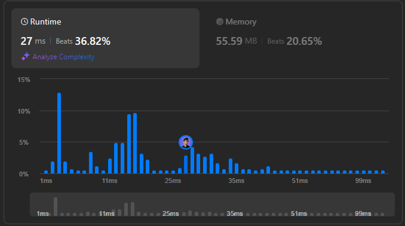

# 🌟 Fastest Way to Solve Maximum Width Ramp! 💯🔥

**Author:** withaarzoo
**Votes:** 168
**Link:** [https://leetcode.com/problems/maximum-width-ramp/solutions/5893635/](https://leetcode.com/problems/maximum-width-ramp/solutions/5893635/)

---


## **Access daily LeetCode Solutions Repo :** [click here](https://github.com/withaarzoo/LeetCode-Solutions)

---



---

# Intuition
The problem asks to find the maximum width of a ramp `(i, j)` such that `i < j` and `nums[i] <= nums[j]`. A brute-force approach would be to check every possible pair, but this would be inefficient for large arrays. The key observation is that we can use a **monotonic decreasing stack** to store potential candidates for `i`, and then we iterate from the back of the array to find the largest possible `j`.

---

# Approach
1. **Monotonic Stack**: We traverse the array and maintain a stack of indices where the values of `nums` are in decreasing order. This ensures that when we later iterate over the array from right to left, we can quickly find an index `i` such that `nums[i] <= nums[j]`.
   
2. **Finding the Maximum Width**: Starting from the rightmost index `j`, for each index, we pop from the stack until the top of the stack has an index `i` where `nums[i] <= nums[j]`. We then compute the width `j - i` and update the maximum width.

# Complexity
- **Time Complexity**: The time complexity is $$O(n)$$ where `n` is the length of the `nums` array. We traverse the array twice: once to build the stack and once to compute the maximum width.
- **Space Complexity**: The space complexity is $$O(n)$$ because we are using a stack to store the indices.

---

# Code
```C++ []
class Solution {
public:
    int maxWidthRamp(vector<int>& nums) {
        int n = nums.size();
        stack<int> s;
        
        // Step 1: Build a decreasing stack of indices
        for (int i = 0; i < n; ++i) {
            if (s.empty() || nums[s.top()] > nums[i]) {
                s.push(i);
            }
        }
        
        int maxWidth = 0;
        
        // Step 2: Traverse from the end and find maximum width ramp
        for (int j = n - 1; j >= 0; --j) {
            while (!s.empty() && nums[s.top()] <= nums[j]) {
                maxWidth = max(maxWidth, j - s.top());
                s.pop();
            }
        }
        
        return maxWidth;
    }
};

```
```Java []
class Solution {
    public int maxWidthRamp(int[] nums) {
        int n = nums.length;
        Stack<Integer> stack = new Stack<>();
        
        // Step 1: Build a decreasing stack of indices
        for (int i = 0; i < n; ++i) {
            if (stack.isEmpty() || nums[stack.peek()] > nums[i]) {
                stack.push(i);
            }
        }
        
        int maxWidth = 0;
        
        // Step 2: Traverse from the end and find maximum width ramp
        for (int j = n - 1; j >= 0; --j) {
            while (!stack.isEmpty() && nums[stack.peek()] <= nums[j]) {
                maxWidth = Math.max(maxWidth, j - stack.pop());
            }
        }
        
        return maxWidth;
    }
}

```
```JavaScript []
/**
 * @param {number[]} nums
 * @return {number}
 */
var maxWidthRamp = function(nums) {
    let n = nums.length;
    let stack = [];
    
    // Step 1: Build a decreasing stack of indices
    for (let i = 0; i < n; i++) {
        if (stack.length === 0 || nums[stack[stack.length - 1]] > nums[i]) {
            stack.push(i);
        }
    }
    
    let maxWidth = 0;
    
    // Step 2: Traverse from the end and find maximum width ramp
    for (let j = n - 1; j >= 0; j--) {
        while (stack.length > 0 && nums[stack[stack.length - 1]] <= nums[j]) {
            maxWidth = Math.max(maxWidth, j - stack.pop());
        }
    }
    
    return maxWidth;
};

```
```Python []
class Solution:
    def maxWidthRamp(self, nums: List[int]) -> int:
        n = len(nums)
        stack = []
        
        # Step 1: Build a decreasing stack of indices
        for i in range(n):
            if not stack or nums[stack[-1]] > nums[i]:
                stack.append(i)
        
        maxWidth = 0
        
        # Step 2: Traverse from the end and find maximum width ramp
        for j in range(n - 1, -1, -1):
            while stack and nums[stack[-1]] <= nums[j]:
                maxWidth = max(maxWidth, j - stack.pop())
        
        return maxWidth

```
```Go []
func maxWidthRamp(nums []int) int {
    n := len(nums)
    stack := []int{}
    
    // Step 1: Build a decreasing stack of indices
    for i := 0; i < n; i++ {
        if len(stack) == 0 || nums[stack[len(stack)-1]] > nums[i] {
            stack = append(stack, i)
        }
    }
    
    maxWidth := 0
    
    // Step 2: Traverse from the end and find maximum width ramp
    for j := n - 1; j >= 0; j-- {
        for len(stack) > 0 && nums[stack[len(stack)-1]] <= nums[j] {
            i := stack[len(stack)-1]
            stack = stack[:len(stack)-1]
            if j - i > maxWidth {
                maxWidth = j - i
            }
        }
    }
    
    return maxWidth
}

```

---

# Step-by-Step Detailed Explanation
1. **Monotonic Stack Construction**: 
   - We iterate through the array from left to right, and for every index `i`, if the stack is empty or `nums[i]` is less than the value at the index on the top of the stack, we push the index `i` onto the stack. This helps to maintain a decreasing sequence of indices in terms of their `nums` values.
   
2. **Finding Maximum Width**:
   - After building the stack, we iterate the array from the end (`j = n - 1`) to the beginning. For each index `j`, we pop from the stack while the top of the stack has an index `i` such that `nums[i] <= nums[j]`. For every valid ramp, we calculate the width `j - i` and update the maximum width.
   
3. **Result**: Once we've traversed the array, the maximum width will be stored in the `maxWidth` variable.

---


