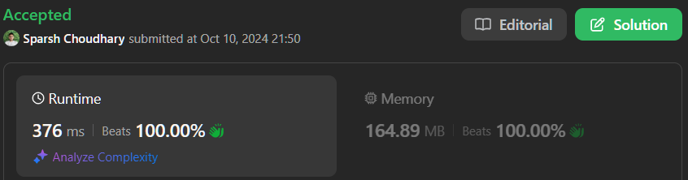

# 🔥BEATS 💯 % 🎯 |✨SUPER EASY BEGINNERS 👏

**Author:** CodeWithSparsh
**Votes:** 2
**Link:** [https://leetcode.com/problems/maximum-width-ramp/solutions/5896333/](https://leetcode.com/problems/maximum-width-ramp/solutions/5896333/)

---



---

# Intuition
A "ramp" is defined as a pair `(i, j)` such that `i < j` and `nums[i] <= nums[j]`. To find the maximum width ramp, we need to scan the array and identify the largest `j - i` for which the condition holds.

---

# Approach
1. **Stack for Decreasing Order**: 
   - We use a stack to keep track of indices where the elements are in decreasing order (i.e., `nums[stack[i]]` in decreasing order). This helps in finding the smallest `i` for the largest `j` efficiently.
   
2. **Backward Traversal**:
   - We traverse the array from the end and for each `j`, check if any index `i` in the stack satisfies `nums[i] <= nums[j]`. This ensures the maximum ramp width is found by subtracting indices.
   
3. **Maximizing Ramp Width**:
   - During the backward traversal, for each valid `i`, we compute the ramp width and track the maximum.

---

# Complexity
- **Time Complexity**: \\(O(n)\\), where \\(n\\) is the length of the array. We traverse the array twice, once to build the stack and once to check for ramps.
- **Space Complexity**: \\(O(n)\\), for the stack used to store indices.

---

```dart []
class Solution {
  int maxWidthRamp(List<int> nums) {
    List<int> stack = [];

    // Build the stack with indices where nums[stack[i]] is in decreasing order
    for (int i = 0; i < nums.length; i++) {
      if (stack.isEmpty || nums[stack.last] > nums[i]) {
        stack.add(i);
      }
    }

    int maxRampWidth = 0;

    // Traverse the array backward to check for valid ramps
    for (int j = nums.length - 1; j >= 0; j--) {
      while (stack.isNotEmpty && nums[stack.last] <= nums[j]) {
        maxRampWidth = max(maxRampWidth, j - stack.last);
        stack.removeLast();
      }
    }

    return maxRampWidth;
  }
}
```

```c []
#include <stdio.h>

int max(int a, int b) {
    return (a > b) ? a : b;
}

int maxWidthRamp(int* nums, int numsSize) {
    int stack[numsSize], top = -1;
    int maxRampWidth = 0;

    // Build stack in decreasing order
    for (int i = 0; i < numsSize; i++) {
        if (top == -1 || nums[stack[top]] > nums[i]) {
            stack[++top] = i;
        }
    }

    // Traverse backward and check ramps
    for (int j = numsSize - 1; j >= 0; j--) {
        while (top >= 0 && nums[stack[top]] <= nums[j]) {
            maxRampWidth = max(maxRampWidth, j - stack[top--]);
        }
    }

    return maxRampWidth;
}

int main() {
    int nums[] = {6, 0, 8, 2, 1, 5};
    int size = sizeof(nums) / sizeof(nums[0]);
    printf("Maximum Width Ramp: %d\
", maxWidthRamp(nums, size));
    return 0;
}
```

```cpp []
class Solution {
public:
    int maxWidthRamp(vector<int>& nums) {
        vector<int> stack;
        
        // Build the stack with decreasing values
        for (int i = 0; i < nums.size(); i++) {
            if (stack.empty() || nums[stack.back()] > nums[i]) {
                stack.push_back(i);
            }
        }

        int maxRampWidth = 0;
        
        // Traverse backward and find ramps
        for (int j = nums.size() - 1; j >= 0; j--) {
            while (!stack.empty() && nums[stack.back()] <= nums[j]) {
                maxRampWidth = max(maxRampWidth, j - stack.back());
                stack.pop_back();
            }
        }

        return maxRampWidth;
    }
};
```

```java []
class Solution {
    public int maxWidthRamp(int[] nums) {
        Stack<Integer> stack = new Stack<>();

        // Build stack of indices where nums[stack[i]] is decreasing
        for (int i = 0; i < nums.length; i++) {
            if (stack.isEmpty() || nums[stack.peek()] > nums[i]) {
                stack.push(i);
            }
        }

        int maxRampWidth = 0;

        // Traverse backward to find valid ramps
        for (int j = nums.length - 1; j >= 0; j--) {
            while (!stack.isEmpty() && nums[stack.peek()] <= nums[j]) {
                maxRampWidth = Math.max(maxRampWidth, j - stack.pop());
            }
        }

        return maxRampWidth;
    }
}
```

```javascript []
var maxWidthRamp = function(nums) {
    let stack = [];

    // Build stack in decreasing order
    for (let i = 0; i < nums.length; i++) {
        if (stack.length === 0 || nums[stack[stack.length - 1]] > nums[i]) {
            stack.push(i);
        }
    }

    let maxRampWidth = 0;

    // Traverse backward to find valid ramps
    for (let j = nums.length - 1; j >= 0; j--) {
        while (stack.length > 0 && nums[stack[stack.length - 1]] <= nums[j]) {
            maxRampWidth = Math.max(maxRampWidth, j - stack.pop());
        }
    }

    return maxRampWidth;
};
```

```python []
class Solution:
    def maxWidthRamp(self, nums: List[int]) -> int:
        stack = []
        
        # Build stack of indices with decreasing nums values
        for i, num in enumerate(nums):
            if not stack or nums[stack[-1]] > num:
                stack.append(i)

        maxRampWidth = 0
        
        # Traverse backward to find valid ramps
        for j in range(len(nums) - 1, -1, -1):
            while stack and nums[stack[-1]] <= nums[j]:
                maxRampWidth = max(maxRampWidth, j - stack.pop())
        
        return maxRampWidth
```

```go []
func maxWidthRamp(nums []int) int {
    stack := []int{}

    // Build stack with decreasing values
    for i := 0; i < len(nums); i++ {
        if len(stack) == 0 || nums[stack[len(stack)-1]] > nums[i] {
            stack = append(stack, i)
        }
    }

    maxRampWidth := 0

    // Traverse backward to find valid ramps
    for j := len(nums) - 1; j >= 0; j-- {
        for len(stack) > 0 && nums[stack[len(stack)-1]] <= nums[j] {
            maxRampWidth = max(maxRampWidth, j - stack[len(stack)-1])
            stack = stack[:len(stack)-1]
        }
    }

    return maxRampWidth
}

func max(a, b int) int {
    if a > b {
        return a
    }
    return b
}
```

---

 {:style='width:250px'}