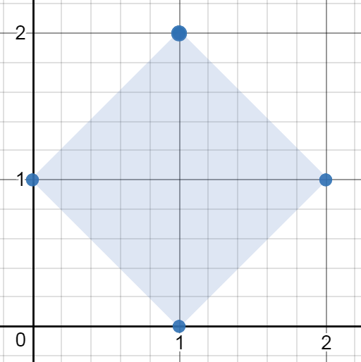
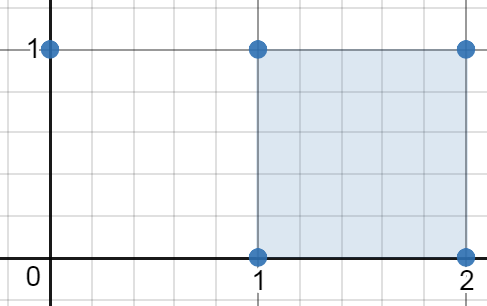
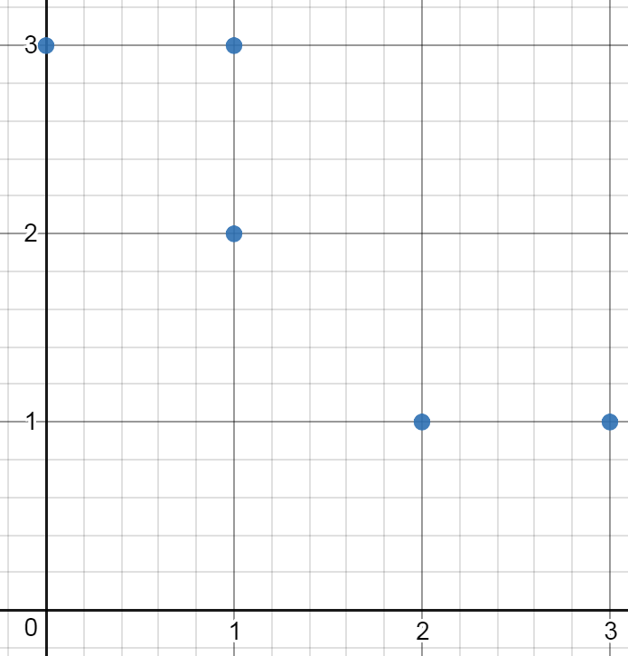

# [963. Minimum Area Rectangle II](https://leetcode.com/problems/minimum-area-rectangle-ii/)

| Category | Difficulty | Likes | Dislikes |
| :------: | :--------: | :---: | :------: |
| Algorithms | Medium | 411 | 483 |

**Tags:** [`array`](https://leetcode.com/tag/array), [`hash-table`](https://leetcode.com/tag/hash-table), [`math`](https://leetcode.com/tag/math), [`geometry`](https://leetcode.com/tag/geometry)

**Companies:** `google`

## Description

You are given an array of points in the **X-Y** plane `points` where `points[i] = [x_i, y_i]`.

Return *the minimum area of any rectangle formed from these points, with sides **not necessarily parallel** to the X and Y axes*. If there is not any such rectangle, return `0`.

Answers within `10^-5` of the actual answer will be accepted.

 

**Example 1:**


```

Input: points = [[1,2],[2,1],[1,0],[0,1]]
Output: 2.00000
Explanation: The minimum area rectangle occurs at [1,2],[2,1],[1,0],[0,1], with an area of 2.

```

**Example 2:**


```

Input: points = [[0,1],[2,1],[1,1],[1,0],[2,0]]
Output: 1.00000
Explanation: The minimum area rectangle occurs at [1,0],[1,1],[2,1],[2,0], with an area of 1.

```

**Example 3:**


```

Input: points = [[0,3],[1,2],[3,1],[1,3],[2,1]]
Output: 0
Explanation: There is no possible rectangle to form from these points.

```

 

**Constraints:**

	- `1 <= points.length <= 50`

	- `points[i].length == 2`

	- `0 <= x_i, y_i <= 4 * 10^4`

	- All the given points are **unique**.

---

**Links:** [Submissions](https://leetcode.com/problems/minimum-area-rectangle-ii/) | [Solutions](https://leetcode.com/problems/minimum-area-rectangle-ii/)
