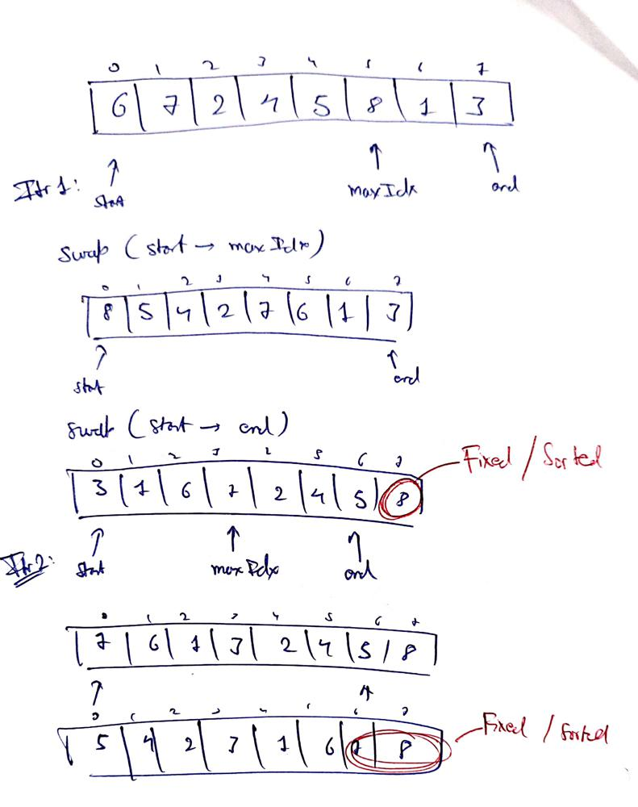

# C++ | Easy to Understand | Diagram

**Author:** Zyro9922
**Votes:** 8
**Link:** [https://leetcode.com/problems/pancake-sorting/solutions/2042838/](https://leetcode.com/problems/pancake-sorting/solutions/2042838/)

---




```
class Solution {
public:
    vector<int> pancakeSort(vector<int>& arr) {
        vector<int> result;
        int start = 0, end = arr.size() - 1;
        while(start < end){
            int maxIdx = 0;
            int maxVal = 0;
            for(int i = start; i <= end; i++){
                if(arr[i] > maxVal){
                    maxIdx = i;
                    maxVal = arr[i];
                }
            }
            //swap start to maxIdx
            int lo = start, hi = maxIdx;
            result.push_back(maxIdx + 1);
            while(lo < hi) swap(arr[lo++], arr[hi--]);
            //swap start to end
            lo = start, hi = end;
            while(lo < hi) swap(arr[lo++], arr[hi--]);
            result.push_back(end + 1);
            --end;
        }
        return result;
    }
};
```