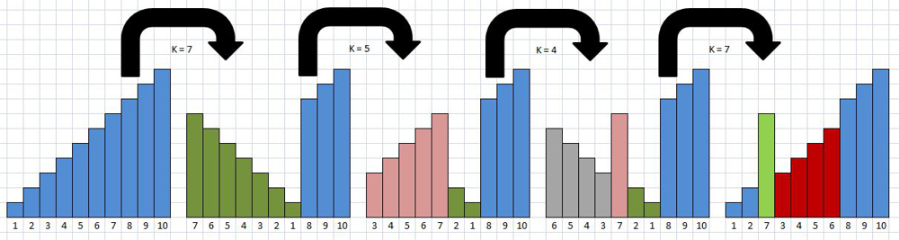
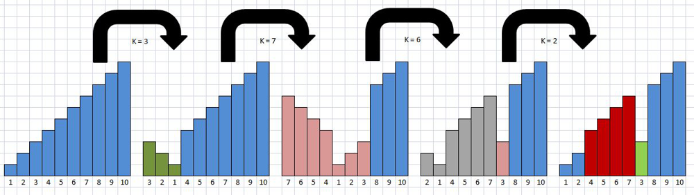
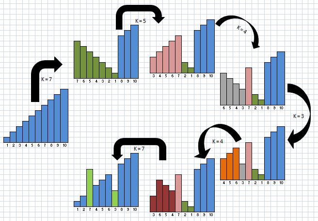

# Dew It | True O(n) | Explained with Diagrams

**Author:** captain_jackked
**Votes:** 111
**Link:** [https://leetcode.com/problems/pancake-sorting/solutions/494417/](https://leetcode.com/problems/pancake-sorting/solutions/494417/)

---

**THE APPROACH**
Imagine a 10 sized array. What happens if we try to move the element from index 7 to index 3 using only Pancake Flips?



You can see that this can be done in 4 steps. Perhaps we could just move elements individually to their correct indices.

However, we will not directly use this as a fundamental operation because it messes up the indices of elements 3 to 6. If we use this for moving each of the elements, we will end up taking O(N2) time to find the solution.

We see a similar side-effect when moving 3 to 7.



**HOWEVER**
* What happens if we exchange 3 and 7?
a. Move 7 to index 3 (as shown above): 3 is now at index 4
b. Move 3 to index 7
* 4, 5 and 6 jump forward in one operation and jump backward in the other: effectively making the swap without side effects
* With a tiny bit of playing around, we can actually optimize the number of steps and bring 8 (4 + 4) down to 6



**IMPLEMENTATION**
* Use a map to find indices of each of the elements 1 to n in the given array
* Loop through positions 0 to n-1: for each index i, swap element at i with element at j
where j is the index of (i+1): use the index map from previous step

**MORE OPTIMZATION**
* If we find the same Pancake Flip occuring as adjacent operations, let them cancel each other out
* Skip Pancake Flips with K = 0 or 1

**THE CODE**
```
class Solution {
    public List<Integer> pancakeSort(int[] arr) {
        Stack<Integer> stack = new Stack<>();
        int n = arr.length;
        int[] indices = new int[n];
        for(int i=0; i<n; ++i) indices[arr[i]-1] = i;
        for(int i=0; i<n; ++i) {
            int pull = indices[i];
            dew(stack, i, pull);
            indices[arr[i]-1] = pull;
            indices[i] = i;
            arr[pull] = arr[i];
            arr[i] = i+1;
        }
        LinkedList<Integer> ans = new LinkedList<>();
        while(!stack.isEmpty()) {
            int x = stack.pop();
            ans.addFirst(x);
        }
        return ans;
    }
    
    private void dew(Stack<Integer> stack, int j, int i) {
        if(i != j) {
            add(stack, i+1);
            add(stack, i-j+1);
            add(stack, i-j);
            add(stack, i-j-1);
            add(stack, i-j);
            add(stack, i+1);
        }
    }
    
    private void add(Stack<Integer> stack, int x) {
        if(x > 1) {
            if(!stack.isEmpty() && stack.peek() == x) stack.pop();
            else stack.push(x);
        }
    }
}