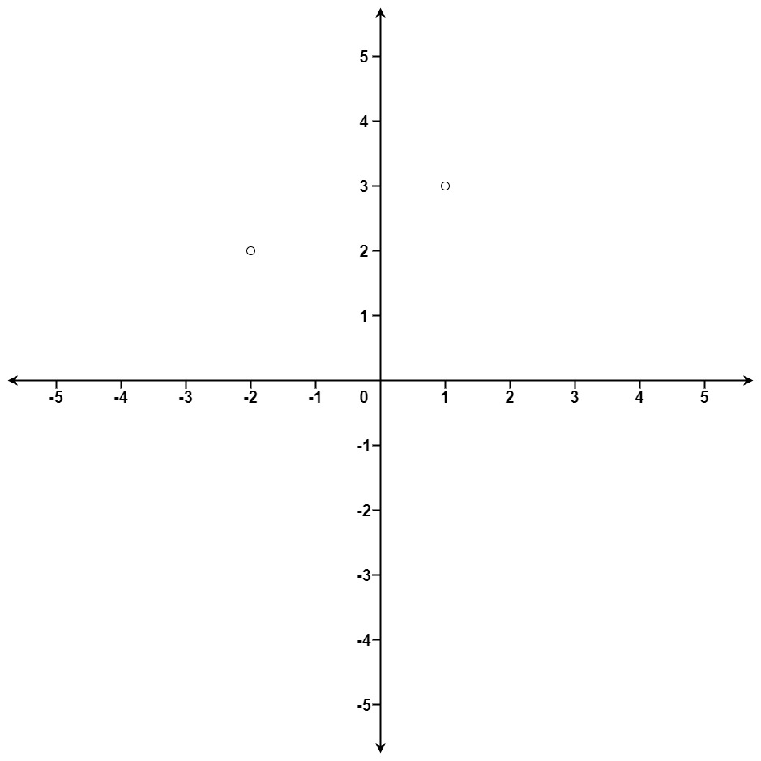

# [973. K Closest Points to Origin](https://leetcode.com/problems/k-closest-points-to-origin/)

| Category | Difficulty | Likes | Dislikes |
| :------: | :--------: | :---: | :------: |
| Algorithms | Medium | 8953 | 335 |

**Tags:** [`array`](https://leetcode.com/tag/array), [`math`](https://leetcode.com/tag/math), [`divide-and-conquer`](https://leetcode.com/tag/divide-and-conquer), [`geometry`](https://leetcode.com/tag/geometry), [`sorting`](https://leetcode.com/tag/sorting), [`heap-priority-queue`](https://leetcode.com/tag/heap-priority-queue), [`quickselect`](https://leetcode.com/tag/quickselect)

**Companies:** `facebook`, `asana`, `amazon`, `google`, `linkedin`, `apple`, `microsoft`, `oracle`, `salesforce`, `wix`

## Description

Given an array of `points` where `points[i] = [x_i, y_i]` represents a point on the **X-Y** plane and an integer `k`, return the `k` closest points to the origin `(0, 0)`.

The distance between two points on the **X-Y** plane is the Euclidean distance (i.e., `&radic;(x_1 - x_2)^2 + (y_1 - y_2)^2`).

You may return the answer in **any order**. The answer is **guaranteed** to be **unique** (except for the order that it is in).

 

**Example 1:**


```

Input: points = [[1,3],[-2,2]], k = 1
Output: [[-2,2]]
Explanation:
The distance between (1, 3) and the origin is sqrt(10).
The distance between (-2, 2) and the origin is sqrt(8).
Since sqrt(8) &lt; sqrt(10), (-2, 2) is closer to the origin.
We only want the closest k = 1 points from the origin, so the answer is just [[-2,2]].

```

**Example 2:**

```

Input: points = [[3,3],[5,-1],[-2,4]], k = 2
Output: [[3,3],[-2,4]]
Explanation: The answer [[-2,4],[3,3]] would also be accepted.

```

 

**Constraints:**

	- `1 <= k <= points.length <= 10^4`

	- `-10^4 <= x_i, y_i <= 10^4`

---

**Links:** [Submissions](https://leetcode.com/problems/k-closest-points-to-origin/) | [Solutions](https://leetcode.com/problems/k-closest-points-to-origin/)
