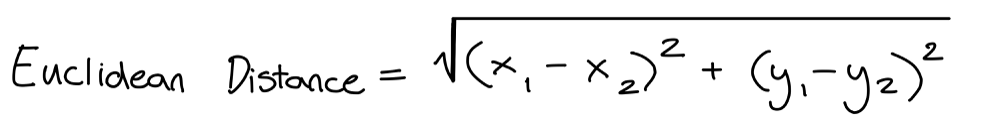
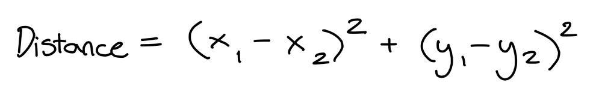
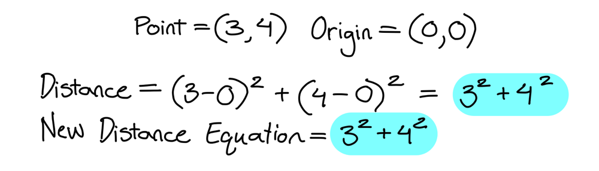
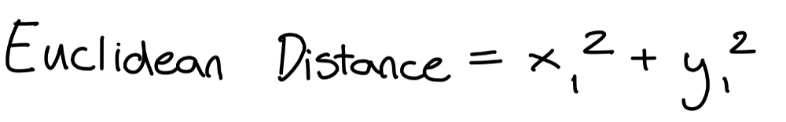
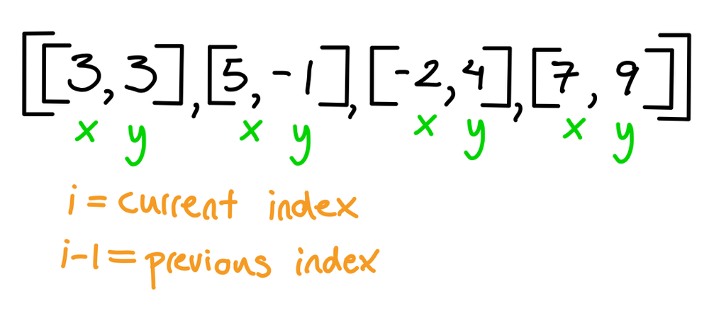
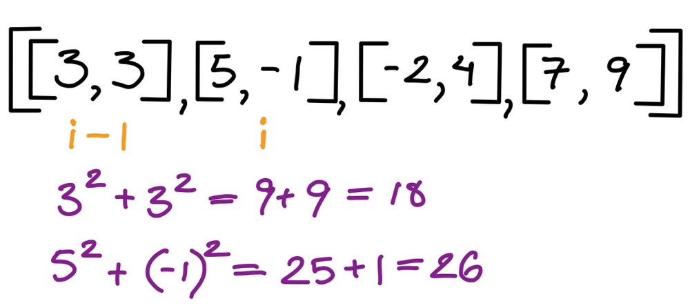
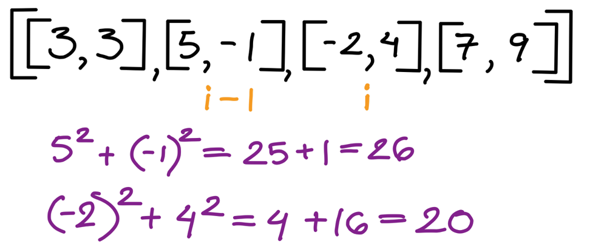
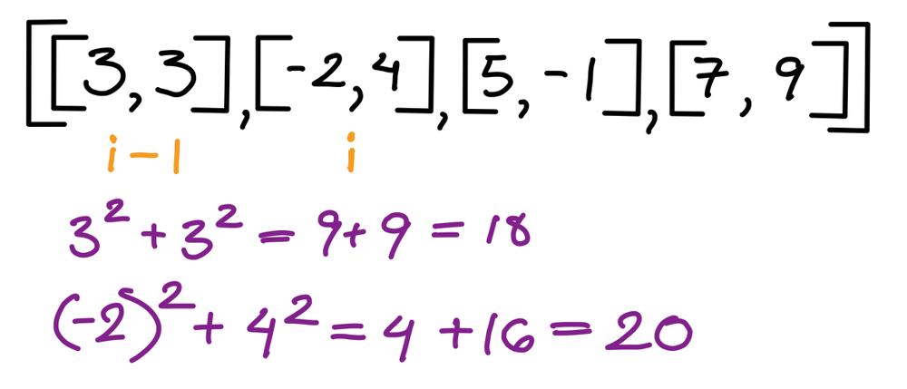
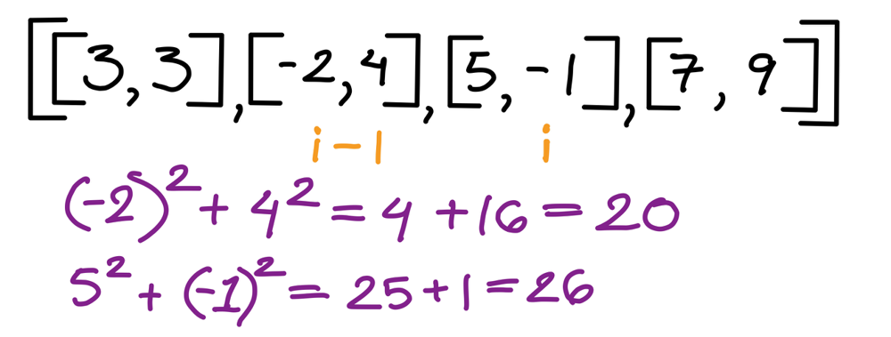
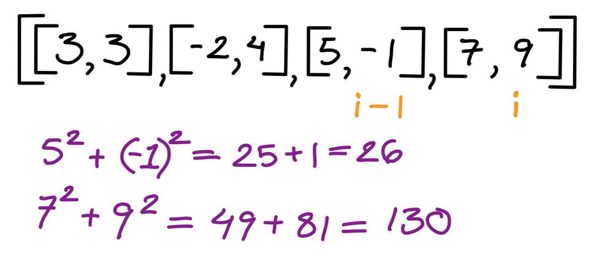

# Golang solution with explanation and images

**Author:** nathannaveen
**Votes:** 5
**Link:** [https://leetcode.com/problems/k-closest-points-to-origin/solutions/1098260/](https://leetcode.com/problems/k-closest-points-to-origin/solutions/1098260/)

---

**Code on The Bottom, If This helps Please Up Vote**

**The New Distance Formula:**

The Euclidean Distance Formula equals (I have drawn this in a picture because the symbols don't aline up when writen up in text)




This can be simplifyed by taking out the square root. We can take out the square root because we are not finding the minimum distance but the point with the minimum distance, and the distance doesn't need to be square rooted. The distance not needing to be square rooted can be shown by doing an experiment, for example let us take the square root of 10 and the square root of 8, we know that the square root of 10 will allways be greater than the square root of 8. We also know that 10 will always be greater than 8. Try this with any two positive numbers. *Note: I said positve numbers because any square number is positive.*

So now our equation for the distance is:




We can simplify the equation again by taking out the x2 and the y2 because x2 and y2 will always be `0`. X2 and y2 will always be `0` because the first point is a regular point, but the second point will be `(0, 0)` because the second point will always be the origin. This can by shown by an example:




So the new distance equation is:




****

**The Idea Of This Solution:**

Now that we know that we know the distance formula for this problem is `x^2 + y^2` we just have to sort the matrix array. 

The way we sort the array is we check whether the current distance is smaller than the the previous distance, then if so we switch the two points, then we move back a space, to check whether the previous value is greater than the current value. This can be show by the following example:







We do nothing because `18 < 26`. So we continue:




`26` is greater than `20` so we have to switch them. We also have to subtract `2` from `i`. `i` will only go back by `1` even though we subtract `2` from `i` because the for loop adds `1` to `i`.




`18` is smaller than `20` so do nothing.




`20` is smaller than `26` so do nothing again.




`26` is smaller than `130` so we do nothing again. Since `i` is at the end `points` is `[[3, 3], [-2, 4], [5, -1], [7, 9]]`.

****

```  go
func kClosest(points [][]int, k int) [][]int {
    for i := 1; i < len(points); i++ {
        if i >= 1 {
            distanceOfIMinusOne := square(points[i-1][0]) + square(points[i-1][1])
            distanceOfI := square(points[i][0]) + square(points[i][1])
            if distanceOfIMinusOne > distanceOfI {
                points[i-1], points[i] = points[i], points[i-1]
                i -= 2
            }
        }
    }
    return points[:k]
}

func square(n int) int {
    return n * n
}
```