# Whiteboard explanation.

**Author:** George_Chrysochoou
**Votes:** 1053
**Link:** [https://leetcode.com/problems/subarray-sums-divisible-by-k/solutions/413234/](https://leetcode.com/problems/subarray-sums-divisible-by-k/solutions/413234/)

---

Ok, here comes a "digestible" solution for this problem as I've been struggling with It for quite some time myself.

The key point is utilising Prefix Sum, the accumulative sum of the elements from the beginning of the array. Let us suppose we have an array with numbered elements. and K is the given number 

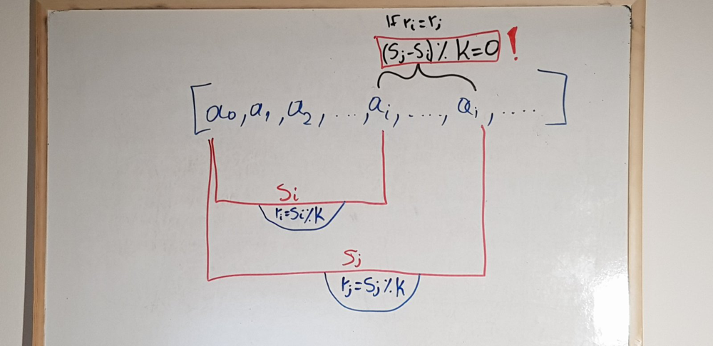

where
			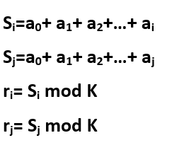

As you can see, If the remainders of i and j are equal (ri=rj)   the subarray from i to j has a remainder of 0, which means It's the type of subarrays we're looking for. But why though? 
Here follows the mathematical proof utilising a known formula (1). 
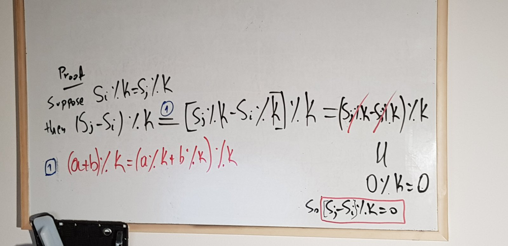

**The idea:**

Knowing the above way of recognizing a required subarrray, we can simply traverse the given array from left to right , looking for remainders I've already seen in the past.
If I come across a remainder I've already seen, that means that the subarray inbetween is of the required type and therefore needs to be counted. 

**The implementation:**

As I need to remember the remainder seen so far, I m gonna have to create some sort of a dictionary (fancy hash map) in order to keep track of them. 
**However** the information that I ve seen a remainder in the past is not enough for the solution of this problem and here's why.

Let's say I have an array.  Assuming my case of finding equal remainders is fulfilled, let's observe the schema that follows. 
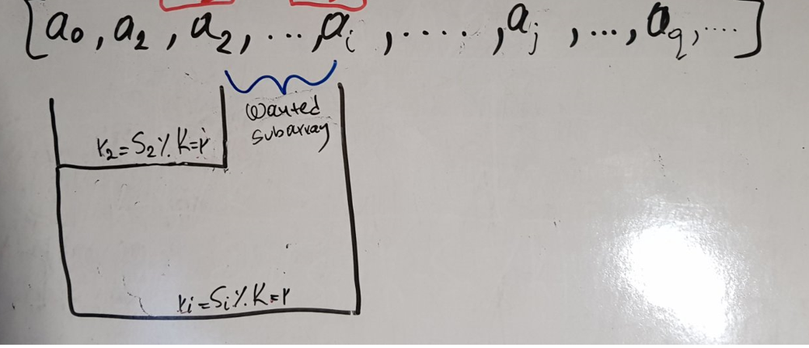
As you can see, **r1=r2=r**


When I reach ri, my algorithm should be able to increment the total count of the wanted subarrays by 1, as my condition of equal remainders is fulfilled. 

**However**,

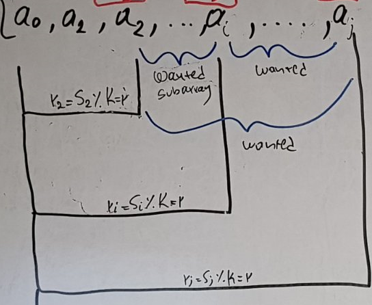

when aj is reached you see that the total count of wanted subarrays grows immediately to 3. Therefore incrementing by one would be incorrect, as 2 new wanted subarrays are met during this step. 
What needs to happen here is that the dictionary shouldn't just store the remainder, but the times we've seen that remainder in the past. 
Let us then denote with freq an array that stores the frequency of the remainders. As for the remainders themselves, they are already stored as the indices of the array. Let me demonstrate.

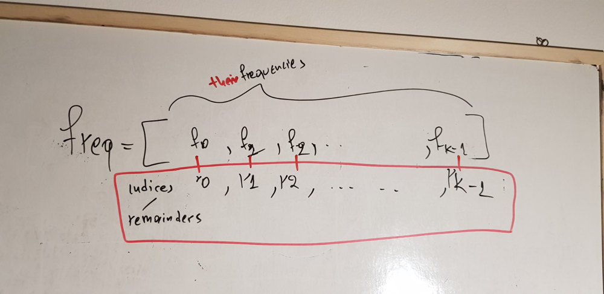

Considering the possible values a remainder  can have ( modulo K ) , this is a very helpful way of storing key:value pairs. 
So if K=2 , possible remainders can be 0,1
Likewise if K=5 possible remainders can be 0,1,2,3,4
Therefore an array with K elements will be just what I need. 

**"But why do I need the damn frequencies?"** you might ask.
Remember that in the previous image, when I met rj, I needed to increment my count by 2?
Turns out that the number that I need to increment my counter with **is the frequency of the remainder at its previous step**.  
Let's demonstrate that in further detail: 

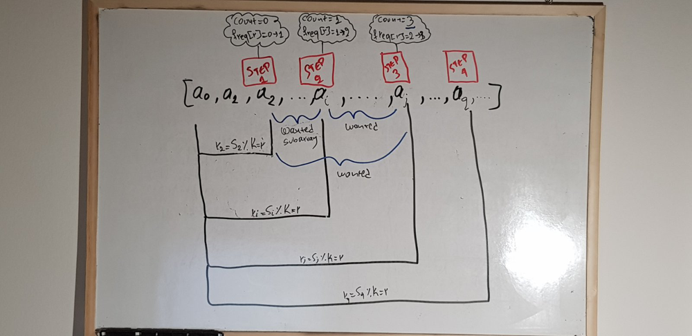

Notice how on each step, 2 things need to occur:
1. 	The counter needs to be incremented **accordingly**
2. 	The frequency has to be incremented by one

But what is "**accordingly**"? If you watch how the counter progresses with each step, you will realise that It increments by the last frrequency of the given remainder. 

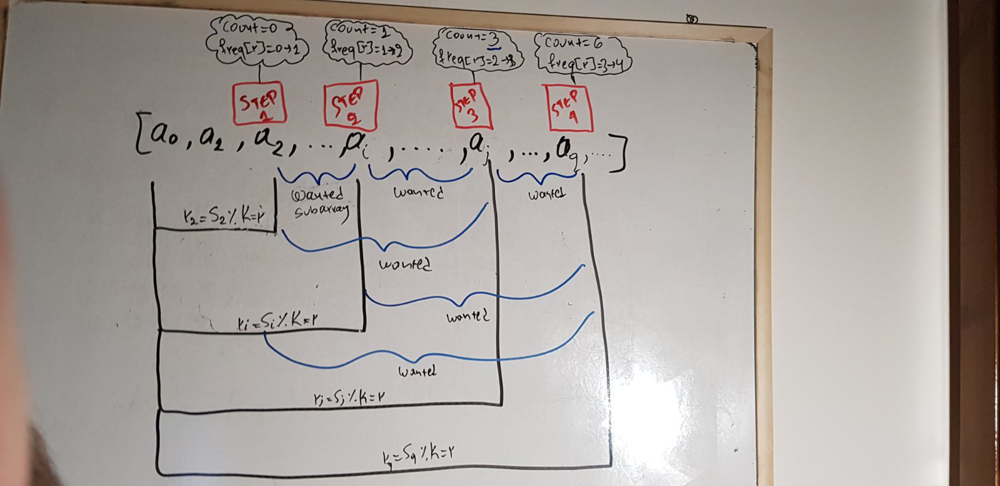

step 4's counter is 6. As you can see It increased by 3, which is obviously the frequency of the last step. Generalising on the n'th step we have:  

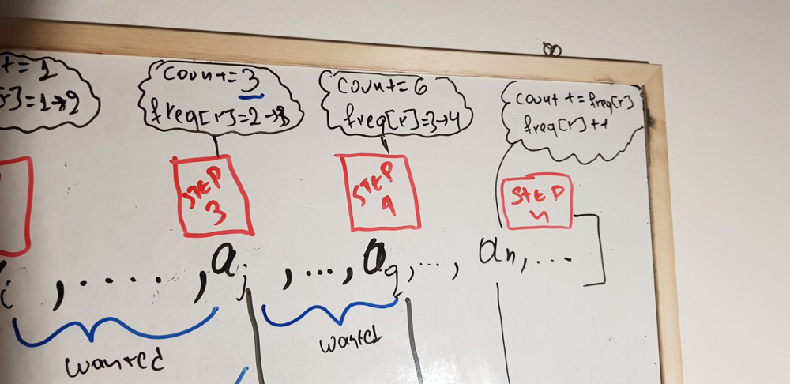


**So let's write some code.**
 
 
```
var subarraysDivByK = function(A, K) {

    let freq = new Array(K).fill(0); // "moduloK : Times I've seen it so far"


    freq[0]=1 //  Explained below

    // This is the accumulative sum of the elements of A
    let sum = 0;

    // The count of wanted subarrays, whose Sum%K= zero
    let count=0;

    for(let i = 0; i < A.length; i++){

        sum=sum+A[i]


        var remainder= sum%K

        //ALWAYS CHOOSE THE POSITIVE REMAINDER
        if(remainder<0)remainder+=K // Explained below


        count+=freq[remainder]

        freq[remainder]++
    }
    return count
    

};
```
**freq[0]=1 EXPLANATION**

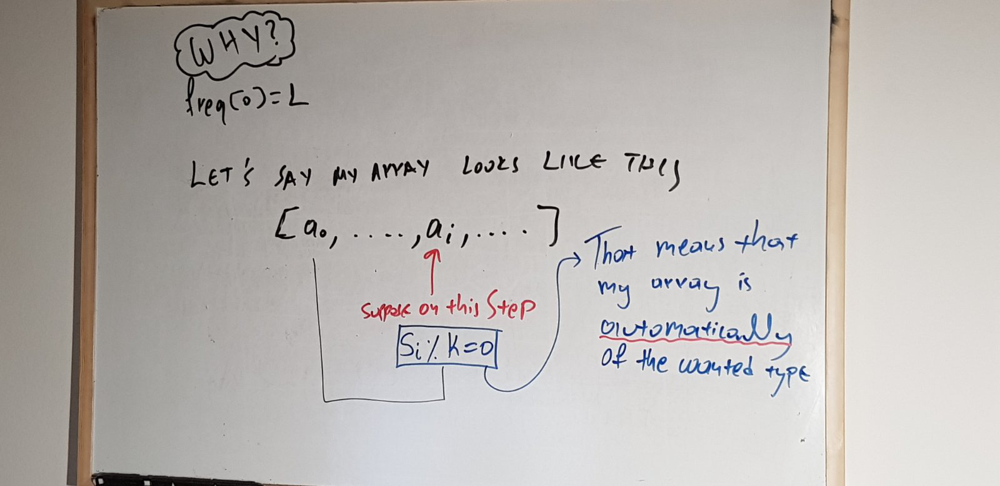


Consider this case. It's my first time meeting a remainder that equals zero. But wait, doesn't that mean that my subarray's sum is Divisible by K? If freq[0]!=1 then my counter wouldn't increment the first time I met a remainder=0. Therefore I need freq[0]=1 in order for my counter to consider the first subarray with a remainder that equals to zero. 


**NEGATIVE REMAINDER EXPLANATION**

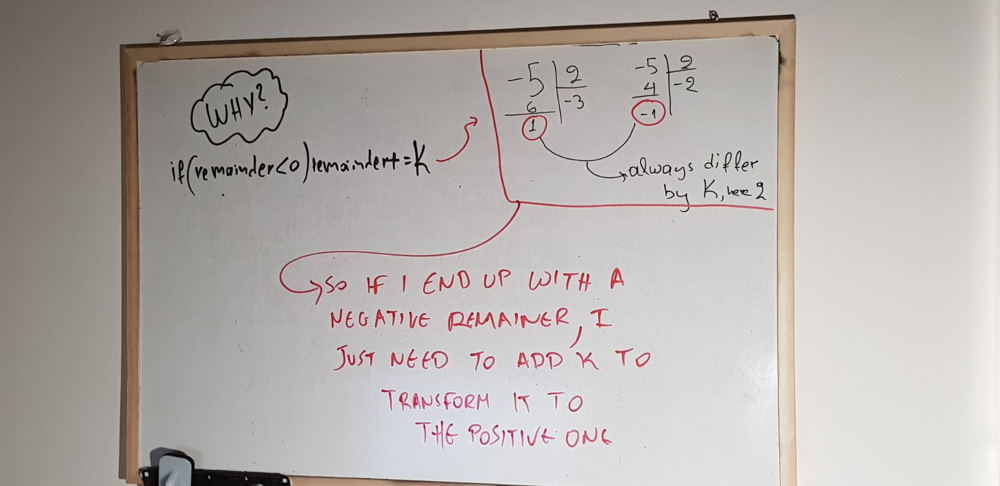

**TLDR :** The division of a negative number by a positive can yield positive and negative remainders. Some languages allow negative remainders, that's no bueno. In order for me to ensure I m taking the correct remainder, I'm adding K to the negative one, which always yields me the appropriate positive remainder. ( Read up on Euclidean division for more info/ proof)

**"But do I really need to do that ?"** you may ask. 
Here's a quick example of what would happen if I allowed negative remainders.
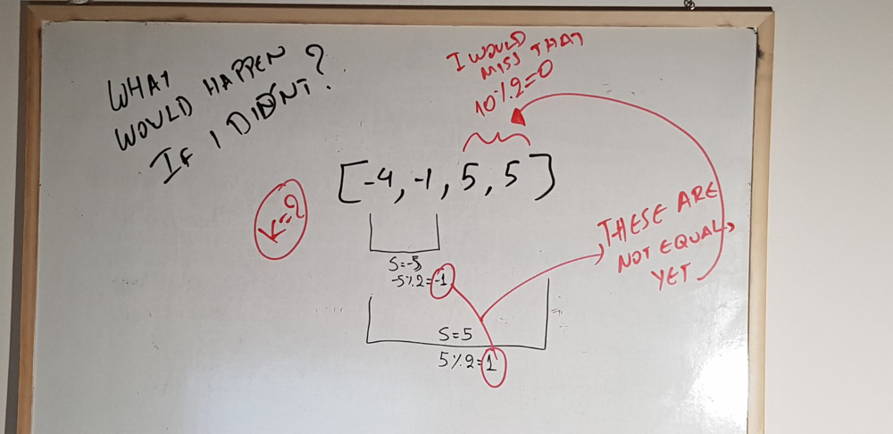

-1!=1, so my condition wouldnt trigger, and the counter wouldnt increment even though [5,5] is a subarray with a sum divisble by 2  . 

Sorry for the long post, hope I cleared up the topic. 


