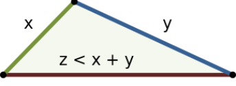

# Python/Java/JS/Go/C++ O( n log n ) by sorting. [w/ Visualization]

**Author:** brianchiang_tw
**Votes:** 12
**Link:** [https://leetcode.com/problems/largest-perimeter-triangle/solutions/550885/](https://leetcode.com/problems/largest-perimeter-triangle/solutions/550885/)

---

O( n log n ) by sorting. 

---
**Hint**:

**Sort** input side length in descending order.

**Try and test** the side length combination of triangle **from the largest one**.

If we find the optimal one, then early return the sum of valid largest side length combination.
Otherwise, return 0 (i.e., impossible to make triangle)

---

**Recall**:

Basic property of triangle:

**[Triangle inequality](https://en.wikipedia.org/wiki/Triangle_inequality)**




Z < X + Y where X, Y, Z are valid side length of triangle.

---
Implementation:
```
class Solution:
    def largestPerimeter(self, A: List[int]) -> int:
        
		# sort side length in descending order
        A.sort( reverse = True )
        
		# Try and test from largest side length
        for i in range( len(A) - 2):
            
            if A[i] < A[i+1] + A[i+2]:
                # Early return when we find largest perimeter triangle
                return A[i] + A[i+1] + A[i+2]
        
        # Reject: impossible to make triangle
        return 0
        
```

---

Java:

```

class Solution {
    public int largestPerimeter(int[] nums) {
        
        
        // Java native int[] sort doesn't support reverse option
        Arrays.sort( nums );

        for( int i = nums.length-3 ; i >= 0 ; i--){
            
            if( nums[i+2] < ( nums[i+1] + nums[i] ) ){
                // Accept: find the triangle with largest perimeter
                return ( nums[i] + nums[i+1] + nums[i+2] );
            }
            
        }
        
        // Reject: impossible to make triangle
        return 0;
    }
}
```

---

Javascript:

```
var compareFn = function(a, b){
    // put larger element of the left hand side
    return b - a;    
}

var largestPerimeter = function(nums) {
    
    nums.sort( compareFn );
    
    for( let i = 0 ; i < nums.length-2 ; i++){
        
        if( nums[i] < ( nums[i+1] + nums[i+2]) ){
            
            // Accept: find the triangle with largest perimeter
            return ( nums[i] +  nums[i+1] + nums[i+2] )
        }
        
    }
    
    // Reject: impossible to make triangle
    return 0;
};
```

---

Go:

```
import(
    "sort"
)

func largestPerimeter(nums []int) int {
    
    // sort side length in descending order
    sort.Slice( nums, func( i, j int) bool{
        return nums[i] > nums[j]
    })
    
    
    for i := 0 ; i < len(nums)-2 ; i++ {

        // Accept: find the triangle with largest perimeter
        if( nums[i] < ( nums[i+1] + nums[i+2]) ){
            return nums[i] + nums[i+1] + nums[i+2]
        }

    }
    
    // Reject: impossible to make triangle
    return 0
}
```

---

C++

```
class Solution {
public:
    int largestPerimeter(vector<int>& nums) {
        
        // sort side length in descending order
        std::sort( nums.rbegin(), nums.rend() );
        
        for( int i = 0 ; i < nums.size()-2 ; i++ ){
            
            // Accept: find the triangle with largest perimeter
            if( nums[i] < ( nums[i+1] + nums[i+2]) ){
                return nums[i] + nums[i+1] + nums[i+2];
            }
            
        }
        
        // Reject: impossible to make triangle
        return 0;
    }
};
```

---

Related leetcode challenge:

[Leetcode #611 Valid Triangle Number](https://leetcode.com/problems/valid-triangle-number/)

[Leetcode #812 Largest Triangle Area](https://leetcode.com/problems/largest-triangle-area/)

---

Reference:

[1] [Python official docs about sort( ) with direction](https://docs.python.org/3/howto/sorting.html#ascending-and-descending)

[2] [Wiki: Triangle inequality](https://en.wikipedia.org/wiki/Triangle_inequality)

[3] [MDN docs: Javascript Array.sort()](https://developer.mozilla.org/en-US/docs/Web/JavaScript/Reference/Global_Objects/Array/sort)

[4] [CPP plus docs: STL sort()](https://cplusplus.com/reference/algorithm/sort/)

[5] [Go offical docs: sort](https://pkg.go.dev/sort)

[6] [Java official docs: sort](https://docs.oracle.com/javase/7/docs/api/java/util/Arrays.html#sort(int[],%20int,%20int))