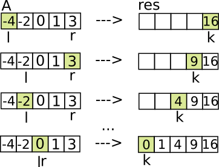

# C++: Simplest, one pass, two pointers

**Author:** andnik
**Votes:** 646
**Link:** [https://leetcode.com/problems/squares-of-a-sorted-array/solutions/495394/](https://leetcode.com/problems/squares-of-a-sorted-array/solutions/495394/)

---

Based on [original post by yukuairoy](https://leetcode.com/problems/squares-of-a-sorted-array/discuss/283978/Python-Two-Pointers).

Let's take example with negative and positive numbers, like:
```
[-4, -2, 0, 1, 3]
```
Since we need to put squeres in result array, we can consider that all numbers are positive (since: `-4**2 = 4**2 = 16`). Now our array looks like it sorted from middle to outside on both sides:
```
[4, 2, 0, 1, 3]
```
Now, we can have two pointers `l` to left most element, `r` to most right element.
Create `res` result array same size as `A`.
Move from right to left in `res` and past `max(abs(A[l]), abs(A[r]))`, move correspondingly `l++` or `r--`.



Same works for example with all negative and all positive numbers.

```
class Solution {
public:
    vector<int> sortedSquares(vector<int>& A) {
        vector<int> res(A.size());
        int l = 0, r = A.size() - 1;
        for (int k = A.size() - 1; k >= 0; k--) {
            if (abs(A[r]) > abs(A[l])) res[k] = A[r] * A[r--];
            else res[k] = A[l] * A[l++];
        }
        return res;
    }
};
```