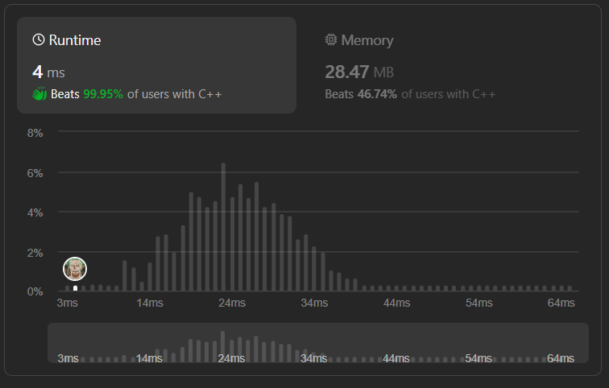

# ✅☑Beats 100% Users || [C++/Java/Python/JavaScript] || 3 Approaches || EXPLAINED🔥

**Author:** MarkSPhilip31
**Votes:** 153
**Link:** [https://leetcode.com/problems/squares-of-a-sorted-array/solutions/4807685/](https://leetcode.com/problems/squares-of-a-sorted-array/solutions/4807685/)

---

# DO GIVE IT A LIKE IF THAT WAS HELPFUL\uD83E\uDEE1\uD83D\uDC47


---



---


# Approaches

(Also explained in the code)

### ***Approach 1( Radix Sort )***
 
1. Squared and stored the values in same array.
1. Instead of using sort function, we are using radix sort to reduce complexity.


# Complexity
- Time complexity:
   $$O(n)$$
    

- Space complexity:
   $$O(n)$$
    


# Code
```C++ []
class Solution {
public:
    int getMax(vector<int>& arr) {
        int max = arr[0];
        for (int i = 1; i < arr.size(); i++) {
            if (arr[i] > max) {
                max = arr[i];
            }
        }
        return max;
    }

    void countSort(vector<int>& arr, int exp) {
        vector<int> output(arr.size());
        vector<int> count(10, 0);

        for (int i = 0; i < arr.size(); i++) {
            count[(arr[i] / exp) % 10]++;
        }

        for (int i = 1; i < 10; i++) {
            count[i] += count[i - 1];
        }

        for (int i = arr.size() - 1; i >= 0; i--) {
            output[count[(arr[i] / exp) % 10] - 1] = arr[i];
            count[(arr[i] / exp) % 10]--;
        }

        for (int i = 0; i < arr.size(); i++) {
            arr[i] = output[i];
        }
    }

    void radixSort(vector<int>& arr) {
        int max = getMax(arr);

        for (int exp = 1; max / exp > 0; exp *= 10) {
            countSort(arr, exp);
        }
    }

    vector<int> sortedSquares(vector<int>& nums) {
        for (int i = 0; i < nums.size(); i++) {
            nums[i] = nums[i] * nums[i];
        }
        radixSort(nums);
        return nums;
    }
};


```
```Java []


class Solution {
    public int getMax(int[] arr) {
        int max = arr[0];
        for (int i = 1; i < arr.length; i++) {
            if (arr[i] > max) {
                max = arr[i];
            }
        }
        return max;
    }

    public void countSort(int[] arr, int exp) {
        int[] output = new int[arr.length];
        int[] count = new int[10];

        for (int i = 0; i < arr.length; i++) {
            count[(arr[i] / exp) % 10]++;
        }

        for (int i = 1; i < 10; i++) {
            count[i] += count[i - 1];
        }

        for (int i = arr.length - 1; i >= 0; i--) {
            output[count[(arr[i] / exp) % 10] - 1] = arr[i];
            count[(arr[i] / exp) % 10]--;
        }

        for (int i = 0; i < arr.length; i++) {
            arr[i] = output[i];
        }
    }

    public void radixSort(int[] arr) {
        int max = getMax(arr);

        for (int exp = 1; max / exp > 0; exp *= 10) {
            countSort(arr, exp);
        }
    }

    public int[] sortedSquares(int[] nums) {
        for (int i = 0; i < nums.length; i++) {
            nums[i] = nums[i] * nums[i];
        }
        radixSort(nums);
        return nums;
    }
}


```
```python3 []
class Solution:
    def getMax(self, arr):
        max_val = max(arr)
        return max_val

    def countSort(self, arr, exp):
        output = [0] * len(arr)
        count = [0] * 10

        for num in arr:
            count[(num // exp) % 10] += 1

        for i in range(1, 10):
            count[i] += count[i - 1]

        for i in range(len(arr) - 1, -1, -1):
            output[count[(arr[i] // exp) % 10] - 1] = arr[i]
            count[(arr[i] // exp) % 10] -= 1

        for i in range(len(arr)):
            arr[i] = output[i]

    def radixSort(self, arr):
        max_val = self.getMax(arr)

        exp = 1
        while max_val // exp > 0:
            self.countSort(arr, exp)
            exp *= 10

    def sortedSquares(self, nums):
        for i in range(len(nums)):
            nums[i] = nums[i] * nums[i]
        self.radixSort(nums)
        return nums


```
```javascript []
class Solution {
    getMax(arr) {
        let max = arr[0];
        for (let i = 1; i < arr.length; i++) {
            if (arr[i] > max) {
                max = arr[i];
            }
        }
        return max;
    }

    countSort(arr, exp) {
        const output = new Array(arr.length);
        const count = new Array(10).fill(0);

        for (let i = 0; i < arr.length; i++) {
            count[Math.floor(arr[i] / exp) % 10]++;
        }

        for (let i = 1; i < 10; i++) {
            count[i] += count[i - 1];
        }

        for (let i = arr.length - 1; i >= 0; i--) {
            output[count[Math.floor(arr[i] / exp) % 10] - 1] = arr[i];
            count[Math.floor(arr[i] / exp) % 10]--;
        }

        for (let i = 0; i < arr.length; i++) {
            arr[i] = output[i];
        }
    }

    radixSort(arr) {
        const max = this.getMax(arr);

        for (let exp = 1; Math.floor(max / exp) > 0; exp *= 10) {
            this.countSort(arr, exp);
        }
    }

    sortedSquares(nums) {
        for (let i = 0; i < nums.length; i++) {
            nums[i] *= nums[i];
        }
        this.radixSort(nums);
        return nums;
    }
}


```
---

### ***Approach 2(Sort Function)***

1. Squared and stored the values in same array.
1. Used Sort Funciton

# Complexity
- Time complexity:
   $$O(nlogn)$$
    

- Space complexity:
   $$O(1)$$
    


# Code
```C++ []
class Solution {
public:
    vector<int> sortedSquares(vector<int>& nums) {
        for(int i =0;i<nums.size();i++){
            nums[i] = nums[i]*nums[i];
        }
        sort(nums.begin(),nums.end());
        return nums;
    }
};


```
```Java []


class Solution {
    public int[] sortedSquares(int[] nums) {
        for (int i = 0; i < nums.length; i++) {
            nums[i] = nums[i] * nums[i];
        }
        Arrays.sort(nums);
        return nums;
    }
}


```
```python3 []
class Solution:
    def sortedSquares(self, nums: List[int]) -> List[int]:
        for i in range(len(nums)):
            nums[i] = nums[i] * nums[i]
        nums.sort()
        return nums

                ------------------------

class Solution:
    def sortedSquares(self, nums: List[int]) -> List[int]:
        ans = (num*num for num in nums)
        ans = sorted(ans)
        return ans


```
```javascript []
var sortedSquares = function(nums) {
    for (let i = 0; i < nums.length; i++) {
        nums[i] = nums[i] * nums[i];
    }
    nums.sort((a, b) => a - b);
    return nums;
};


```
---

### ***Approach 3( 2 Pointer )***
```Why_Iterating_backwards\uD83D\uDE80 []
1. Since the original array is not sorted, it's not guaranteed 
    that the largest elements (in terms of absolute value) 
    are at the ends of the array.

1. By iterating backwards from the end of the array, we can 
    start populating the result array from the end, ensuring 
    that the squares of larger elements occupy the higher 
    indices of the result array.
```


# Complexity
- Time complexity:
   $$O(n)$$
    

- Space complexity:
   $$O(n)$$
    


# Code
```C++ []
class Solution {
public:
    vector<int> sortedSquares(vector<int>& nums) {
        int n = nums.size();
        int s=0,e=n-1;
        vector<int>ans(n);
        for(int i =n-1;i>=0;i--){
            if(abs(nums[s])>=abs(nums[e])){
                ans[i] = nums[s]*nums[s];
                s++;
            }else{
                ans[i] = nums[e]*nums[e];
                e--;
            }
        }
        return ans;
    }
};

```
```Java []

class Solution {
    public int[] sortedSquares(int[] nums) {
        int n = nums.length;
        int[] ans = new int[n];
        int start = 0, end = n - 1;
        for (int i = n - 1; i >= 0; i--) {
            if (Math.abs(nums[start]) >= Math.abs(nums[end])) {
                ans[i] = nums[start] * nums[start];
                start++;
            } else {
                ans[i] = nums[end] * nums[end];
                end--;
            }
        }
        return ans;
    }
}

```
```python3 []
class Solution:
    def sortedSquares(self, nums: List[int]) -> List[int]:
        n = len(nums)
        ans = [0] * n
        start, end = 0, n - 1
        for i in range(n - 1, -1, -1):
            if abs(nums[start]) >= abs(nums[end]):
                ans[i] = nums[start] * nums[start]
                start += 1
            else:
                ans[i] = nums[end] * nums[end]
                end -= 1
        return ans


```
```javascript []

var sortedSquares = function(nums) {
    const n = nums.length;
    const ans = new Array(n);
    let start = 0, end = n - 1;
    for (let i = n - 1; i >= 0; i--) {
        if (Math.abs(nums[start]) >= Math.abs(nums[end])) {
            ans[i] = nums[start] * nums[start];
            start++;
        } else {
            ans[i] = nums[end] * nums[end];
            end--;
        }
    }
    return ans;
};


```
---


# DO GIVE IT A LIKE IF THAT WAS HELPFUL\uD83E\uDEE1\uD83D\uDC47

---
---


---