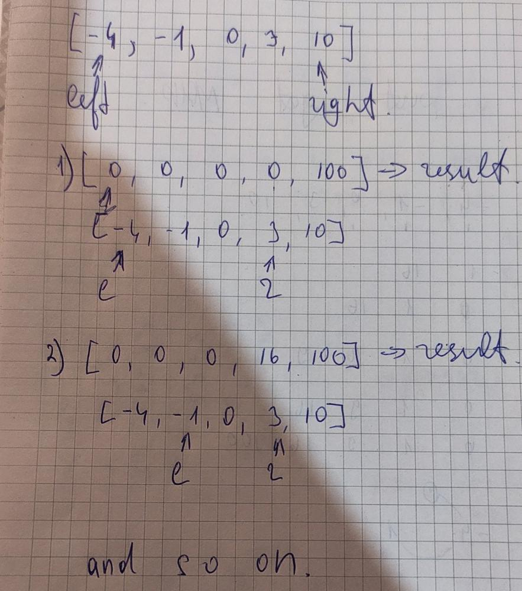

# Java. Two pointers

**Author:** mikhmanoff
**Votes:** 11
**Link:** [https://leetcode.com/problems/squares-of-a-sorted-array/solutions/3531964/](https://leetcode.com/problems/squares-of-a-sorted-array/solutions/3531964/)

---




# Code
```
class Solution {
    public int[] sortedSquares(int[] nums) {
        int n = nums.length;
        int[] result = new int[n];
        int left = 0;
        int right = n - 1;
        int i = n - 1;

        while (left <= right) {
            int leftSquare = nums[left] * nums[left];
            int rightSquare = nums[right] * nums[right];

            if (leftSquare > rightSquare) {
                result[i] = leftSquare;
                left++;
            } else {
                result[i] = rightSquare;
                right--;
            }

            i--;
        }

        return result;
    }
}
```