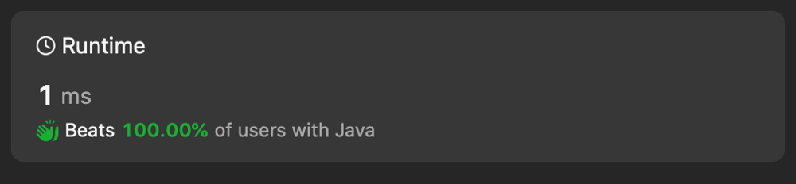

# ✅ the best O(n) solution in 8 languages + 4 one liners (explained)

**Author:** codeninja8
**Votes:** 0
**Link:** [https://leetcode.com/problems/squares-of-a-sorted-array/solutions/4812766/](https://leetcode.com/problems/squares-of-a-sorted-array/solutions/4812766/)

---

# Approach 1 Complexity: O(nlog)
the first approach would be to
1. x * x
2. sort 

``` javascript []
var sortedSquares = function(nums) {
    return nums.map(x => x * x).sort((a, b) => a - b);
};
```
``` ruby []
def sorted_squares(nums)
    return nums.map { |x| x * x}.sort()
```
``` python []
class Solution(object):
    def sortedSquares(self, nums):
        return sorted([x * x for x in nums])
```
``` racket []
(define (sorted-squares nums)
  (sort (map (lambda (x) (* x x)) nums) <))
```


# Approach 2 O(n)
We're going to populate the array `res` starting from the largest value, and go backward. 

We could start with the smallest value, but it would be more complicated since the smallest value can be in the middle of the array. The largest value is always in `nums[0]` or `nums[nums.length]`.

So we start with `left = 0` and `right = nums.length - 1` and go down `idx--` in the resulting array.

``` java []
class Solution {
    public int[] sortedSquares(int[] nums) {
        int[] res = new int[nums.length];

        int left = 0;
        int right = nums.length - 1;
        int idx = right;
        while (left <= right) {
            if (Math.abs(nums[left]) > Math.abs(nums[right])) {
                res[idx--] = nums[left] * nums[left++];
            } else {
                res[idx--] = nums[right] * nums[right--];
            }
        }

        return res;
    }
}
```
``` javascript []
var sortedSquares = function(nums) {
    var left = 0;
    var right = nums.length - 1;
    var idx = right;
    var res = new Array(nums.length);
    while (left <= right) {
        if (Math.abs(nums[left]) > Math.abs(nums[right])) {
            res[idx--] = nums[left++] ** 2;
        } else {
            res[idx--] = nums[right--] ** 2;
        }
    }

    return res;
};
```
``` c []
int* sortedSquares(int* nums, int numsSize, int* returnSize) {
    int left = 0;
    int right = numsSize - 1;
    int idx = right;
    int *res = malloc(numsSize * sizeof(*nums));

    while (left <= right) {
        if (abs(nums[left]) > abs(nums[right])) {
            res[idx--] = pow(nums[left++], 2);
        } else {
            res[idx--] = pow(nums[right--], 2);
        }
    }

    *returnSize = numsSize;
    return res;
}
```
``` python []
class Solution(object):
    def sortedSquares(self, nums):
        left = 0
        right = len(nums) - 1
        idx = right
        res = [0] * len(nums)
        while left <= right:
            if abs(nums[left]) > abs(nums[right]):
                res[idx] = nums[left] ** 2
                left += 1
            else:
                res[idx] = nums[right] ** 2
                right -= 1
            idx -= 1
        return res      
```
``` php []
class Solution {
    function sortedSquares($nums) {
        $res = array_fill(0, count($nums), 0);
        $left = 0;
        $right = count($nums) - 1;
        $idx = $right;

        while ($left <= $right) {
            if (abs($nums[$left]) > abs($nums[$right])) {
                $res[$idx--] = $nums[$left++] ** 2;
            } else {
                $res[$idx--] = $nums[$right--] ** 2;
            }
        }

        return $res;
    }
}
```
``` golang []
func Abs(val int) int {
    if (val < 0) {
        return val * -1
    } else {
        return val
    }
}

func sortedSquares(nums []int) []int {
    res := make([]int, len(nums))
    left := 0
    right := len(nums) - 1

    for i := right; left <= right; i-- {
        if Abs(nums[left]) > Abs(nums[right]) {
            res[i] = nums[left] * nums[left]
            left++
        } else {
            res[i] = nums[right] * nums[right]
            right--
        }
    }

    return res
}
```
``` ruby []
def sorted_squares(nums)
    left = 0
    right = nums.length() - 1
    idx = right
    res = Array.new(nums.length(), 0)

    while left <= right
        if nums[left].abs() > nums[right].abs()
            res[idx] = nums[left] ** 2
            left += 1
        else
            res[idx] = nums[right] ** 2
            right -= 1
        end
        idx -= 1
    end

    return res
end
```
``` racket []
(define (sorted-squares nums)
  (reverse (let loop ([left 0]
             [right (sub1 (length nums))]
             [vec (list->vector nums)])
    (cond [(> left right) '()]
          [(> (abs (vector-ref vec left)) (abs (vector-ref vec right))) (cons (expt (vector-ref vec left) 2) (loop (add1 left) right vec))]
          [else (cons (expt (vector-ref vec right) 2) (loop left (sub1 right) vec))]))))
```



like \uD83D\uDC4D
