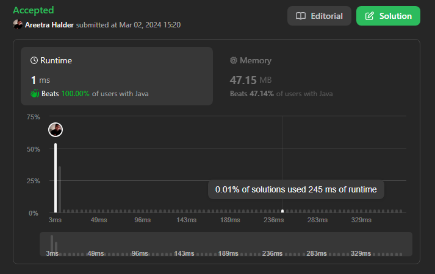

# 🔥✅✅ Beats 100% with Proof | Very Easy to Understand ✅✅🔥

**Author:** areetrahalder
**Votes:** 16
**Link:** [https://leetcode.com/problems/squares-of-a-sorted-array/solutions/4809974/](https://leetcode.com/problems/squares-of-a-sorted-array/solutions/4809974/)

---

# Proof - Upvote if you are watching the proof



# Intuition
<!-- Describe your first thoughts on how to solve this problem. -->
The problem requires returning an array of squares of each number sorted in non-decreasing order. Given that the input array is sorted in non-decreasing order, we can take advantage of this property to simplify the solution.

# Approach
<!-- Describe your approach to solving the problem. -->
The approach here involves using two pointers, `left` and `right`, initialized to the start and end of the array, respectively. We create a new array, `output`, to store the squares in non-decreasing order. We iterate through the input array in reverse order, comparing the squares of the elements at `left` and `right`. The larger square is added to the `output` array, and the corresponding pointer (`left` or `right`) is moved accordingly.

# Algorithm
1. Initialize `left` to 0, `right` to `nums.length - 1`, and `i` to `nums.length - 1`.
2. Create an array `output` of the same length as `nums`.
3. Run a loop while `left` is less than or equal to `right`.
    * Calculate the square of the element at `left` and `right`.
    * Compare the squared values and choose the larger one.
    * Assign the chosen value to `output[i]` and decrement `i`.
    * Move the corresponding pointer (`left` or `right`).
4. Return the `output` array.

# Complexity
- Time complexity: $$O(n)$$
<!-- Add your time complexity here, e.g. $$O(n)$$ -->
> where n is the length of the input array nums. The algorithm iterates through the array once.

- Space complexity: $$O(n)$$
<!-- Add your space complexity here, e.g. $$O(n)$$ -->
> for the additional array output used to store the squared values.

# Code
```Java []
class Solution {
    public int[] sortedSquares(int[] nums) {
        int left = 0, right = nums.length-1, i = nums.length - 1;
        int[] output = new int[nums.length];
        while(left <= right){
            int value;
            if(nums[left] * nums[left] >= nums[right] * nums[right]){
                value = nums[left] * nums[left++];
            }else{
                value = nums[right] * nums[right--];
            }
            output[i--] = value;
        }
        return output;
    }
}
```
```C []
/**
 * Note: The returned array must be malloced, assume caller calls free().
 */
int* sortedSquares(int* nums, int numsSize, int* returnSize) {
    int left = 0, right = numsSize - 1, i = numsSize - 1;
    int* output = (int*)malloc(numsSize * sizeof(int));
    *returnSize = numsSize;
    
    while(left <= right){
        int value;
        if(nums[left] * nums[left] >= nums[right] * nums[right]){
            value = nums[left] * nums[left++];
        }else{
            value = nums[right] * nums[right--];
        }
        output[i--] = value;
    }
    return output;
}

```
```C++ []
class Solution {
public:
    vector<int> sortedSquares(vector<int>& nums) {
        int left = 0, right = nums.size() - 1;
        vector<int> output(nums.size());
        
        for (int i = nums.size() - 1; i >= 0; --i) {
            int value;
            if (nums[left] * nums[left] >= nums[right] * nums[right]) {
                value = nums[left] * nums[left++];
            } else {
                value = nums[right] * nums[right--];
            }
            output[i] = value;
        }
        return output;
    }
};

```
```C# []
public class Solution {
    public int[] SortedSquares(int[] nums) {
        int left = 0, right = nums.Length - 1, i = nums.Length - 1;
        int[] output = new int[nums.Length];
        
        while (left <= right) {
            int value;
            if (nums[left] * nums[left] >= nums[right] * nums[right]) {
                value = nums[left] * nums[left++];
            } else {
                value = nums[right] * nums[right--];
            }
            output[i--] = value;
        }
        return output;
    }
}

```
```Python []
class Solution(object):
    def sortedSquares(self, nums):
        """
        :type nums: List[int]
        :rtype: List[int]
        """
        left, right, i = 0, len(nums) - 1, len(nums) - 1
        output = [0] * len(nums)
        while left <= right:
            value = 0
            if nums[left] * nums[left] >= nums[right] * nums[right]:
                value = nums[left] * nums[left]
                left += 1
            else:
                value = nums[right] * nums[right]
                right -= 1
            output[i] = value
            i -= 1
        return output

```
```Python3 []
class Solution:
    def sortedSquares(self, nums: List[int]) -> List[int]:
        left, right, i = 0, len(nums) - 1, len(nums) - 1
        output = [0] * len(nums)
        while left <= right:
            value = 0
            if nums[left] * nums[left] >= nums[right] * nums[right]:
                value = nums[left] * nums[left]
                left += 1
            else:
                value = nums[right] * nums[right]
                right -= 1
            output[i] = value
            i -= 1
        return output

```
```Javascript []
/**
 * @param {number[]} nums
 * @return {number[]}
 */
var sortedSquares = function(nums) {
    let left = 0, right = nums.length - 1, i = nums.length - 1;
    let output = new Array(nums.length);
    while (left <= right) {
        let value;
        if (nums[left] * nums[left] >= nums[right] * nums[right]) {
            value = nums[left] * nums[left++];
        } else {
            value = nums[right] * nums[right--];
        }
        output[i--] = value;
    }
    return output;
};

```
```Typescript []
function sortedSquares(nums: number[]): number[] {
    let left = 0, right = nums.length - 1, i = nums.length - 1;
    let output: number[] = new Array(nums.length);
    while (left <= right) {
        let value: number;
        if (nums[left] * nums[left] >= nums[right] * nums[right]) {
            value = nums[left] * nums[left++];
        } else {
            value = nums[right] * nums[right--];
        }
        output[i--] = value;
    }
    return output;
}

```

# Upvote - Please


