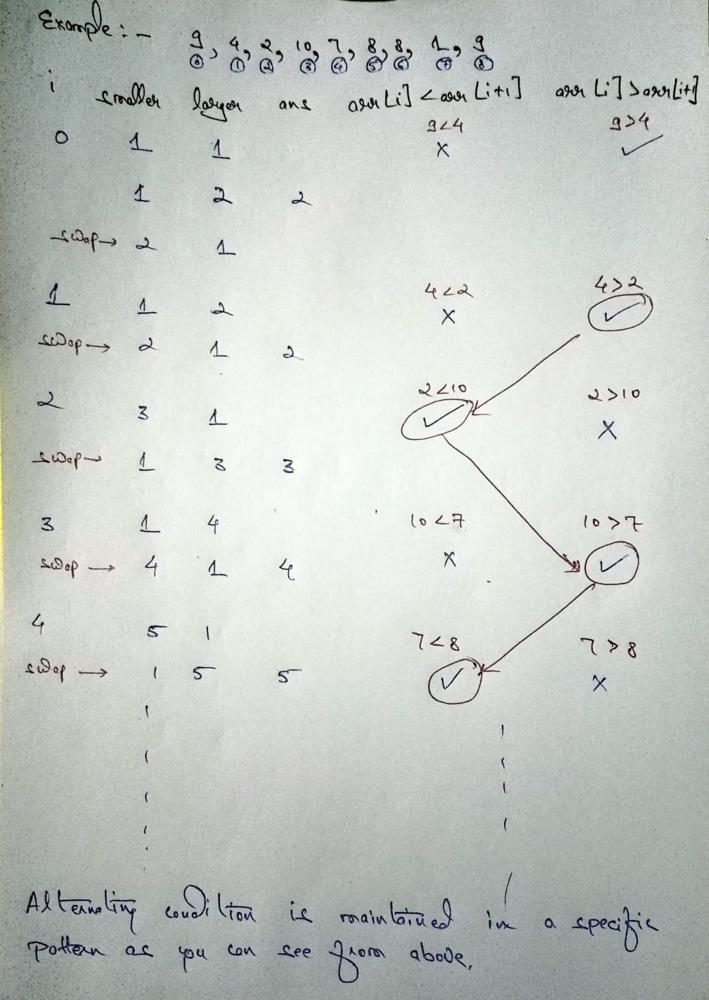

# C++ | Easy-Explanation | Kadane's-Extension | Sliding-Window

**Author:** modisanskar5
**Votes:** 19
**Link:** [https://leetcode.com/problems/longest-turbulent-subarray/solutions/2260177/](https://leetcode.com/problems/longest-turbulent-subarray/solutions/2260177/)

---

## Logic
- This problem is the extension of ***kadane's algorithm***.
- Below in the code I have explained everything and its execution you can find in the dry run done below.

## Implementation
```
int maxTurbulenceSize(vector<int>& arr) {
    //From the conditions given to be followed 
    //we have to find the maximum count of one type of pattern whether 
    //the k is even or whether it is odd.        
        int ans = 1;
        int smaller = 1;
        int larger = 1;
    //A pattern is alternating itself if at any k(odd) arr[k]>arr[k+1] then
    //at the next it has to follow arr[k]<arr[k+1] as k will be even.
    //If the pattern is not followed then it will switch to counting in 
    //the next pattern
        for (int i = 0; i < arr.size() - 1; ++i) {
    //We have taken 2 pointers smaller and larger which helps us in switching
    //between patterns
    //and counting the parts of specific pattern
            smaller = arr[i] < arr[i + 1] ? smaller + 1 : 1;
            larger = arr[i] > arr[i + 1] ? larger + 1 : 1;
            
            ans = max(ans, max(smaller, larger));
            //Decide which pattern count is high
            swap(smaller, larger);
            //Maintaining the alternating condition in the pattern
        }
        return ans;
    }
```

## Dry Run



- TC - O(N)

**Thank You!** for reading . Do upvote\uD83D\uDC4D if you like the explanation and if there is any scope of improvement do mention it in the comments \uD83D\uDE01.
