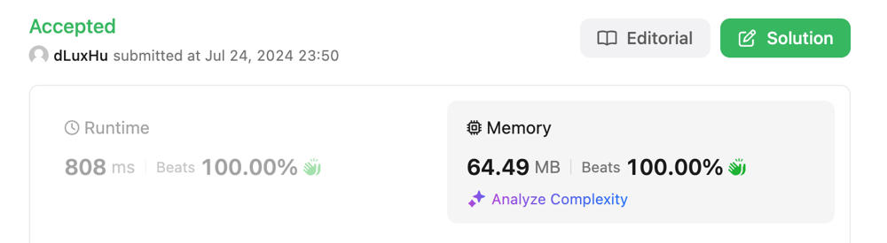

# Scala solution, beats 100% in CPU and Memory

**Author:** dLuxHu
**Votes:** 0
**Link:** [https://leetcode.com/problems/longest-turbulent-subarray/solutions/5531561/](https://leetcode.com/problems/longest-turbulent-subarray/solutions/5531561/)

---

# Submission



# Approach
* First, handle special cases: empty array and 1-length array.
* Then create a `diffs` vector that is the signum of the diffs of consecutive elements in the array.
* Then go through the `diffs` vector and calculate the longest string that has alternating values (`-1` and `1`). Need to handle `0` as a special case!

# Complexity
- Time complexity: $O(n)$

- Space complexity: $O(n)$

# Code
```
object Solution {
  def maxTurbulenceSize(arr: Array[Int]): Int =
    if (arr.length <= 1) arr.length
    else {
      val (_, diffs) = arr.view.tail.foldLeft((arr.head, Vector.empty[Int])) {
        case ((prevItem, diffs), currItem) => (currItem, diffs :+ (currItem - prevItem).sign)
      }
      val (_, _, maxLen) = diffs.tail.foldLeft(if (diffs.head == 0) (0, 0, 0) else (diffs.head, 1, 1)) {
        case ((prevItem, currLen, maxLen), currItem) =>
          val newLen =
            if (currItem.sign == 0) 0
            else if (prevItem.sign != currItem.sign) currLen + 1
            else 1
          val newMaxLen = Math.max(newLen, maxLen)
          (currItem, newLen, newMaxLen)
      }
      maxLen + 1
    }
}
```

