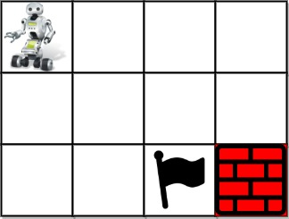
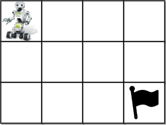

# [980. Unique Paths III](https://leetcode.com/problems/unique-paths-iii/)

| Category | Difficulty | Likes | Dislikes |
| :------: | :--------: | :---: | :------: |
| Algorithms | Hard | 5444 | 197 |

**Tags:** [`array`](https://leetcode.com/tag/array), [`backtracking`](https://leetcode.com/tag/backtracking), [`bit-manipulation`](https://leetcode.com/tag/bit-manipulation), [`matrix`](https://leetcode.com/tag/matrix)

**Companies:** `databricks`, `facebook`, `google`, `amazon`, `microsoft`, `goldman-sachs`, `bloomberg`

## Description

You are given an `m x n` integer array `grid` where `grid[i][j]` could be:

	- `1` representing the starting square. There is exactly one starting square.

	- `2` representing the ending square. There is exactly one ending square.

	- `0` representing empty squares we can walk over.

	- `-1` representing obstacles that we cannot walk over.

Return *the number of 4-directional walks from the starting square to the ending square, that walk over every non-obstacle square exactly once*.

 

**Example 1:**


```

Input: grid = [[1,0,0,0],[0,0,0,0],[0,0,2,-1]]
Output: 2
Explanation: We have the following two paths: 
1. (0,0),(0,1),(0,2),(0,3),(1,3),(1,2),(1,1),(1,0),(2,0),(2,1),(2,2)
2. (0,0),(1,0),(2,0),(2,1),(1,1),(0,1),(0,2),(0,3),(1,3),(1,2),(2,2)

```

**Example 2:**


```

Input: grid = [[1,0,0,0],[0,0,0,0],[0,0,0,2]]
Output: 4
Explanation: We have the following four paths: 
1. (0,0),(0,1),(0,2),(0,3),(1,3),(1,2),(1,1),(1,0),(2,0),(2,1),(2,2),(2,3)
2. (0,0),(0,1),(1,1),(1,0),(2,0),(2,1),(2,2),(1,2),(0,2),(0,3),(1,3),(2,3)
3. (0,0),(1,0),(2,0),(2,1),(2,2),(1,2),(1,1),(0,1),(0,2),(0,3),(1,3),(2,3)
4. (0,0),(1,0),(2,0),(2,1),(1,1),(0,1),(0,2),(0,3),(1,3),(1,2),(2,2),(2,3)

```

**Example 3:**


```

Input: grid = [[0,1],[2,0]]
Output: 0
Explanation: There is no path that walks over every empty square exactly once.
Note that the starting and ending square can be anywhere in the grid.

```

 

**Constraints:**

	- `m == grid.length`

	- `n == grid[i].length`

	- `1 <= m, n <= 20`

	- `1 <= m * n <= 20`

	- `-1 <= grid[i][j] <= 2`

	- There is exactly one starting cell and one ending cell.

---

**Links:** [Submissions](https://leetcode.com/problems/unique-paths-iii/) | [Solutions](https://leetcode.com/problems/unique-paths-iii/)
