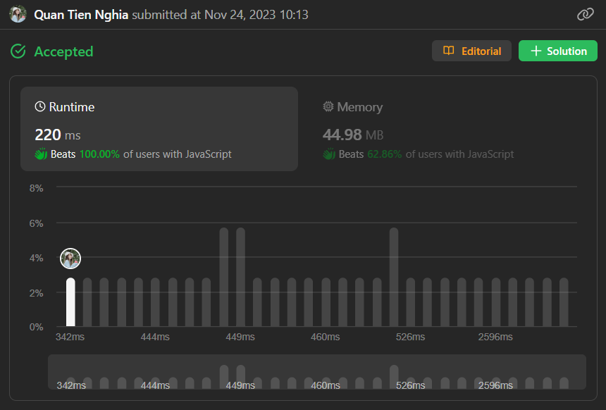

# Efficient JS Solution - Lazy propagation O(n + 16*2^16) (Beat 100% time)

**Author:** CuteTN
**Votes:** 1
**Link:** [https://leetcode.com/problems/triples-with-bitwise-and-equal-to-zero/solutions/4324220/](https://leetcode.com/problems/triples-with-bitwise-and-equal-to-zero/solutions/4324220/)

---



# Intuition
- Firstly, let's define `m = max(nums)`.
- One possible approach to this problem is to use **inclusion-exclusion** technique.
- For example, with `nums = [1,2,3]`, if we can somehow count the number of elements in `nums` that has the 0-th bit set (`#1`, including `1, 3`), those that has 1-th bit set (`#2`, including `2, 3`) and those that has both bits set (`#3`, including `3`), the answer is simply $$n^3 - (\\#1)^3 - (\\#2)^3 + (\\#3)^3 = 3^3 - 2^3 - 2^3 + 1^3 = 12$$. Why tho?
- The idea is, we just take all triplets ($$n^3$$). Then exclude the number of triplets that has 0-th bit set in its AND, notice that we must choose 3 numbers that each has 0-th bit set, thus there are $$(\\#1)^3$$ ways. Similarly, we should also exclude those triplets that has 1-th bit set in its AND, which is $$(\\#2)^3$$. Now notice that the number of triplets that has both bit set in its AND has been excluded twice, thus, we must add them back, the number of triplets that satisfies this is  $$(\\#3)^3$$.
- We can generalize this idea with **inclusion-exclusion** technique for 16 bits.

# Approach
- Let's define an array `ones`, for each `0 <= s < 2^16`, `ones[s]` stores the number of elements `x` in `nums` that satisfies the below condition:
  - If the `i`-th bit of `s` is set (`0 <= i < 16`), then the `i`-th bit of `x` must also be set. Notice that if the `i`-th bit of `s` is `0`, there's no condition on `x`.
- This array is equivalent to the concept described in the Intuition part, thus it is the key to solve the problem as introduced before. So how can we even evaluate `ones`?

## Naive approach - O(nm)
> I believe you can get accepted with just this approach as the LeetCode environment is really lenient.
- Initialize `ones` to an array with full of zeroes.
- For each `x` in `nums`, we can iterate through every `s` from $$0$$ to $$2^{16}$$, if `x & s == s`, we need to increase `ones[s]` by `1`.

## Branching approach - O(nm)
> Normally, an ideal operations to run in order not to get a TLE should not exceed `5e6` (in most platforms, not just LeetCode). But the naive approach requires around `6e7` operations. Which suggests that we can do better. This approach doesn't reduce the time complexity in theory, but it helps reduce the number of operations down to roughly `8e6`.
- You can still stick to the naive approach with 2 optimization,
- First optimization: you can group duplicated elements of nums to add at once. For example, if `x` appear `5` times in `nums`, for every `s` that satisfies the said condition in naive approach, we can just increase `ones[s]` by `5`.
- Second optimization: instead of iterate through every `s`, you can use backtracking to generating `s` in binary in such a way that `s` will always guarantee the said condition. In more details, if the `i`-th bit of `x` is `1`, there's no point iterating `s` that has `i`-th bit equal to `0`. Thus cutting down the number of operations by a lot.

## Lazy propagation approach - O(n + mlog^2(m))
> I believe this is the intended solution to the problem. It's inspired by line sweeper and segment tree range update technique. It's hard to describe in words but I'll try my best...
- You may notice that whenever we need to `ones[s] += amount`, we also need to do `ones[t] += amount`, with all `t` such that `s & t == t`. Hence, this maintain a parent-child relation ship between `s` and `t`. Therefore, we can hope to lazily `+= amount` to all of descendants of `s` whenever we actually needed it.
- However it's not that easy, as our structure is not a ***tree***, it's actually a ***DAG***. Which means, multiple `s`'s may share the same child `t`, This could be problematic. For instance, consider `1` additional amount of the node `111B` (`B` means binary representation), it will then propagate this `1` amount to `110B`, `101B` and `011B`. It's good so far, but the issue appears when these 3 nodes propagate to their next children. The node `100B` will unexpectedly receive `2` additional amount that were propagated from both `101B` and `110B`.
- The reason for the duplication is we actually allow permutation when flipping `1`'s to `0`'s. The original node `111B` have 2 ways to reach `100B`, both ways flip the 0-th and 1-th bits, but in different order. Therefore, to actually get rid of this permutation problem, we're going to need an extra dimension `b` for each node, where `b` (`0 <= b < 16`) represents the least bit we can flip. A node is now denoted as `(s, b)` instead of just `s`. The reason for this is to prevent flipping the bit before the largest bit we have flipped. With this representation, `ones[s] = sum of additional amount in (s,b) for all 0 <= b < 16)`.
- Getting back to the example, the original node `(111B, 0)` will propagate to `(101B, 1)` and `(110B, 0)`. Notice that the node `(101B, 1)` cannot propagate to `100B`, as we cannot flipped the 0-th bit when `b = 1`. Therefore, only `(110B, 0)` can actually propagate to `100B` (or more precisely, it propagates to `(100B, 1)`). This completely avoids the duplication issue.

- In my code, `laz` is a 2-dimensional array of the size $$2^{16}\	imes16$$, with `laz[s][b]` represents the additional amount of the node `(s,b)`. The array `ones` can be obtained by `laz` so it's not necessary. `cnt[i]` counts the number of `1`'s in the binary representation of i. `pri` is all numbers in the range $$[0, 2^{16})$$ but sorted in the-number-of-1's-in-binary order, which helps streamline the propagating process. For each number `num` in `nums`, I'll add `1` to `laz[num, 0]` (which takes $$O(n)$$) and start the propagation after that (which takes $$O(mlog^2(m))$$).

# Complexity
- Time complexity: $$O(n + mlog^2(m))$$
- Space complexity: $$O(n + mlogm)$$

# Code
```js
//#region Tensor
/**
 * @template TItem
 */
class Tensor {
  /**
   * @param {number} capacity The max capacity of the tensor
   * @param {number[] | undefined} dimensions
   */
  constructor(capacity, dimensions) {
    /**
     * @private
     * @type {TItem[]}
     */
    this._data = new Uint16Array(capacity);

    /**
     * @private
     * @type {number[]}
     */
    this._dimensions;

    /**
     * @private
     * @type {number}
     */
    this._total = 0;

    this.resize(...dimensions);

    /**
     * An array of indices whole sole purpose is to avoid recreating array for some operations such as **forEach**
     * @type {number[]}
     * @private
     */
    this.__indices = [];
  }

  /**
   * @param {...number} dimensions
   */
  resize(...dimensions) {
    this._dimensions = dimensions;
    if (!this._dimensions?.length) this._total = 0;
    else {
      this._total = 1;
      for (let i = 0; i < this._dimensions.length; i++)
        this._total *= this._dimensions[i];
    }
  }

  /**
   * @param {TItem} value
   */
  fill(value) {
    if (!this._dimensions)
      throw `Call "resize" to initialize the dimensions of the Tensor first.`;
    this._data.fill(value, 0, this._total);
  }

  /**
   * @private
   * @param {number[]} indices
   */
  _getFlattenIndex(indices) {
    if (!this._dimensions)
      throw `Call "resize" to initialize the dimensions of the Tensor first.`;
    let n = indices.length;
    if (n != this._dimensions.length)
      throw `The number of dimensions does not match`;
    if (!n) return 0;

    if (indices[0] < 0 || indices[0] >= this._dimensions[0])
      throw `The ${0}-th dimension should be in range [0, ${
        this._dimensions[0]
      })`;

    let result = indices[0];
    for (let i = 1; i < n; i++) {
      if (indices[i] < 0 || indices[i] >= this._dimensions[i])
        throw `The ${i}-th dimension should be in range [0, ${this._dimensions[i]})`;
      result = result * this._dimensions[i] + indices[i];
    }

    return result;
  }

  /**
   * @param  {...number} indices
   */
  at(...indices) {
    return this._data[this._getFlattenIndex(indices)];
  }

  /**
   * @param  {TItem} value
   * @param  {...number} indices
   */
  set(value, ...indices) {
    this._data[this._getFlattenIndex(indices)] = value;
  }

  /**
   * @param  {TItem} value
   * @param  {...number} indices
   */
  setMin(value, ...indices) {
    let flattenIndex = this._getFlattenIndex(indices);
    this._data[flattenIndex] = Math.min(value, this._data[flattenIndex]);
  }

  /**
   * @param  {TItem} value
   * @param  {...number} indices
   */
  setMax(value, ...indices) {
    let flattenIndex = this._getFlattenIndex(indices);
    this._data[flattenIndex] = Math.max(value, this._data[flattenIndex]);
  }

  /**
   * @param  {TItem} amount
   * @param  {...number} indices
   */
  inc(amount, ...indices) {
    let flattenIndex = this._getFlattenIndex(indices);
    this._data[flattenIndex] += amount;
  }

  /**
   * WARNING: Don't mutate indices array
   * @param {(value: TItem, indices: number[], set: (value: TItem) => void) =>} cb
   */
  forEach(cb) {
    if (!this._dimensions)
      throw `Call "resize" to initialize the dimensions of the Tensor first.`;

    const indices = this.__indices;
    const d = this._dimensions.length;

    while (indices.length < d) indices.push(0);
    indices.fill(0, 0, d);

    let i = 0;
    const set = (value) => {
      this._data[i] = value;
    };

    cb(this._data[0], indices, set);

    for (i = 1; i < this._total; i++) {
      let j = d;
      do {
        j--;
        indices[j]++;
        if (indices[j] == this._dimensions[j]) indices[j] = 0;
      } while (!indices[j]);

      cb(this._data[i], indices, set);
    }
  }
}
//#endregion

function count1s(mask) {
  let res = 0;
  while (mask) {
    res++;
    mask -= mask & -mask;
  }
  return res;
}

let MAX = 65536;
let laz = new Tensor(MAX * 16, [MAX, 16]);
let pri = new Uint16Array(MAX);
let cnt = new Uint16Array(MAX);

for (let i = 0; i < MAX; ++i) {
  cnt[i] = count1s(i);
  pri[i] = i;
}
pri.sort((a,b) => cnt[b] - cnt[a]);

/**
 * @param {number[]} nums
 * @return {number}
 */
var countTriplets = function(nums) {
  laz.fill(0);
  let n = nums.length;
  
  for (let i = 0; i < n; ++i) laz.inc(1, nums[i], 0);
  let res = 0;

  for (let i = 0; i < MAX; ++i) {
    let num = pri[i];
    let c = 0;

    for (let b = 0; b < 16; ++b) {
      let l = laz.at(num, b);
      if (!l) continue;

      c += l;
      for (let bb = b; bb < 16; ++bb) {
        if (!(num & (1 << bb))) continue;
        laz.inc(l, num & ~(1 << bb), bb);
      }
    }

    if (cnt[num] % 2) res -= c ** 3;
    else res += c** 3;
  }

  return res;
};
```