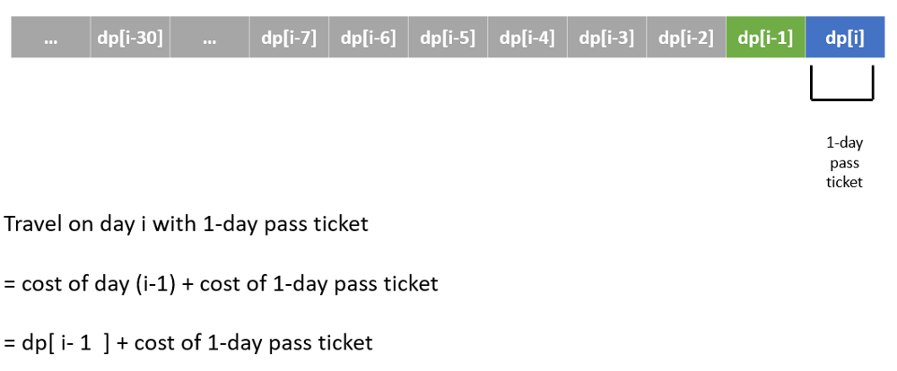
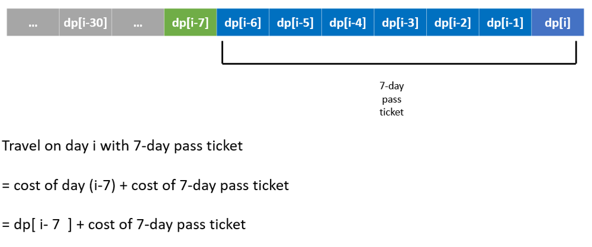
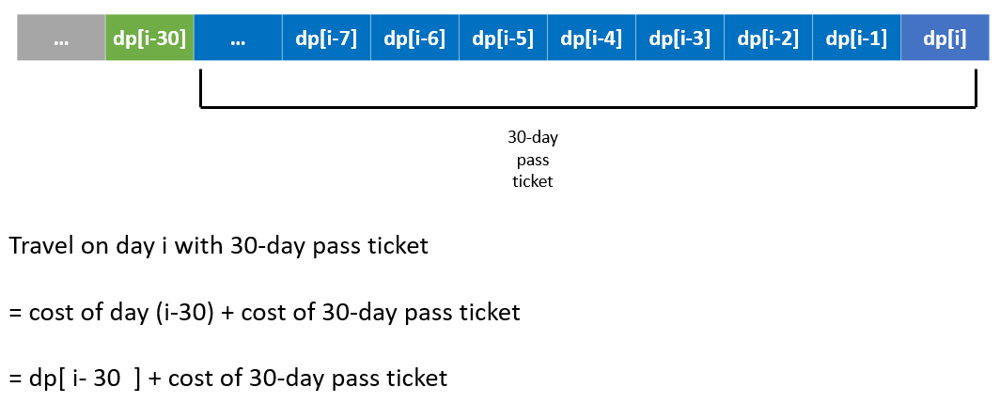

# Python/JS/Go/C++ by DP [w/ Visualization] 有中文解析文章

**Author:** brianchiang_tw
**Votes:** 68
**Link:** [https://leetcode.com/problems/minimum-cost-for-tickets/solutions/810749/](https://leetcode.com/problems/minimum-cost-for-tickets/solutions/810749/)

---

[\u7528DP\u4F86\u7CBE\u6253\u7D30\u7B97: \u706B\u8ECA\u65C5\u884C\u652F\u51FA\u7684\u6700\u5C0F\u8CBB\u7528](https://vocus.cc/article/66658857fd897800012eeb0c)

[DP\u6F14\u7B97\u6CD5\u6846\u67B6 \u8207 \u63A8\u85A6\u5B78\u7FD2\u8DEF\u5F91](https://vocus.cc/article/66616aeffd89780001cab1da)

**Hint**:

Optimal substructure for DP

----

Base case:
```
# no cost before first day (i.e., no travel)
dp[ 0 ] = 0
```

---

General case:

For non-traveling day:

```
# today is not traveling day, no extra cost

dp[ d ] = dp[ d - 1 ] 
```

---

For traveling day:

```

# compute minimum cost from subproblem

dp[ d ] = min( dp[     d - 1      ] + cost[0],
               dp[ max(d - 7, 0)  ] + cost[1],
			   dp[ max(d - 30, 0) ] + cost[2] )

# cost[0]: the cost of 1-day-pass ticket
# cost[1]: the cost of 7-day-pass ticket
# cost[2]: the cost of 30-day-pass ticket
```

Note:
Here we use **max**( d-7, **0**) and **max**( d-30, **0**) to **avoid invalid day index** which is out-of-boundary.

---



---



---



---

**Implementation** by Bottom-up DP with iteration (i.e., tabulation method)

Python:

```
class Solution:
    def mincostTickets(self, days: List[int], costs: List[int]) -> int:
        
        # index of ticket
        _1day_pass, _7day_pass, _30day_pass = 0, 1, 2
        
        # set of travel days
        travel_days = set(days)
        
        # last travel day
        last_traverl_day = days[-1]
        
        # DP Table, record for minimum cost of ticket to travel
        dp_cost = [  0 for _ in range(last_traverl_day+1)]
    
        
        # Solve min cost by Dynamic Programming
        for day_i in range(1, last_traverl_day+1):
            
            
            if day_i not in travel_days:
                
                # today is not traveling day
                # no extra cost
                dp_cost[day_i] = dp_cost[day_i - 1]
            
            
            else:
                
                # today is traveling day
                # compute optimal cost by DP
                
                dp_cost[day_i] = min(   dp_cost[ day_i - 1 ]  + costs[ _1day_pass ],
                                        dp_cost[ max(day_i - 7, 0) ]  + costs[ _7day_pass ],
                                        dp_cost[ max(day_i - 30, 0) ] + costs[ _30day_pass ]     )
        
        
        # Cost on last travel day of this year is the answer
        return dp_cost[last_traverl_day]
        
```

---

**Implementaion** by Top-down DP with recursion + memoization

```
class Solution:
    def mincostTickets(self, days: List[int], costs: List[int]) -> int:
        
        # To speed-up travel day look-up, so make it a hashSet.
        travel_days = set(days)

        ## DP table
        # index: day
        # value: minimal cost up to day so far
        dp = {}

        def travel(day):
            
            # Look-up DP table
            if day in dp:
                return dp[day]
            
            ## Base case
            # Before day_0, no traverl anymore, therefore no cost
            if day < 0:
                return 0


            ## General cases:

            # Not in travel day, just backtrack to previous day directly
            elif day not in travel_days:
                dp[day] = travel(day-1)
                return dp[day]

            # Today is travel day, pick the one which is of minimal cost
            one_pass = travel(day-1) + costs[0]
            seven_pass = travel(day-7) + costs[1]
            monthly_pass = travel(day-30) + costs[2]

            dp[day] = min( one_pass, seven_pass, monthly_pass)
            return dp[day]
        #-----------------------------------------------
        return travel( day = days[-1] )

```

---

Javascript:

```
var mincostTickets = function(days, costs) {
    
    // index of ticket
    const [ _1day, _7day, _30day] = [0, 1, 2];
    
    // set of travel days
    let travelDays = new Set(days);
    
    let lastTravelDay = days[days.length-1];
    
    // DP table, record for minimum cost of ticket to travel
    dpCost = new Array( lastTravelDay+1 ).fill(0);
    
    // solve min cost by DP
    for( let day_i=1; day_i <= lastTravelDay ; day_i++ ){
        
        if( travelDays.has(day_i) == false ){
            
            // today is not traveling day
            // no extra cost
            dpCost[ day_i ] = dpCost[ day_i - 1 ];
            
        }else{
            
            // today is traveling day
            // compute optimal min cost
            dpCost[ day_i ] = Math.min( dpCost[ day_i - 1 ] + costs[ _1day ],
                                        dpCost[ Math.max(day_i - 7, 0) ] + costs[ _7day ], 
                                        dpCost[ Math.max(day_i - 30, 0) ] + costs[_30day]  );
        }
    }

    return dpCost[lastTravelDay];
    
};
```

---

Go:

```
// Golang doesn't have natural built in min/max function for integers
// Programmer have to implement it manually
func MinOf(vars ...int) int {
    min := vars[0]

    for _, i := range vars {
        if min > i {
            min = i
        }
    }

    return min
}


func Max( x, y int) int {
    
    if x > y{
        return x
    }else{
        return y
    }
    
}


type void struct{}
var member void

func mincostTickets(days []int, costs []int) int {
    
    // help reader to understand code, to avoid magic number
    const _1day, _7day, _30day = 0, 1, 2
    
    // set of travel days
    travelDays := make( map[int]void )
    
    for _, curTravelDay := range days{
        travelDays[ curTravelDay ] = member
    }
    
    // last travel day from input array
    lastTraverlDay := days[ len(days) - 1 ]
    
    // dp table
    dpCost := make([]int, lastTraverlDay+1)
    
    for day_i := 1 ; day_i <= lastTraverlDay ; day_i++ {
        
        if _, isTravelDay := travelDays[day_i] ; isTravelDay == false{
            
            // today is not traveling day
            // no extra cost
            dpCost[ day_i ] = dpCost[ day_i -1 ]
        
        }else{
            
                // today is traveling day
                // compute optimal cost by DP
                
                dpCost[day_i] = MinOf( dpCost[ day_i - 1 ]  + costs[ _1day ],
                                        dpCost[ Max(day_i - 7, 0) ]  + costs[ _7day ],
                                        dpCost[ Max(day_i - 30, 0) ] + costs[ _30day ]     )
        }
    }
    
    return dpCost[ lastTraverlDay ]
}
```

---

C++

```
class Solution {
public:
    int mincostTickets(vector<int>& days, vector<int>& costs) {
        
        // index of ticket
        enum Ticket { _1day, _7day, _30day };
        
        
        // set of travel days
        set<int> travelDays = set<int>(days.begin(), days.end());
        
        int lastTravelDay = days.back();
        
        // dp table, record for minimum cost ofticket to travel
        vector<int> dpCost = vector<int>( lastTravelDay+1 );
        
        // Solve min cost by DP
        for( int day_i = 1; day_i <= lastTravelDay ; day_i++ ){
            
            if( travelDays.count(day_i) == 0 ){
                
                // today is not traveling day
                // no extra cost
                dpCost[ day_i ] = dpCost[ day_i - 1 ];
                
            }else{
                
                // today is traveling day
                // compute optimal cost by DP
                dpCost[ day_i ] = min( {dpCost[ day_i - 1 ]            + costs[ _1day ], 
                                        dpCost[ max(day_i - 7, 0) ]    + costs[ _7day ], 
                                        dpCost[ max(day_i - 30, 0) ]   + costs[ _30day]} );
            }
        }

        return dpCost[lastTravelDay];
    }
};
```