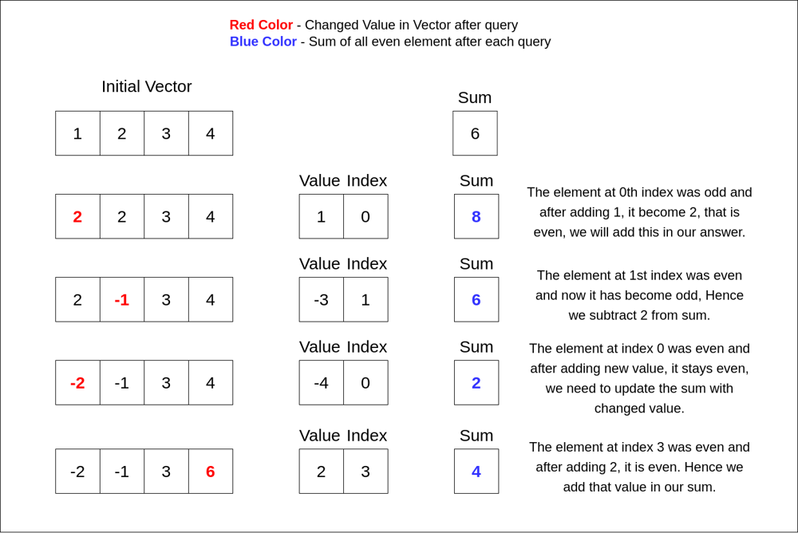

# C++ | Diagram | Related Problems

**Author:** kiranpalsingh1806
**Votes:** 56
**Link:** [https://leetcode.com/problems/sum-of-even-numbers-after-queries/solutions/2603390/](https://leetcode.com/problems/sum-of-even-numbers-after-queries/solutions/2603390/)

---


<details>

<summary> Approach </summary>

- We will calculate the sum of all even elements initially.

When we change element after each query, we have four cases to handle.
- The changed element was even before query and after query.
- The changed element was odd before query and became even after query.
- The changed element was even before query and became odd after query.
- The changed element was odd before query and after query.
</details>




```cpp
class Solution {
public:
    vector<int> sumEvenAfterQueries(vector<int>& nums, vector<vector<int>>& queries) {

        int sum = 0, N = queries.size();
        for (int n : nums) {
            if (n % 2 == 0) sum += n;
        }
        
        vector<int> ans(N, 0);
        
        // Four cases to handle.
        for (int i = 0; i < N; i++) {
            int val = queries[i][0], index = queries[i][1];
            int oldValue = nums[index];
            nums[index] += val;
            
            bool wasEven = (oldValue % 2) == 0;
            bool nowEven = (nums[index] % 2 == 0);
            
            if (wasEven && nowEven) {
                sum += val;
                ans[i] = sum;
            } else if (!wasEven && nowEven) {
                sum += nums[index];
                ans[i] = sum;
            } else if (wasEven && !nowEven) {
                sum -= oldValue;
                ans[i] = sum;
            } else {
                ans[i] = sum;
            }
        }
        
        return ans;
    }
};
```

**Query Related Problems**
[1. Range Frequency Queries ](https://leetcode.com/problems/range-frequency-queries/)
[2. XOR Queries of a Subarray ](https://leetcode.com/problems/xor-queries-of-a-subarray/)
[3. Queries on a Permutation With Key ](https://leetcode.com/problems/queries-on-a-permutation-with-key/)
[4. Subrectangle Queries ](https://leetcode.com/problems/subrectangle-queries/)
[5. Queries on Number of Points Inside a Circle ](https://leetcode.com/problems/queries-on-number-of-points-inside-a-circle/)
[6. Minimum Absolute Difference Queries ](https://leetcode.com/problems/minimum-absolute-difference-queries/)
[7. Maximum Genetic Difference Query ](https://leetcode.com/problems/maximum-genetic-difference-query/)
[8. Most Beautiful Item for Each Query ](https://leetcode.com/problems/most-beautiful-item-for-each-query/)