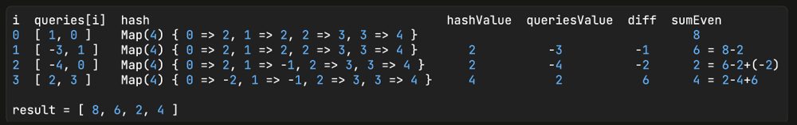

# Runtime 87% 🔥 with Hash O(n), Javascript and Typescript.

**Author:** anuchataowkaen
**Votes:** 0
**Link:** [https://leetcode.com/problems/sum-of-even-numbers-after-queries/solutions/4808941/](https://leetcode.com/problems/sum-of-even-numbers-after-queries/solutions/4808941/)

---




# Code
``` javascript []
function sumEvenAfterQueries(nums, queries) {
  const result = [];

  // init
  let sumEven = 0;
  nums[queries[0][1]] = nums[queries[0][1]] + queries[0][0];
  const hash = new Map();
  nums.forEach((e, i) => {
    hash.set(i, e);
    if (e % 2 === 0) sumEven += e;
  });
  result.push(sumEven);

  for (let i = 1; i < queries.length; i++) {
    const hashVal = hash.get(queries[i][1]);
    const queriesVal = queries[i][0];
    const diff = hashVal + queriesVal;
    if (diff % 2 === 0) {
      if (hashVal % 2 === 0) {
        sumEven = sumEven - hashVal + diff;
      } else {
        sumEven = sumEven + diff;
      }
    } else if (hashVal % 2 === 0) {
      sumEven = sumEven - hashVal;
    }
    hash.set(queries[i][1], diff);
    result.push(sumEven);
  }
  return result;
}


```
``` typescript []
function sumEvenAfterQueries(nums: number[], queries: number[][]): number[] {
  const result: number[] = []

  // init
  let sumEven = 0
  nums[queries[0][1]] = nums[queries[0][1]] + queries[0][0]
  const hash = new Map()
  nums.forEach((e, i) => {
    hash.set(i, e)
    if (e % 2 === 0) sumEven += e
  })
  result.push(sumEven)

  for (let i = 1; i < queries.length; i++) {
    const hashVal = hash.get(queries[i][1])
    const queriesVal = queries[i][0]
    const diff = hashVal + queriesVal

    if (diff % 2 === 0) {
      if (hashVal % 2 === 0) {
        sumEven = sumEven - hashVal + diff
      } else {
        sumEven = sumEven + diff
      }
    } else if (hashVal % 2 === 0) {
      sumEven = sumEven - hashVal
    }
    hash.set(queries[i][1], diff)
    result.push(sumEven)
  }

  return result
}

```