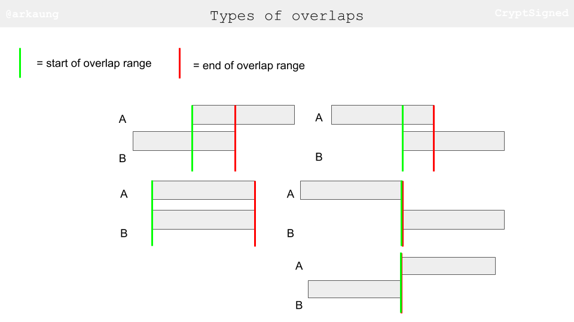
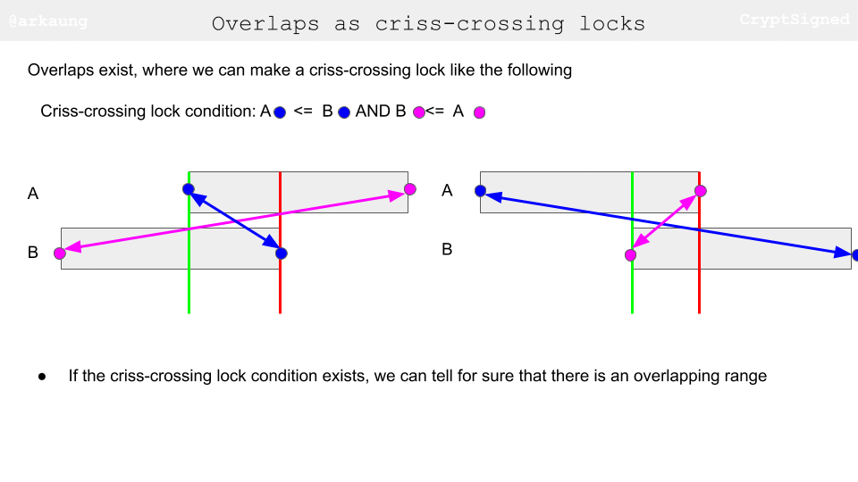
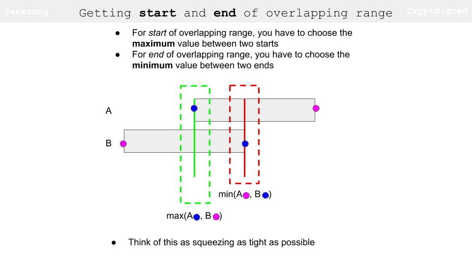
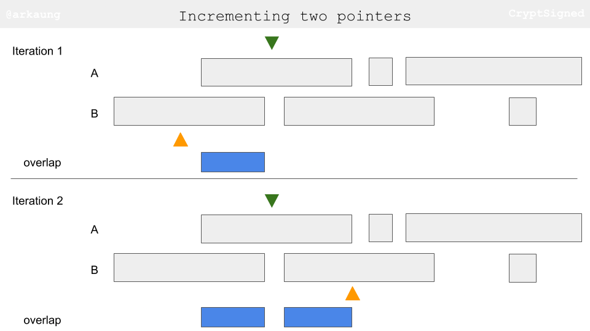
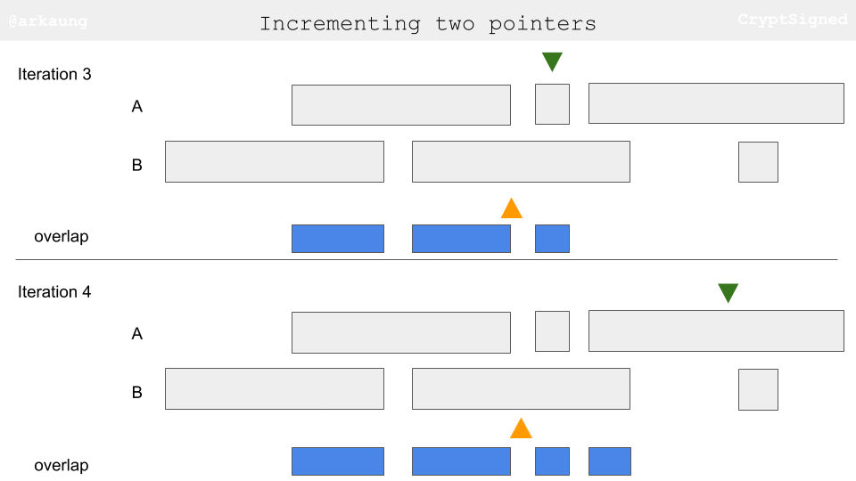
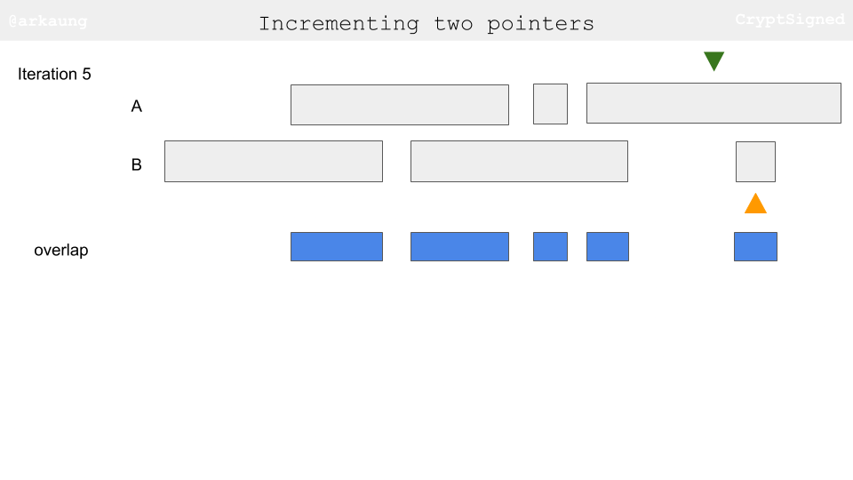

# [Python] Two Pointer Approach + Thinking Process Diagrams

**Author:** arkaung
**Votes:** 943
**Link:** [https://leetcode.com/problems/interval-list-intersections/solutions/647482/](https://leetcode.com/problems/interval-list-intersections/solutions/647482/)

---

I love this problem. Even though it is a two pointer problem, making everything concise is quite hard!

Let's break down this problem into two parts:
**First part** - Finding overlapping range

Let's see possible types of overlaps


What's the condition for two ranges to have an overlapping range? Check out the figures below. The way I think is: if we can have a criss-crossing lock condition satisfied, we have essentially found an overlapping range.


After we have made sure that there is an overlapping range, we need to figure out the start and end of the overlapping range. I think of this as trying to squeeze the overlapping range as tight as possible (pushing as far *right* as possible for start and pushing as far *left* as possible for end)


**Second part** - Incrementing pointers

The idea behind is to increment the pointer based on the end values of two ranges. Let's say the current range in A has end value smaller than to equal to end value of the current range in B, that essentially means that you have exhausted that range in A and you should move on to the next range. Let's try to visually think about this. When you are going through the images, keep track of end values of the ranges and how the little pointer triangles progess.




**Python**
``` python
1. class Solution:
2.     def intervalIntersection(self, A: List[List[int]], B: List[List[int]]) -> List[List[int]]:
3.         i = 0
4.         j = 0
5.         
6.         result = []
7.         while i < len(A) and j < len(B):
8.             a_start, a_end = A[i]
9.             b_start, b_end = B[j]
10.             if a_start <= b_end and b_start <= a_end:                       # Criss-cross lock
11.                 result.append([max(a_start, b_start), min(a_end, b_end)])   # Squeezing
12.                 
13.             if a_end <= b_end:         # Exhausted this range in A
14.                 i += 1               # Point to next range in A
15.             else:                      # Exhausted this range in B
16.                 j += 1               # Point to next range in B
17.         return result
```